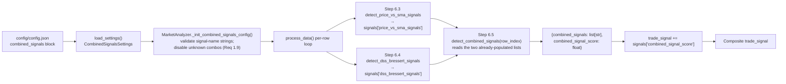

# Design Document

## Overview

This feature adds a **Combined_Signal (confluence)** category to the trading project
(`d:\projects\trading\vpa`). A Combined_Signal fires on a row only when **all** of its
constituent conditions hold on that row (AND / confluence logic), as opposed to the existing
composite `trade_signal` which simply **sums** every category's sub-score. The first set of
confluences combines the DSS Bressert crossover/zone signals with the price-vs-SMA
(10 SMA) position/crossover signals. The work is tracked by Jira ticket **SP-327** (Story,
Side Projects / trading project) and follows the requirements in `requirements.md` for this
spec.

SP-327 builds entirely on already-delivered building blocks and introduces no new
indicator maths:

- **SP-325 — DSS Bressert (Done).** `MarketAnalyzer.detect_dss_bressert_signals(row_index)`
  already emits the signal-name strings `"DSS Bullish Crossover"`, `"DSS Bearish Crossover"`,
  `"DSS Oversold"`, `"DSS Overbought"` into the per-row signals dict as
  `dss_bressert_signals` (list) / `dss_bressert_signal_score` (numeric). The ML/backtest path
  (`VPAFeatureExtractor`) already emits inline `dss_bullish_cross` / `dss_bearish_cross` (0/1)
  columns.
- **SP-326 / SP-340 — price-vs-SMA (the "10 SMA").**
  `MarketAnalyzer.detect_price_vs_sma_signals(row_index)` already emits `"Price above SMA"`,
  `"Price below SMA"`, `"Price crossed above SMA"`, `"Price crossed below SMA"` into
  `price_vs_sma_signals` / `price_vs_sma_signal_score`. SP-340 integrated it into the
  ML/backtest path as a **standalone, inline-reimplemented** signal that emits
  `price_vs_sma_value` and (signed) `price_vs_sma_signal_score` columns.

The known drift between the two composite scores (live `trade_signal` vs the extractor's
`composite_score`) that is tracked by **SP-340 is out of scope** for this feature; this design
does not touch, fold into, or attempt to reconcile `composite_score`.

The design follows established project conventions throughout and introduces no new
architecture:

- A **frozen-dataclass config block** (`combined_signals`) in `vpa/config/settings.py`,
  loaded with the existing `_section` / `_optional` / `_number` helpers, shaped like the
  existing signal blocks but holding a **collection** of named combinations. Unlike DSS
  (which defaults enabled), the Combined_Signal category **defaults OFF** so an absent block
  is default-safe (Req 1.7).
- A **live post-pass** on `MarketAnalyzer` in `vpa/app_runner.py`: an
  `_init_combined_signals_config()` init hook (deep validation, matching how
  `_init_dss_bressert_config` validates), and a `detect_combined_signals(row_index, log=...)`
  method that runs as a **new Step 6.5** — *after* Step 6.3 (price-vs-SMA) and Step 6.4
  (DSS) — reading the already-populated per-row signal-name lists and contributing a single
  additive `combined_signal_score` term to `trade_signal` (Req 2, 3).
- **Isolated backtest wiring** reusing the existing `BacktestEngine` **unchanged**
  (Req 5.4): new inline-computed feature columns in `VPAFeatureExtractor`, ten new
  `SignalType` members (one bullish + one bearish per combination) plus `SIGNAL_DIRECTIONS`
  entries and column-guarded `classify_signals` reads in `vpa/ml_validation/signal_analysis.py`,
  and five new `StrategyVariation`s in `vpa/backtesting/variations.py`.

The category degrades gracefully when disabled, when a constituent is disabled, or when there
is insufficient data — mirroring the DSS Bressert and RSI patterns (Req 4).

### Two settled design decisions (recorded for traceability)

Two scope decisions were settled with the user and are **not re-opened** here:

1. **Live path: confluence is a POST-PASS over already-computed per-row signal-name lists.**
   The two constituent signals already run as Steps 6.3/6.4 in
   `MarketAnalyzer.process_data()` and write their signal-name lists into the per-row
   `signals` dict. The new Step 6.5 reads those lists for the current row and evaluates
   presence/absence of configured signal-name strings — it does **not** re-run or re-derive
   the constituents, and it does **not** sum sub-scores (Req 2.4).

2. **Backtest path stays SEPARATE from `MarketAnalyzer` (SP-340 hard rule).** The ML/backtest
   path (`VPAFeatureExtractor`) MUST NOT call `MarketAnalyzer`; it reimplements the signal
   logic **inline** from the feature series it already builds. SP-327 therefore adds the
   missing inline feature columns (DSS zone flags, price-vs-SMA position/cross flags) and
   derives the combinations inline per row. `composite_score` stays **byte-for-byte
   unchanged** (SP-340 zero-regression rule): the new columns, like `price_vs_sma`, are **not**
   folded into `composite_score`.

### Why the two paths differ (and why that is correct)

The live analyzer owns one object with per-row signal-name lists already materialised, so the
cleanest confluence check is a string-membership post-pass over those lists. The ML/backtest
path has no `MarketAnalyzer` instance (by SP-340 rule) and works on a flat feature DataFrame,
so it derives per-combination 0/1 columns inline from the same series it already computes, and
`classify_signals` turns those columns into `SignalEntry` records. Both paths encode the
**same five confluence definitions**; they differ only in representation (string lists vs
feature columns), which is unavoidable given the SP-340 separation rule.

## Architecture

### Component and data flow — live analysis path (post-pass)

The Combined_Signal plugs into the existing per-row analysis loop as a **post-pass**. By the
time Step 6.5 runs, Step 6.3 has already written `price_vs_sma_signals` and Step 6.4 has
already written `dss_bressert_signals` into the current row's `signals` dict.
`detect_combined_signals` reads those two lists, evaluates each configured combination's
constituent conditions against presence/absence of the configured signal-name strings, and
folds a single `combined_signal_score` term into the composite `trade_signal` sum.



The combined sub-score is added to the existing summation alongside `single_candle`, `trend`,
`multiple_bar`, `acc_dist`, `ma_crossover`, `rsi`, `price_vs_sma`, and `dss_bressert` — one
more single additive term, with no weighting, scaling, or ordering dependency (Req 3.1, 3.3).

Because Step 6.5 reads **already-computed** lists, a disabled or insufficient-data constituent
simply yields an **empty list** for that signal in the row's `signals` dict. Presence
conditions on it then fail naturally and absence conditions on it pass naturally — the Req
2.10 / 2.11 negation semantics fall out of ordinary string-membership checks with no special
casing (explained in Components §3).

### Component and data flow — isolated backtest path (inline, SP-340 separation)

The ML/backtest path never touches `MarketAnalyzer` (SP-340 hard rule). `VPAFeatureExtractor`
already computes the DSS oscillator/trigger series and the price-vs-SMA series inline over the
whole frame. SP-327 adds inline-computed per-row **flag columns** (DSS zone + price position /
cross), then derives one 0/1 column **per combination per direction** as the AND of the
relevant flags. `classify_signals` turns those columns into `SignalEntry` records; a per-combination
`StrategyVariation` filters the signal log; and `run_variation` calls
`BacktestEngine().run(...)` exactly once (engine reused unchanged).

```mermaid
flowchart LR
    A["OHLCV frame + inline series<br/>(dss_osc/dss_trig, sma_series, closes)"] --> B["VPAFeatureExtractor<br/>inline flag columns per row"]
    B --> C["Combination columns<br/>combo_*_bull / combo_*_bear (0/1)"]
    C --> D["signal_analysis.classify_signals(df)<br/>column-guarded notna masks"]
    D --> E["SignalEntry records<br/>10 Combined SignalTypes (UP/DOWN)"]
    E --> F["5 Combined StrategyVariations<br/>signal_filter admits only that combo's 2 types"]
    F --> G["run_variation(): BacktestEngine().run(filtered_log, prices, config)"]
    G --> H["pnl.price_trades → equity_curve → metrics.calculate"]
    H --> I["MetricsResult (full performance suite)"]
```



The individual-signal comparators already exist in the catalogue: `DSS_Bressert_Only`
(SP-325) and the price-vs-SMA baselines classified via the existing `PRICE_ABOVE_SMA` /
`PRICE_BELOW_SMA` SignalTypes (SP-340). The full metrics suite, the zero-match →
`num_trades 0` / metrics `0.0` behaviour (Req 5.6), and per-variation failure isolation via
`VariationFailure` (Req 5.7) all come **free** from the existing `run_variation` /
`run_variations` pipeline — no engine change is required.

## Components and Interfaces

### 1. Config typing — `vpa/config/settings.py` (additions)

Three new frozen dataclasses express the `combined_signals` block: a condition, a combination,
and the top-level block. The block holds a **collection** of named combinations (Req 1.1,
1.2), each with two-or-more conditions and a signed combined score (Req 1.3, 1.6). The shape
is JSON-serializable and loaded with the existing helpers so an absent block is default-safe
and leaves the category **disabled by default** (Req 1.7).

```python
@dataclass(frozen=True)
class CombinedCondition:
    """One constituent clause: a signal-name string evaluated as presence/absence."""

    signal_name: str
    kind: str = "presence"  # "presence" | "absence"


@dataclass(frozen=True)
class CombinedSignalDef:
    """One named combination: its score and its (>= 2) constituent conditions."""

    name: str
    score: float = 0.0
    conditions: tuple[CombinedCondition, ...] = ()


@dataclass(frozen=True)
class CombinedSignalsSettings:
    """The combined_signals block. Defaults OFF (Req 1.7) — unlike dss_bressert."""

    enabled: bool = False
    combinations: tuple[CombinedSignalDef, ...] = ()
```

`Settings` gains one field: `combined_signals: CombinedSignalsSettings = CombinedSignalsSettings()`
(default-constructed so an absent block yields `enabled=False`, no combinations — Req 1.7).

A `_combined_signals_settings(raw)` loader builds it, reusing `_section` / `_optional` /
`_number` exactly like `_dss_bressert_settings`. The one new shape over the existing helpers
is iterating a JSON **list** of combination objects (each with a nested `conditions` list):

```python
def _combined_signals_settings(raw: dict[str, Any]) -> CombinedSignalsSettings:
    enabled = _optional(raw, "enabled", False, "combined_signals.enabled", bool)
    raw_combos = raw.get("combinations", [])
    if not isinstance(raw_combos, list):
        raise ConfigurationError("Invalid setting combined_signals.combinations: expected array")

    combos: list[CombinedSignalDef] = []
    for i, rc in enumerate(raw_combos):
        if not isinstance(rc, dict):
            raise ConfigurationError(f"Invalid setting combined_signals.combinations[{i}]: expected object")
        path = f"combined_signals.combinations[{i}]"
        name = _value(rc, "name", f"{path}.name", str)
        score = _number(rc, "score", 0, f"{path}.score")
        raw_conds = rc.get("conditions", [])
        if not isinstance(raw_conds, list):
            raise ConfigurationError(f"Invalid setting {path}.conditions: expected array")
        conds = tuple(
            CombinedCondition(
                signal_name=_value(c, "signal_name", f"{path}.conditions[{j}].signal_name", str),
                kind=_optional(c, "kind", "presence", f"{path}.conditions[{j}].kind", str),
            )
            for j, c in enumerate(raw_conds)
        )
        combos.append(CombinedSignalDef(name=name, score=score, conditions=conds))

    return CombinedSignalsSettings(enabled=enabled, combinations=tuple(combos))
```

Inside `load_settings()`, one argument is added to the `Settings(...)` construction:
`combined_signals=_combined_signals_settings(_section(raw, "combined_signals", "combined_signals"))`.
Because `_section` returns `{}` when the key is absent, an absent block yields
`CombinedSignalsSettings(enabled=False, combinations=())` — the category is off and processing
completes without error (Req 1.7).

**What `load_settings` validates vs what the analyzer validates.** Like DSS, load-time
validation covers only **type/shape** (via `_value` / `_optional` / `_number`): `enabled` is a
bool, `combinations` is a list of objects, each with a string `name`, numeric `score`, and a
list of conditions each with a string `signal_name` and a string `kind`. **Deep validation**
— that each `signal_name` is one of the known constituent signal-name strings, and that each
combination has `>= 2` conditions (Req 1.3) — lives in the analyzer's
`_init_combined_signals_config()` so an invalid combination **disables just that one
combination with a WARN** rather than aborting startup (Req 1.9), exactly as DSS defers range
validation to its init hook.

**Known valid signal-name strings** (Req 1.4) — the only strings a condition may reference:

- DSS_Bressert_Signal: `"DSS Bullish Crossover"`, `"DSS Bearish Crossover"`,
  `"DSS Oversold"`, `"DSS Overbought"`.
- Price_vs_SMA_Signal: `"Price above SMA"`, `"Price below SMA"`,
  `"Price crossed above SMA"`, `"Price crossed below SMA"`.

### 2. MarketAnalyzer init hook — `vpa/app_runner.py` (`_init_combined_signals_config`)

Added to `__init__` alongside the existing `_init_price_vs_sma_config()` /
`_init_dss_bressert_config()` calls. It mirrors `_init_dss_bressert_config`: it reads the typed
config, applies the `enabled` default-off gate, and performs the **deep validation** that
load-time cannot (Req 1.9). The validated, usable combinations are stored on
`self.__combined_signals` (a list of `CombinedSignalDef`) and the category flag on
`self.__combined_signals_enabled`.

```python
# The known signal-name strings a condition may reference (Req 1.4).
_KNOWN_COMBINED_SIGNAL_NAMES = frozenset({
    "DSS Bullish Crossover", "DSS Bearish Crossover", "DSS Oversold", "DSS Overbought",
    "Price above SMA", "Price below SMA", "Price crossed above SMA", "Price crossed below SMA",
})


def _init_combined_signals_config(self):
    """Load and validate the combined_signals section (Req 1, 4).

    Sets self.__combined_signals_enabled (bool) and self.__combined_signals
    (list[CombinedSignalDef] of the valid combinations). Category defaults OFF
    when the flag is false/absent/non-boolean (Req 1.7, 4.1-4.3). A combination
    referencing an unknown signal-name string, or with fewer than two
    conditions, is dropped with a WARN and the remaining valid combinations are
    retained (Req 1.3, 1.9).
    """
    cfg = self.__config.combined_signals

    if not cfg.enabled:
        self.__combined_signals_enabled = False
        self.__combined_signals = []
        return

    valid: list[CombinedSignalDef] = []
    for combo in cfg.combinations:
        if len(combo.conditions) < 2:
            self.__logger.log(
                f"Combined signal '{combo.name}' disabled: requires at least two conditions.",
                level="WARN",
            )
            continue
        unknown = [c.signal_name for c in combo.conditions if c.signal_name not in _KNOWN_COMBINED_SIGNAL_NAMES]
        if unknown:
            self.__logger.log(
                f"Combined signal '{combo.name}' disabled: unknown signal-name string(s) {unknown}.",
                level="WARN",
            )
            continue
        valid.append(combo)

    self.__combined_signals = valid
    self.__combined_signals_enabled = True
```

Validation is pure config inspection — no data access — so it is safe at construction time,
exactly like `_init_dss_bressert_config`.

### 3. MarketAnalyzer detector — `vpa/app_runner.py` (`detect_combined_signals`)

The post-pass. It takes the current row's already-populated constituent lists from the
`signals` dict and evaluates each enabled combination. It returns exactly the two-entry shape
`{"combined_signals": list[str], "combined_signal_score": float}` (Req 3.2), matching the
`dss_bressert_signals` / `dss_bressert_signal_score` and `price_vs_sma_signals` /
`price_vs_sma_signal_score` conventions.

Because this is a **post-pass over existing lists**, the method is called from Step 6.5 with
the current row's `signals` dict (which already holds Steps 6.3/6.4 output). The signature
takes `row_index` for convention-parity with the other `detect_*` methods, plus the row's
signal-name lists it reads.

```python
def detect_combined_signals(
    self,
    row_index: int,
    dss_signals: list[str],
    price_vs_sma_signals: list[str],
    log: bool = True,
) -> dict:
    """Evaluate configured confluences against the row's constituent signal lists.

    Reads the already-computed per-row DSS and price-vs-SMA signal-name lists
    (populated by Steps 6.3/6.4) and fires each enabled combination whose every
    constituent condition holds (AND — Req 2.2). A presence condition holds iff
    its signal-name string IS in the relevant list; an absence condition holds
    iff the string is NOT in the list (Req 2.1). Returns exactly two keys:
    combined_signals (list[str]) and combined_signal_score (float) (Req 3.2).

    Graceful degradation (Req 4): disabled category -> empty list + 0.0. A
    disabled or insufficient-data constituent simply contributes an empty list,
    so its presence conditions fail and its absence conditions pass naturally
    (Req 2.10, 2.11) — no special casing required.
    """
    empty_result = {"combined_signals": [], "combined_signal_score": 0.0}

    if not self.__combined_signals_enabled:
        return empty_result

    # The union of signal-name strings present on this row, keyed by which
    # constituent they belong to. A combination's condition is checked against
    # the correct constituent list by the string itself (the known-names set
    # partitions cleanly between the two constituents).
    present = set(dss_signals) | set(price_vs_sma_signals)

    fired: list[str] = []
    total_score = 0.0

    for combo in self.__combined_signals:
        holds = True
        for cond in combo.conditions:
            is_present = cond.signal_name in present
            if cond.kind == "absence":
                # Absence condition holds iff the string is NOT present. A
                # disabled/no-data constituent yields an empty list, so the
                # string is absent and the condition is trivially satisfied
                # (Req 2.11).
                if is_present:
                    holds = False
                    break
            else:  # presence
                # Presence condition holds iff the string IS present. A
                # disabled/no-data constituent yields an empty list, so the
                # string is absent and the condition fails (Req 2.10).
                if not is_present:
                    holds = False
                    break
        if holds:
            fired.append(combo.name)          # exactly one name per firing combo (Req 2.9)
            total_score += combo.score        # signed: bullish > 0 adds, bearish < 0 subtracts

    if log and fired:
        self.__logger.log(f"Combined Signals: {fired}, Score: {total_score:.2f}", level="INFO")

    return {"combined_signals": fired, "combined_signal_score": total_score}
```

Notes on the contract:

- **AND / confluence, not summation** (Req 2.4). A combination fires only when *every*
  condition holds; the decision is pure string presence/absence, never a sum of constituent
  sub-scores.
- **One name per firing combination** (Req 2.9). Each firing combination appends exactly its
  own `name` to the `combined_signals` list, and adds its own configured `score` to the
  sub-score. The sign convention matches DSS/SMA: a bullish combination is configured with a
  **positive** score (adds), a bearish combination with a **negative** score (subtracts), so
  the single additive fold into `trade_signal` keeps direction consistent across categories.
- **Negation semantics fall out naturally** (Req 2.7, 2.8, 2.10, 2.11). Both the
  three-way `DSS_Cross_SMA_Not_Overbought` and the per-constituent disabled/no-data cases are
  handled by the same membership check: an absence condition on `"DSS Overbought"` holds
  precisely when that string is not in the DSS list — whether because the row genuinely is not
  overbought, or because DSS is disabled and its list is empty.
- **Graceful degradation** (Req 3.4, 4.1-4.5). When the category is disabled the method
  returns `{[], 0.0}` and never inspects any combination. When a constituent is disabled or
  reports insufficient data (including warmup), its list is empty, so presence-dependent
  combinations do not fire and contribute `0.0`. Warmup therefore needs no explicit guard here
  — it is already encoded in the empty constituent lists produced by Steps 6.3/6.4.

### 4. MarketAnalyzer wiring — `vpa/app_runner.py` (`process_data`)

Two edits, matching the existing Step 6.x structure. No `compute_*` pre-pass is needed —
Step 6.5 consumes Steps 6.3/6.4 output, which is already in `signals`.

1. Add a **Step 6.5** detect-and-merge block, placed immediately after Step 6.4:
   ```python
   # Step 6.5: Detect combined (confluence) signals over the constituent lists
   combined = self.detect_combined_signals(
       row_position,
       signals["dss_bressert_signals"],
       signals["price_vs_sma_signals"],
       log=row_position >= log_start_index,
   )
   signals["combined_signals"] = combined["combined_signals"]
   signals["combined_signal_score"] = combined["combined_signal_score"]
   ```
2. Add `+ signals["combined_signal_score"]` as a single additive term to the `trade_signal`
   summation (which currently sums `single_candle`, `trend`, `multiple_bar`, `acc_dist`,
   `ma_crossover`, `rsi`, `price_vs_sma`, `dss_bressert`). This makes the combined category one
   more additive term with no weighting, scaling, or ordering dependency (Req 3.1, 3.3). When
   the category is disabled or nothing fires, the term is `0.0` and `trade_signal` is unchanged
   (Req 3.4).

### 5. Feature extractor — `vpa/ml_validation/feature_extractor.py` (inline flags + combination columns)

Per the SP-340 hard rule, this path **never calls `MarketAnalyzer`**; it reimplements the
needed logic inline from series it already builds. `generate_dataset` already precomputes:

- `dss_osc` / `dss_trig` (via `calculate_dss_bressert`) and emits inline
  `dss_bullish_cross` / `dss_bearish_cross` (0/1) per row — these already cover the two DSS
  **crossover** constituents.
- `sma_series` (`rolling(window=period, min_periods=period).mean()`) and `closes`, and emits
  signed `price_vs_sma_value` / `price_vs_sma_signal_score` via `compute_price_vs_sma_feature`.

Combinations 2–5 additionally need the DSS **zone** state and the price-vs-SMA
**position-vs-cross** distinction, which are not all emitted yet. SP-327 adds the missing
inline flag columns, computed from the **same series the extractor already has**, then derives
the per-combination columns from them.

#### 5.1 New inline flag columns (per row, 0/1)

Computed in the row loop using the positional index `pos`, mirroring the existing inline DSS
cross block (`dss_osc[pos]` vs thresholds; `closes[pos]` vs `sma_series[pos]`; `pos-1` for
cross):

```python
# DSS zone flags — from the oscillator vs the configured thresholds (dss_cfg).
# Guarded by the same dss_enabled / warmup / finite checks as the cross block.
dss_oversold = 0
dss_overbought = 0
if dss_enabled and dss_osc is not None and pos >= dss_warmup:
    osc = dss_osc[pos]
    if np.isfinite(osc):
        dss_oversold = int(osc <= dss_cfg.oversold_threshold)
        dss_overbought = int(osc >= dss_cfg.overbought_threshold)

# Price-vs-SMA position + cross flags — from close vs SMA (and prev-vs-curr for cross).
# Guarded by the same pvs_enabled / NaN checks as compute_price_vs_sma_feature.
price_above_sma = 0
price_below_sma = 0
price_crossed_above_sma = 0
price_crossed_below_sma = 0
if pvs_enabled and sma_series is not None:
    sma = sma_series[pos]
    close = closes[pos]
    if not (_pvs_isnan(sma) or _pvs_isnan(close)):
        price_above_sma = int(close > sma)
        price_below_sma = int(close < sma)
        if pos > 0:
            prev_sma = sma_series[pos - 1]
            prev_close = closes[pos - 1]
            if not (_pvs_isnan(prev_sma) or _pvs_isnan(prev_close)):
                price_crossed_above_sma = int(prev_close <= prev_sma and close > sma)
                price_crossed_below_sma = int(prev_close >= prev_sma and close < sma)
```

These six flags, plus the existing `dss_bullish_cross` / `dss_bearish_cross`, carry everything
the five combinations need. All are appended to `FEATURE_COLUMNS` and emitted in
`_extract_feature_vector` (threaded in from the loop as default-0 parameters, exactly like the
existing `dss_bullish_cross` / `price_vs_sma_*` parameters).

**`composite_score` is unchanged** (SP-340 zero-regression rule): the composite line stays
`single_candle_score + trend_score + multiple_bar_score + acc_dist_score + rsi_signal_score`.
The new flag columns, like `price_vs_sma_*`, are **not** folded into `composite_score`.

#### 5.2 Per-combination derived columns (one 0/1 column per combination per direction)

From the eight flags, ten combination columns are derived inline as boolean ANDs. Each is the
exact confluence of the requirements combination mapped to its flags. Column names follow a
`combo_<name>_bull` / `combo_<name>_bear` convention:

| Combination (Req 1.5) | Bull column | Bull expression | Bear column | Bear expression |
|---|---|---|---|---|
| DSS_Cross_Plus_SMA_Position | `combo_dss_cross_sma_pos_bull` | `dss_bullish_cross AND price_above_sma` | `combo_dss_cross_sma_pos_bear` | `dss_bearish_cross AND price_below_sma` |
| DSS_Cross_Plus_SMA_Cross | `combo_dss_cross_sma_cross_bull` | `dss_bullish_cross AND price_crossed_above_sma` | `combo_dss_cross_sma_cross_bear` | `dss_bearish_cross AND price_crossed_below_sma` |
| DSS_Zone_Plus_SMA_Cross | `combo_dss_zone_sma_cross_bull` | `dss_oversold AND price_crossed_above_sma` | `combo_dss_zone_sma_cross_bear` | `dss_overbought AND price_crossed_below_sma` |
| DSS_Cross_From_Zone | `combo_dss_cross_from_zone_bull` | `dss_bullish_cross AND dss_oversold` | `combo_dss_cross_from_zone_bear` | `dss_bearish_cross AND dss_overbought` |
| DSS_Cross_SMA_Not_Overbought | `combo_dss_cross_sma_not_ob_bull` | `dss_bullish_cross AND price_above_sma AND NOT dss_overbought` | `combo_dss_cross_sma_not_ob_bear` | `dss_bearish_cross AND price_below_sma AND NOT dss_oversold` |

Each column is `int(<expression>)` so it is 0/1 per row, computed in the same loop iteration
after the flags are known. The two three-way columns include the **negation**
(`and not dss_overbought` / `and not dss_oversold`), matching the live absence-condition
semantics (Req 2.7, 2.8) and the requirements combination 5 definition. All ten columns are
appended to `FEATURE_COLUMNS` and emitted by `_extract_feature_vector`.

> Design note: deriving the combination columns from the eight shared flags (rather than
> re-deriving each from raw series) guarantees the inline backtest-path combinations use the
> *same* flag definitions as the individual-signal columns, so a combination column can never
> disagree with its constituents on the same row. This is the inline analogue of the live
> path's "read the one source list" invariant.

### 6. Backtest wiring — `vpa/ml_validation/signal_analysis.py` (10 new SignalTypes)

Two `SignalType` members per combination (bullish + bearish), each with a `SIGNAL_DIRECTIONS`
entry (bullish UP, bearish DOWN — Req 5.1), and a column-guarded, `notna`-masked read in
`classify_signals` following the **exact** existing DSS pattern.

```python
class SignalType(Enum):
    ...  # existing members unchanged (incl. DSS_BULLISH/BEARISH, PRICE_ABOVE/BELOW_SMA)
    COMBO_DSS_CROSS_SMA_POS_BULL = "combo_dss_cross_sma_pos_bull"
    COMBO_DSS_CROSS_SMA_POS_BEAR = "combo_dss_cross_sma_pos_bear"
    COMBO_DSS_CROSS_SMA_CROSS_BULL = "combo_dss_cross_sma_cross_bull"
    COMBO_DSS_CROSS_SMA_CROSS_BEAR = "combo_dss_cross_sma_cross_bear"
    COMBO_DSS_ZONE_SMA_CROSS_BULL = "combo_dss_zone_sma_cross_bull"
    COMBO_DSS_ZONE_SMA_CROSS_BEAR = "combo_dss_zone_sma_cross_bear"
    COMBO_DSS_CROSS_FROM_ZONE_BULL = "combo_dss_cross_from_zone_bull"
    COMBO_DSS_CROSS_FROM_ZONE_BEAR = "combo_dss_cross_from_zone_bear"
    COMBO_DSS_CROSS_SMA_NOT_OB_BULL = "combo_dss_cross_sma_not_ob_bull"
    COMBO_DSS_CROSS_SMA_NOT_OB_BEAR = "combo_dss_cross_sma_not_ob_bear"


SIGNAL_DIRECTIONS = {
    ...,  # existing entries unchanged
    SignalType.COMBO_DSS_CROSS_SMA_POS_BULL: SignalDirection.UP,
    SignalType.COMBO_DSS_CROSS_SMA_POS_BEAR: SignalDirection.DOWN,
    SignalType.COMBO_DSS_CROSS_SMA_CROSS_BULL: SignalDirection.UP,
    SignalType.COMBO_DSS_CROSS_SMA_CROSS_BEAR: SignalDirection.DOWN,
    SignalType.COMBO_DSS_ZONE_SMA_CROSS_BULL: SignalDirection.UP,
    SignalType.COMBO_DSS_ZONE_SMA_CROSS_BEAR: SignalDirection.DOWN,
    SignalType.COMBO_DSS_CROSS_FROM_ZONE_BULL: SignalDirection.UP,
    SignalType.COMBO_DSS_CROSS_FROM_ZONE_BEAR: SignalDirection.DOWN,
    SignalType.COMBO_DSS_CROSS_SMA_NOT_OB_BULL: SignalDirection.UP,
    SignalType.COMBO_DSS_CROSS_SMA_NOT_OB_BEAR: SignalDirection.DOWN,
}
```

`classify_signals(df)` gains one column-presence-guarded, `notna`-masked read per combination
column, in the identical style to the existing `dss_bullish_cross` block. Because `result` is
initialised `{st: [] for st in SignalType}`, an absent column leaves that type's list empty
(Req 5.2):

```python
_COMBO_COLUMN_TO_TYPE = {
    "combo_dss_cross_sma_pos_bull": SignalType.COMBO_DSS_CROSS_SMA_POS_BULL,
    "combo_dss_cross_sma_pos_bear": SignalType.COMBO_DSS_CROSS_SMA_POS_BEAR,
    "combo_dss_cross_sma_cross_bull": SignalType.COMBO_DSS_CROSS_SMA_CROSS_BULL,
    "combo_dss_cross_sma_cross_bear": SignalType.COMBO_DSS_CROSS_SMA_CROSS_BEAR,
    "combo_dss_zone_sma_cross_bull": SignalType.COMBO_DSS_ZONE_SMA_CROSS_BULL,
    "combo_dss_zone_sma_cross_bear": SignalType.COMBO_DSS_ZONE_SMA_CROSS_BEAR,
    "combo_dss_cross_from_zone_bull": SignalType.COMBO_DSS_CROSS_FROM_ZONE_BULL,
    "combo_dss_cross_from_zone_bear": SignalType.COMBO_DSS_CROSS_FROM_ZONE_BEAR,
    "combo_dss_cross_sma_not_ob_bull": SignalType.COMBO_DSS_CROSS_SMA_NOT_OB_BULL,
    "combo_dss_cross_sma_not_ob_bear": SignalType.COMBO_DSS_CROSS_SMA_NOT_OB_BEAR,
}

for col, sig_type in _COMBO_COLUMN_TO_TYPE.items():
    if col in df.columns:
        mask = df[col].notna() & (df[col] == 1)
        result[sig_type] = df.index[mask].tolist()
```

This matches the existing `PRICE_ABOVE_SMA`/`PRICE_BELOW_SMA` and `DSS_BULLISH`/`DSS_BEARISH`
reads exactly; those individual-signal types remain the comparison baselines (Req 5.3).

### 7. Backtest wiring — `vpa/backtesting/variations.py` (5 new variations)

One `StrategyVariation` per combination in `build_default_variations()`, each with a
`signal_filter` admitting **only** that combination's two `SignalType` members and excluding
every other type — following the existing `_include_dss` / `DSS_Bressert_Only` pattern. The
engine is reused **unchanged** via `run_variation()` → `BacktestEngine().run(...)` (Req 5.4).

```python
_COMBO_FILTER_TYPES: dict[str, frozenset[SignalType]] = {
    "Combo_DSS_Cross_SMA_Position": frozenset(
        {SignalType.COMBO_DSS_CROSS_SMA_POS_BULL, SignalType.COMBO_DSS_CROSS_SMA_POS_BEAR}
    ),
    "Combo_DSS_Cross_SMA_Cross": frozenset(
        {SignalType.COMBO_DSS_CROSS_SMA_CROSS_BULL, SignalType.COMBO_DSS_CROSS_SMA_CROSS_BEAR}
    ),
    "Combo_DSS_Zone_SMA_Cross": frozenset(
        {SignalType.COMBO_DSS_ZONE_SMA_CROSS_BULL, SignalType.COMBO_DSS_ZONE_SMA_CROSS_BEAR}
    ),
    "Combo_DSS_Cross_From_Zone": frozenset(
        {SignalType.COMBO_DSS_CROSS_FROM_ZONE_BULL, SignalType.COMBO_DSS_CROSS_FROM_ZONE_BEAR}
    ),
    "Combo_DSS_Cross_SMA_Not_Overbought": frozenset(
        {SignalType.COMBO_DSS_CROSS_SMA_NOT_OB_BULL, SignalType.COMBO_DSS_CROSS_SMA_NOT_OB_BEAR}
    ),
}


def _make_combo_filter(allowed: frozenset[SignalType]) -> SignalFilter:
    """Build a filter admitting only the given combination's SignalType members (Req 5.3)."""
    def _include(entry: SignalEntry) -> bool:
        return entry.signal_type in allowed
    return _include
```

Added inside `build_default_variations()` (alongside the existing `DSS_Bressert_Only`):

```python
for combo_name, allowed in _COMBO_FILTER_TYPES.items():
    variations.append(
        StrategyVariation(name=combo_name, signal_filter=_make_combo_filter(allowed))
    )
```

Everything downstream is inherited from the existing pipeline, with no engine change:

- `run_variation` filters the signal log to the combination's entries, calls
  `BacktestEngine().run(...)` exactly once, and threads the result through
  `pnl.price_trades → equity_curve.build_equity_curve → metrics.calculate`, producing the full
  `MetricsResult` suite — total return, annualised return, buy-and-hold return, Sharpe ratio,
  maximum drawdown, win rate, profit factor, average win, average loss, expectancy, time in
  market, number of trades, and trades per year (Req 5.5).
- When a combination's filter matches zero entries, the filtered log is empty and the engine
  completes without error, reporting `num_trades == 0` and every trade-derived metric `0.0`
  (Req 5.6).
- `run_variations` already isolates per-variation failures into
  `VariationFailure(name, error)` without aborting the batch (Req 5.7).
- The `DSS_Bressert_Only` variation and the price-vs-SMA individual-signal classifications
  (`PRICE_ABOVE_SMA` / `PRICE_BELOW_SMA`) are the per-signal comparators the combinations are
  measured against (Req 5.3). There is no dedicated `SMA_Only` variation today; the price-vs-SMA
  baseline is available through those two SignalTypes, and a `SMA_Only` variation can be added
  with the same `_make_combo_filter` helper if an explicit SMA-only variation is wanted later.

## Data Models

### New dataclasses (`vpa/config/settings.py`)

| Dataclass | Fields | Defaults | Requirement |
|---|---|---|---|
| `CombinedCondition` | `signal_name: str`, `kind: str` (`"presence"`/`"absence"`) | `kind="presence"` | Req 1.3, 1.4 |
| `CombinedSignalDef` | `name: str`, `score: float`, `conditions: tuple[CombinedCondition, ...]` | `score=0.0`, `conditions=()` | Req 1.3, 1.6 |
| `CombinedSignalsSettings` | `enabled: bool`, `combinations: tuple[CombinedSignalDef, ...]` | `enabled=False`, `combinations=()` | Req 1.1, 1.2, 1.7 |

`Settings` gains one field: `combined_signals: CombinedSignalsSettings = CombinedSignalsSettings()`.
The default is `enabled=False` with no combinations, so an absent `combined_signals` block
leaves the category disabled (Req 1.7).

### New per-row signals dictionary entries (live path, Req 3.2)

| Key | Type | Meaning |
|---|---|---|
| `combined_signals` | `list[str]` | Zero or more combination `name`s that fired on the row |
| `combined_signal_score` | `float` (numeric) | Additive sub-score folded into the composite `trade_signal` |

### New analyzer state (`MarketAnalyzer`)

| Attribute | Type | Meaning |
|---|---|---|
| `__combined_signals_enabled` | `bool` | Whether the category is active for the session |
| `__combined_signals` | `list[CombinedSignalDef]` | The validated, usable combinations (unknown/under-specified dropped — Req 1.9) |

### New feature-dataset columns (backtest path)

Inline **flag** columns (0/1 per row), computed from series the extractor already builds:

| Column | Type | Meaning | Source |
|---|---|---|---|
| `dss_bullish_cross` | `0`/`1` | DSS bullish crossover on this row (**existing**) | `dss_osc`/`dss_trig` prev-vs-curr |
| `dss_bearish_cross` | `0`/`1` | DSS bearish crossover on this row (**existing**) | `dss_osc`/`dss_trig` prev-vs-curr |
| `dss_oversold` | `0`/`1` | DSS oscillator ≤ oversold threshold | `dss_osc[pos]` vs `dss_cfg.oversold_threshold` |
| `dss_overbought` | `0`/`1` | DSS oscillator ≥ overbought threshold | `dss_osc[pos]` vs `dss_cfg.overbought_threshold` |
| `price_above_sma` | `0`/`1` | Close strictly above SMA | `closes[pos] > sma_series[pos]` |
| `price_below_sma` | `0`/`1` | Close strictly below SMA | `closes[pos] < sma_series[pos]` |
| `price_crossed_above_sma` | `0`/`1` | Close moved from at/below to above SMA | prev-vs-curr close/SMA |
| `price_crossed_below_sma` | `0`/`1` | Close moved from at/above to below SMA | prev-vs-curr close/SMA |

Derived **combination** columns (0/1 per row), each an inline AND of the flags above:

| Column | Type | Meaning (direction) |
|---|---|---|
| `combo_dss_cross_sma_pos_bull` / `_bear` | `0`/`1` | DSS cross + SMA position (UP / DOWN) |
| `combo_dss_cross_sma_cross_bull` / `_bear` | `0`/`1` | DSS cross + SMA cross (UP / DOWN) |
| `combo_dss_zone_sma_cross_bull` / `_bear` | `0`/`1` | DSS zone + SMA cross (UP / DOWN) |
| `combo_dss_cross_from_zone_bull` / `_bear` | `0`/`1` | DSS cross from zone (UP / DOWN) |
| `combo_dss_cross_sma_not_ob_bull` / `_bear` | `0`/`1` | DSS cross + SMA position + NOT opposite zone (UP / DOWN) |

### New `SignalType` members (`vpa/ml_validation/signal_analysis.py`)

| Member | Value | Direction (`SIGNAL_DIRECTIONS`) |
|---|---|---|
| `COMBO_DSS_CROSS_SMA_POS_BULL` | `"combo_dss_cross_sma_pos_bull"` | `UP` |
| `COMBO_DSS_CROSS_SMA_POS_BEAR` | `"combo_dss_cross_sma_pos_bear"` | `DOWN` |
| `COMBO_DSS_CROSS_SMA_CROSS_BULL` | `"combo_dss_cross_sma_cross_bull"` | `UP` |
| `COMBO_DSS_CROSS_SMA_CROSS_BEAR` | `"combo_dss_cross_sma_cross_bear"` | `DOWN` |
| `COMBO_DSS_ZONE_SMA_CROSS_BULL` | `"combo_dss_zone_sma_cross_bull"` | `UP` |
| `COMBO_DSS_ZONE_SMA_CROSS_BEAR` | `"combo_dss_zone_sma_cross_bear"` | `DOWN` |
| `COMBO_DSS_CROSS_FROM_ZONE_BULL` | `"combo_dss_cross_from_zone_bull"` | `UP` |
| `COMBO_DSS_CROSS_FROM_ZONE_BEAR` | `"combo_dss_cross_from_zone_bear"` | `DOWN` |
| `COMBO_DSS_CROSS_SMA_NOT_OB_BULL` | `"combo_dss_cross_sma_not_ob_bull"` | `UP` |
| `COMBO_DSS_CROSS_SMA_NOT_OB_BEAR` | `"combo_dss_cross_sma_not_ob_bear"` | `DOWN` |

### `config/config.json` addition — the five starter combinations (Req 1.5)

The block seeds all five starter combinations, each with a bullish definition and a bearish
mirror. Non-zero starter scores (bullish positive, bearish negative) are shown so the fired
sub-scores are observable; the exact magnitudes are tunable. The category ships **enabled** in
the committed config (the default-OFF behaviour of Req 1.7 applies only when the block is
*absent*).

```json
"combined_signals": {
  "enabled": true,
  "combinations": [
    {
      "name": "DSS_Cross_Plus_SMA_Position_Bull",
      "score": 10,
      "conditions": [
        {"signal_name": "DSS Bullish Crossover", "kind": "presence"},
        {"signal_name": "Price above SMA", "kind": "presence"}
      ]
    },
    {
      "name": "DSS_Cross_Plus_SMA_Position_Bear",
      "score": -10,
      "conditions": [
        {"signal_name": "DSS Bearish Crossover", "kind": "presence"},
        {"signal_name": "Price below SMA", "kind": "presence"}
      ]
    },
    {
      "name": "DSS_Cross_Plus_SMA_Cross_Bull",
      "score": 10,
      "conditions": [
        {"signal_name": "DSS Bullish Crossover", "kind": "presence"},
        {"signal_name": "Price crossed above SMA", "kind": "presence"}
      ]
    },
    {
      "name": "DSS_Cross_Plus_SMA_Cross_Bear",
      "score": -10,
      "conditions": [
        {"signal_name": "DSS Bearish Crossover", "kind": "presence"},
        {"signal_name": "Price crossed below SMA", "kind": "presence"}
      ]
    },
    {
      "name": "DSS_Zone_Plus_SMA_Cross_Bull",
      "score": 10,
      "conditions": [
        {"signal_name": "DSS Oversold", "kind": "presence"},
        {"signal_name": "Price crossed above SMA", "kind": "presence"}
      ]
    },
    {
      "name": "DSS_Zone_Plus_SMA_Cross_Bear",
      "score": -10,
      "conditions": [
        {"signal_name": "DSS Overbought", "kind": "presence"},
        {"signal_name": "Price crossed below SMA", "kind": "presence"}
      ]
    },
    {
      "name": "DSS_Cross_From_Zone_Bull",
      "score": 10,
      "conditions": [
        {"signal_name": "DSS Bullish Crossover", "kind": "presence"},
        {"signal_name": "DSS Oversold", "kind": "presence"}
      ]
    },
    {
      "name": "DSS_Cross_From_Zone_Bear",
      "score": -10,
      "conditions": [
        {"signal_name": "DSS Bearish Crossover", "kind": "presence"},
        {"signal_name": "DSS Overbought", "kind": "presence"}
      ]
    },
    {
      "name": "DSS_Cross_SMA_Not_Overbought_Bull",
      "score": 10,
      "conditions": [
        {"signal_name": "DSS Bullish Crossover", "kind": "presence"},
        {"signal_name": "Price above SMA", "kind": "presence"},
        {"signal_name": "DSS Overbought", "kind": "absence"}
      ]
    },
    {
      "name": "DSS_Cross_SMA_Not_Overbought_Bear",
      "score": -10,
      "conditions": [
        {"signal_name": "DSS Bearish Crossover", "kind": "presence"},
        {"signal_name": "Price below SMA", "kind": "presence"},
        {"signal_name": "DSS Oversold", "kind": "absence"}
      ]
    }
  ]
}
```

> Modelling note: the requirements name five combinations "each with a bullish definition and
> a bearish mirror" (Req 1.5). Because a `CombinedSignalDef` carries a single signed score and
> one ordered condition list, each requirements combination is expressed as **two** config
> entries (a `_Bull` and a `_Bear`), which also maps one-to-one onto the ten backtest
> `SignalType` members and keeps bullish/bearish scores independently tunable. A combination
> that references the same constituent twice (e.g. `DSS_Cross_From_Zone` → two DSS strings) is
> fully supported — conditions are evaluated independently against the union of present
> signal-name strings.

## Correctness Properties

*A property is a characteristic or behavior that should hold true across all valid executions
of a system — essentially, a formal statement about what the system should do. Properties
serve as the bridge between human-readable specifications and machine-verifiable correctness
guarantees.*

The confluence evaluation is a **pure function** of (the configured combinations, the row's
constituent signal-name lists), and the composite fold is a pure additive term, so
property-based testing applies well to `detect_combined_signals` and its interaction with the
composite. The backtest-path concerns (engine reuse, metrics reporting, variation filtering)
are external-pipeline integration and config-shape facts, so they are covered by example and
integration tests in the Testing Strategy rather than by properties. The five properties below
are the result of folding the per-criterion prework and removing redundancy.

### Property 1: Confluence oracle — fires iff all conditions hold, by presence/absence only

*For any* set of configured combinations and *for any* pair of constituent signal-name lists
(a DSS list and a price-vs-SMA list, each possibly empty), `detect_combined_signals` returns a
`combined_signals` list that contains exactly the `name` of each enabled combination for which
**every** condition holds — where a presence condition holds iff its signal-name string is in
the union of the two lists and an absence condition holds iff its string is not — and returns a
`combined_signal_score` equal to the sum of the `score`s of exactly those fired combinations.
The result depends only on presence/absence of the configured strings and never on any numeric
constituent sub-score (varying constituent sub-scores while holding the string lists fixed
never changes the fired set or the combined score). An empty constituent list makes every
presence condition on that constituent fail and every absence condition on it hold.

**Validates: Requirements 1.8, 2.1, 2.2, 2.3, 2.4, 2.9, 2.10, 2.11, 4.4, 4.5**

### Property 2: Composite additivity and non-interference

*For any* processed row, the composite `trade_signal` computed with the combined term equals
the composite computed without the combined term plus `combined_signal_score`, and every other
signal category's numeric contribution is identical to the value it would have without the
combined term (the combined category adds a single additive term with no weighting, scaling, or
ordering dependency).

**Validates: Requirements 3.1, 3.3**

### Property 3: Disabled / no-fire degradation

*For any* row and *for any* constituent lists, when the combined category is disabled
`detect_combined_signals` returns an empty `combined_signals` list and a `combined_signal_score`
of exactly `0.0`, contributes exactly `0.0` to the composite, and raises no error; and whenever
no combination's conditions all hold, the list is empty, the score is `0.0`, and the composite
is unchanged.

**Validates: Requirements 3.4, 4.1, 4.2**

### Property 4: Output shape

*For any* row and constituent lists, `detect_combined_signals` returns a dictionary with
exactly two entries: a `combined_signals` value that is a list of strings, and a
`combined_signal_score` value of numeric type.

**Validates: Requirements 3.2**

### Property 5: classify_signals partitions rows by combination column

*For any* feature DataFrame, for each combination column that is present, `classify_signals`
maps exactly the row indices whose value is non-NaN and equal to `1` to that column's
`SignalType`, and for each combination column that is absent leaves that `SignalType`'s list
empty.

**Validates: Requirements 5.2**

## Error Handling

The design favours **graceful degradation** over raised exceptions, matching how DSS Bressert
and RSI degrade. Confluence is a post-pass over already-computed lists, so most degradation is
inherited from the constituents (an unavailable constituent is simply an empty list).

| Condition | Where handled | Behaviour | Requirement |
|---|---|---|---|
| **Category disabled** (`enabled` false, or absent/non-boolean → typed `False` by Settings) | `_init_combined_signals_config` sets `__combined_signals_enabled = False` | `detect_combined_signals` returns `{[], 0.0}`; combinations never evaluated; composite unchanged | Req 1.7, 4.1-4.3 |
| **Combination references an unknown signal-name string** | `_init_combined_signals_config` logs a `WARN` and drops just that combination, retaining the rest | That combination never fires; valid siblings unaffected; no error raised | Req 1.9 |
| **Combination has fewer than two conditions** | `_init_combined_signals_config` logs a `WARN` and drops it | Under-specified combination never fires; valid siblings retained | Req 1.3 |
| **A presence constituent is disabled / warming up / NaN** | Steps 6.3/6.4 already emit an empty list for that constituent | Presence conditions on it fail, absence conditions pass; dependent combinations do not fire and contribute `0.0` | Req 2.10, 4.4, 4.5 |
| **An absence constituent is disabled / no data** | Empty constituent list | The referenced string is absent, so the absence condition is trivially satisfied | Req 2.11 |
| **Config type/shape mismatch** (e.g. `combinations` not a list, `name` not a string) | `load_settings` via `_value` / `_optional` / `_number` raises `ConfigurationError` | Startup fails fast for a malformed config, exactly like the other blocks | Req 1.1-1.4 |

Additional notes:

- **Deep vs type validation split** mirrors DSS exactly: `load_settings` enforces only
  type/shape; semantic validity (known strings, ≥2 conditions) is deferred to the analyzer init
  hook so a bad combination disables itself rather than aborting the whole session (Req 1.9).
- **No warmup guard is needed in `detect_combined_signals`.** Warmup and insufficient-data are
  already expressed as empty constituent lists by Steps 6.3/6.4, so the membership checks handle
  them with no extra branch (Req 4.5).
- **Backtest variation errors** are already isolated by `run_variations` into
  `VariationFailure(name, error)` without aborting the batch (Req 5.7).

## Testing Strategy

A dual approach: **property-based tests** for the pure confluence logic and the composite fold
(universal properties across generated inputs), and **example / integration tests** for config
shape, specific combination scenarios, the required Req 6 unit scenarios, `classify_signals`
columns, and the backtest variations.

### Property-based tests (Hypothesis)

The project already uses **Hypothesis** (see the `.hypothesis` example database in the sibling
projects; this project follows the same convention). Each property from the Correctness
Properties section maps to a **single** Hypothesis test configured to run a minimum of **100
iterations** (`@settings(max_examples=100)`), tagged with a comment referencing the design
property.

Tag format: `# Feature: combined-signals-confluence, Property {number}: {property_text}`

| Property | Generator sketch |
|---|---|
| P1 confluence oracle | Draw random combinations (random names, random signed scores, 2–3 conditions over the 8 known strings with random presence/absence) and random DSS/price-vs-SMA present-string subsets (incl. empty); build a `MarketAnalyzer` from a `fixed_df` with the config; assert the fired set + score equal a reference AND-of-conditions oracle computed in the test. Include a metamorphic sub-check: mutating only the (unused) constituent sub-scores leaves the fired set unchanged (Req 2.4). |
| P2 composite additivity | Any processed row; assert `trade_signal` with the combined term == without + `combined_signal_score`, and other sub-scores unchanged |
| P3 degradation | Any constituent lists with the category disabled → empty list + `0.0`, no raise; and any lists where no combination fully holds → empty + `0.0` |
| P4 output shape | Any lists → dict with exactly the two keys and the right types (`list[str]`, numeric) |
| P5 classify_signals partition | Random DataFrames with injected combo columns (values in {0, 1, NaN}) and some columns absent → assert each present column's index partition is exactly the `notna & == 1` rows, absent columns empty |

The analyzer-facing properties are exercised by constructing a `MarketAnalyzer` from a
`fixed_df` and calling `detect_combined_signals` with crafted constituent lists, so the
confluence logic is tested independently of the DSS/SMA calculators and without any data fetch.

### Unit / example tests (Req 6 scenarios + config)

Focused examples that complement the properties. The Req 6 coverage criteria map directly to
these cases (several are concrete instances of Property 1):

- **Both constituents fire** (Req 6.1): row with `"DSS Bullish Crossover"` + `"Price above SMA"`
  → `DSS_Cross_Plus_SMA_Position_Bull` fires, sub-score non-zero.
- **Exactly one holds** (Req 6.2): only one of the two strings present → does not fire, score `0.0`.
- **Neither holds** (Req 6.3): neither string present → does not fire, score `0.0`.
- **A constituent disabled** (Req 6.4): DSS disabled (empty DSS list) while `"Price above SMA"`
  present → does not fire, score `0.0`.
- **Category off** (Req 6.5): `enabled=false` → `combined_signals` empty, score `0.0`.
- **Category on, confluence holds** (Req 6.6): `enabled=true`, both strings present →
  `DSS_Cross_Plus_SMA_Position_Bull` produces its configured score.
- **Negation blocked by presence** (Req 6.7): `"DSS Bullish Crossover"` + `"Price above SMA"`
  present but `"DSS Overbought"` also present → `DSS_Cross_SMA_Not_Overbought_Bull` does NOT
  fire, score `0.0`.
- **Negation satisfied by absence** (Req 6.8): same two presences with `"DSS Overbought"`
  absent → fires, non-zero.
- **Three-way confluence** (Req 6.9): all three conditions of
  `DSS_Cross_SMA_Not_Overbought_Bull` hold → fires, non-zero.
- **DSS-only self-confluence** (Req 6.10): `"DSS Bullish Crossover"` + `"DSS Oversold"` both
  present (both from the DSS list) → `DSS_Cross_From_Zone_Bull` fires, non-zero.
- **Config shape** (Req 1.1-1.6): a block with two combinations loads both; a three-condition
  combination preserves all three; each of the eight known strings is accepted; the five starter
  combinations (ten `_Bull`/`_Bear` entries) round-trip from the committed `config.json`.
- **Absent block default-off** (Req 1.7): a config with no `combined_signals` block →
  `enabled=False`, no combinations, processing completes without error.
- **Deep validation** (Req 1.3, 1.9): a combination with an unknown signal-name string is
  dropped with a `WARN` while a valid sibling is retained; a combination with one condition is
  dropped with a `WARN`.
- **Enabled coercion edge** (Req 4.3): missing / non-boolean `enabled` → category disabled.

### Integration / example tests (backtest, Req 5)

The backtest reuses the existing engine, so it is verified with 1–3 representative fixtures
rather than property tests:

- **SignalType + directions** (Req 5.1): assert the ten `COMBO_*` members exist and map to the
  correct `UP`/`DOWN` directions in `SIGNAL_DIRECTIONS`.
- **`classify_signals` combination columns** (Req 5.2): a feature-dataset DataFrame with
  `combo_*` columns → correct index lists per `SignalType`; absent columns → empty lists; NaN
  rows excluded. (Universal behaviour is Property 5; this is a concrete fixture check.)
- **Variation filters** (Req 5.3): each of the five combination `StrategyVariation`s admits
  only its own two `SignalType` members and excludes every other type (including the DSS-only
  and price-vs-SMA baseline types).
- **Combination run** (Req 5.4, 5.5): a fixture signal log containing combination and non-combination
  entries plus a price series → run a combination variation through `run_variation` → assert the
  engine ran once via its public `run` API, only that combination's entries were priced, and a
  full `MetricsResult` suite is produced (total return, annualised return, buy-and-hold, Sharpe,
  max drawdown, win rate, profit factor, avg win, avg loss, expectancy, time in market, num
  trades, trades/year).
- **Zero matches** (Req 5.6): a signal log with no entries for a combination → completes without
  error, `num_trades == 0`, every trade-derived metric `0.0`.
- **Failure isolation** (Req 5.7): a deliberately failing variation in a batch →
  `VariationFailure(name, error)` recorded, other variations still run.

### Feature-extractor column tests (backtest-path inline derivation)

Because the backtest path derives the combinations inline (SP-340 separation), the inline flag
and combination columns need their own example coverage, mirroring the existing DSS/price-vs-SMA
column tests:

- The eight flag columns and ten combination columns appear in `FEATURE_COLUMNS` and in the
  emitted feature vector in the fixed order.
- `composite_score` is **unchanged** vs the pre-SP-327 baseline for a fixed input dataset
  (zero-regression guard, SP-340 rule): the new columns are not folded into `composite_score`.
- Each combination column equals the AND of its constituent flags on crafted rows (one example
  per combination per direction, including the negation for `combo_dss_cross_sma_not_ob_*`).

### Full-suite and lint/format gate (before marking Done)

Per the repo testing rules, bare `pytest` is the fast path and **deselects** the slow ML tests.
Before any push / PR / marking the Jira task Done, run, in order:

1. `ruff check .` — lint clean (CI enforces this).
2. `ruff format --check .` — formatting clean (run after any tool-written file, which can drop
   trailing newlines).
3. `pytest -m ""` — the **full** suite including the slow ML tests (`-m slow`), not bare `pytest`.

A CI pipeline, if added, must use `pytest -m ""` so the slow ML tests are not silently skipped.

### Why property-based testing applies here

`detect_combined_signals` is a pure function over a large input space (arbitrary combination
configs and arbitrary constituent string lists) with a clear universal rule (fire iff all
conditions hold, by presence/absence), and the composite fold is a pure additive term — exactly
the profile PBT suits. The config shape, the specific starter-combination scenarios, the
backtest engine reuse, the metrics reporting, and the inline feature-column derivation are
config/one-shot/external-pipeline concerns and are therefore covered by example and integration
tests instead.

## Design Decisions

- **Live confluence is a post-pass over Steps 6.3/6.4 lists.** No re-computation of
  constituents; the decision is pure string presence/absence over already-materialised lists.
  Negation and degradation fall out of empty lists (settled; recorded for traceability).
- **Backtest path stays separate from `MarketAnalyzer` (SP-340 hard rule).** Combinations are
  derived inline from shared flag columns; `composite_score` is byte-for-byte unchanged.
- **Each requirements combination = two config entries + two SignalTypes** (`_Bull` / `_Bear`),
  so bullish and bearish scores are independently tunable and map one-to-one onto the backtest
  wiring.
- **Category defaults OFF** when the config block is absent (Req 1.7), unlike DSS which defaults
  enabled — a deliberate difference so adding the feature is opt-in.
- **Engine reused unchanged** — new variations plug in purely through `signal_filter`, inheriting
  the full metrics suite, zero-match handling, and per-variation failure isolation (Req 5.4-5.7).
