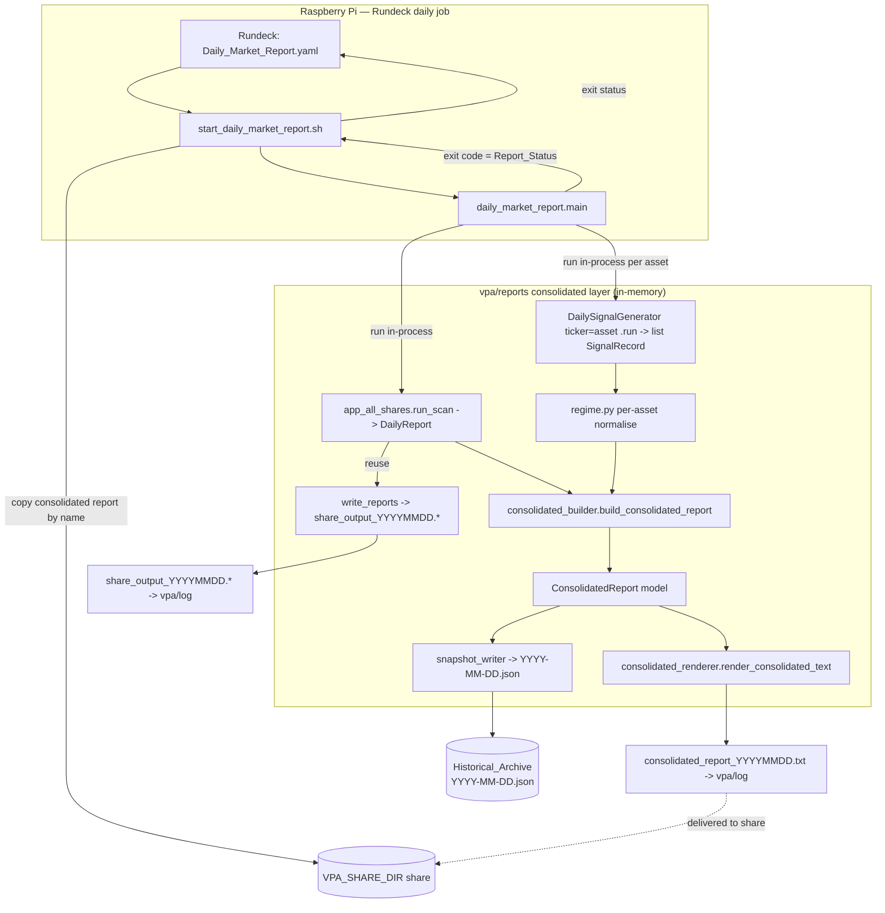

# Design Document

## Overview

The Daily Market Report (Jira SP-356, Trading Bot 0.7) is a single **in-memory orchestrator
job**. In one run on the Raspberry Pi it:

1. **Runs the all-shares VPA scan in-process** via `vpa/app_all_shares.py` `run_scan(...)`,
   which returns one in-memory `DailyReport` (`vpa/reports/models.py`) of `TickerScanResult`
   rows. Each row carries both the `signal_score` and the opportunity fields
   (`opportunity_status`, `drawdown_pct`, `momentum_pct`, `fifty_two_week_high`). `DailyReport`
   already exposes `.successful_results` (sorted `(-(signal_score or 0), report_ticker)`),
   `.opportunities` (sorted `(drawdown_pct, report_ticker)`, filtered to
   `opportunity_status == "qualifies"`), and the counts. So the **Top VPA Signals view and the
   Opportunities view both come from this one object** — there is no second input and no file
   read.
2. **Runs the SP-315 market-regime generator in-process** via
   `vpa/ml_validation/daily_signal.py` `DailySignalGenerator(ticker=...).run()`, once **per
   configured asset**, to obtain `list[SignalRecord]`. SP-315 downloads its own OHLCV, runs the
   VPA feature pipeline, classifies the latest candle, and returns actionable records (possibly
   empty, meaning "no high-conviction signal"), already sorted confidence High-first.
3. **Writes each component's own individual outputs** as they are written today — reusing
   `write_reports(report, output_dir)` for the all-shares scan (the date-stamped
   `share_output_YYYYMMDD.csv/html/txt`), and letting SP-315 append to its own signals-log CSV.
4. **Builds and writes the Consolidated_Daily_Report** (four fixed sections: Market Regime, Top
   VPA Signals, Opportunities, Daily Summary) and a **JSON snapshot** to a date-stamped
   historical archive — all from the in-memory objects produced in steps 1–2. The rendered
   consolidated report is written to `vpa/log/` under a **known, stable filename**
   (`consolidated_report_YYYYMMDD.txt`, mirroring the all-shares scan's `share_output_YYYYMMDD`
   stem) so that delivery to the Shared_Drive is **deterministic by name** — see below.

The orchestrator **reads no text or CSV files for its inputs.** Every input is an in-memory
Python object obtained by invoking the upstream component directly.

### Delivery of the consolidated report to the Shared_Drive

Because one run now produces **several** outputs (the all-shares `share_output_*` files, the
SP-315 signals-log CSV, and the Consolidated_Daily_Report), "copy the latest file in `vpa/log/`"
is no longer precise — the **Consolidated_Daily_Report specifically** must land on the
Shared_Drive (Req 1.5, 1.6). The design decision is: the orchestrator writes the rendered
consolidated report to `vpa/log/consolidated_report_YYYYMMDD.txt` (a known, stable name derived
from the `Report_Date`), and the launcher copies **that specific file** — not merely the most
recently written output — to `$VPA_SHARE_DIR` (default `/mnt/data/my_share`). The launcher MAY
also copy the other outputs, but the consolidated report is delivered deterministically by its
known filename. This keeps the write pattern consistent with the existing `write_reports`/`vpa/log`
convention while guaranteeing the report a trader needs reaches their day-to-day computer.

Running the SP-315 generator here also gives it a **scheduled home it currently lacks**:
SP-315 is DONE but unscheduled, so folding it into this daily job is where it finally runs on a
schedule.

The feature builds directly on the existing `vpa/reports` module
(`vpa/reports/models.py`, `vpa/reports/renderers.py`, `vpa/reports/writers.py`). Those files
already establish the house pattern — frozen dataclasses for report data, pure `render_*`
functions returning strings, and a `write_*` function that stamps files by date and creates
parent directories. This design **adds** new composable models, a new renderer, a JSON snapshot
writer, and the orchestrator entrypoint, leaving the existing `DailyReport`, `render_*`, and
`write_reports` functions intact.

### Relationship to the existing daily jobs

The two existing daily jobs — `Daily_VPA_Check_for_SPY` and `Daily_VPA_Check_-_ALL_SP500`
(`vpa/jobs/*.yaml`) — are **subsumed** by this orchestrator. Once the new job is in place they
are simply **disabled in the Rundeck UI**; there is **no coexistence or transition logic in
code**. (`Daily_VPA_Check_-_ALL_SP500` is already `scheduleEnabled: false` today.) This new job
is its own Rundeck job with its own exit status — it is not embedded into another scan's
launcher.

### Future database-backed inputs (out of scope)

Because the report builder is a **pure function over typed in-memory inputs**, a future
database-backed input source is a clean swap: only the code that produces the `DailyReport` and
the per-asset regime records would change, leaving the builder, renderer, models, and snapshot
untouched. That swap is **out of scope** for this feature.

### Asset-neutrality

`DailySignalGenerator`'s `ticker` is a constructor parameter (default `"SPY"`), so running it
per asset is natural. SPY is only the current primary asset. Nothing in the data model,
regime wrapper, renderer, or snapshot schema hardcodes SPY: the Market Regime section is keyed
by asset identifier, and the design supports additional indexes, commodities, and shares with
no structural change — add assets to the configured list.

## Architecture

The consolidated layer is organised as small, single-responsibility modules placed under
`vpa/reports/` alongside the existing files, following the existing models/renderers/writers
split. Every input to the builder is an **in-memory object**, not a file.

| New module | Responsibility |
|---|---|
| `vpa/reports/consolidated_models.py` | Frozen dataclasses for the consolidated report and its four sections; JSON `to_dict`/`from_dict` helpers (Req 3-7). |
| `vpa/reports/regime.py` | Asset-neutral in-memory wrapper that invokes `DailySignalGenerator` per configured asset and normalises each result into the Market Regime input, classifying present / missing / empty and catching `InsufficientDataError` / other errors **per asset** (Req 2.3, 3, 8, 9). **Not a file reader.** |
| `vpa/reports/consolidated_builder.py` | Pure function `build_consolidated_report(report_date, scan_result, regime_result)`: assemble the four sections from the in-memory `DailyReport` and the per-asset regime records; ordering, top-5, counts (Req 1, 4, 5, 6, 8). |
| `vpa/reports/consolidated_renderer.py` | `render_consolidated_text(report)` → string, extending the `render_plain_text` pattern (Req 1.2-1.4, 3-6). |
| `vpa/reports/snapshot_writer.py` | JSON snapshot write (temp-file + atomic `os.replace`) + read-back parse (Req 7). |
| `vpa/reports/daily_market_report.py` | Orchestrator `main(argv) -> int`: run `run_scan`, run the regime wrapper per asset, write individual outputs, build → render → write report, write snapshot; emit one terminal `Report_Status`; map to exit code (Req 1.5, 1.6, 1.7, 2, 9, 10). |

The existing `vpa/reports/writers.py::report_paths` / `write_reports` and
`vpa/reports/renderers.py` are left unchanged and are **reused** by the orchestrator for the
all-shares scan's individual outputs.

### Delivery: shell launcher + Rundeck job

Following the confirmed repo pattern (`vpa/scripts/start_vpa_all_shares.sh`,
`start_grow_forward_intraday.sh`):

- **New launcher `vpa/scripts/start_daily_market_report.sh`** — activates the venv, ensures
  `/usr/local/trading` is on `PYTHONPATH`, runs `python -m vpa.reports.daily_market_report`,
  copies the **Consolidated_Daily_Report specifically** — the known
  `vpa/log/consolidated_report_YYYYMMDD.txt` file — to the share (`VPA_SHARE_DIR`, default
  `/mnt/data/my_share`) so the report is accessible from the user's day-to-day computer
  (Req 1.5, 1.6), and `exit $?` so the orchestrator's own exit status is what Rundeck sees. The
  launcher MAY additionally copy the other run outputs (`share_output_*`, the SP-315 signals-log
  CSV), but the consolidated report is delivered **deterministically by its known filename**,
  not by "latest file wins".
- **New Rundeck job `vpa/jobs/Daily_Market_Report.yaml`** — follows the existing job pattern
  (single `scriptfile` command, daily schedule, `keepgoing: false`, `node-first`), pointing at
  the new launcher.

Because this is its own job, there is no `vpa_status` / `report_status` bash combination and no
"must not mask the scan status" framing — the orchestrator process **is** the job, and its exit
status is the Rundeck status. A partial upstream failure (graceful degradation) is still a
success exit; failure exit is reserved for "no report could be produced at all".

### Component and flow diagram



### Key design decisions and rationale

- **In-memory orchestration, no file inputs.** The scan and the regime generator are invoked
  directly and return typed Python objects, so the report is built from live objects rather than
  re-parsing text. This removes the fragile file-contract coupling of the previous design and
  makes the builder trivially testable.
- **One scan object feeds two sections.** `DailyReport` already exposes both
  `.successful_results` and `.opportunities` with their own sort keys, so Top VPA Signals and
  Opportunities are two views of the same object — no duplicate scan, no second input.
- **New composable models, not an extended `DailyReport`.** The consolidated report is a
  different shape (four heterogeneous sections, one asset-keyed). New dataclasses keep each
  model cohesive and leave the working `DailyReport` path untouched.
- **A new renderer and JSON snapshot writer alongside the existing ones.** `render_csv` /
  `render_html` / `render_plain_text` / `write_reports` are kept intact; the consolidated layer
  adds `render_consolidated_text` and `snapshot_writer`, mirroring the existing
  renderers/writers separation.
- **Pure builder, I/O at the edges.** `build_consolidated_report` is pure over typed inputs;
  the orchestrator owns all invocation, logging, and writing. This makes ordering/counting/
  degradation logic directly property-testable and makes a future DB-backed input a clean swap.
- **Per-asset isolation in the regime wrapper.** Each asset is generated independently and its
  failure (e.g. `InsufficientDataError`) is caught per asset, so one asset failing degrades
  gracefully while the others still render.

## Components and Interfaces

### Orchestrator — `vpa/reports/daily_market_report.py`

```python
def main(argv: list[str] | None = None) -> int:
    """Run the upstream scans in-process, build and write the consolidated daily
    report, and return a process exit code.

    0 = report produced (Req 10.2), INCLUDING partial upstream failure
        (graceful degradation is success, Req 10.3).
    non-zero = the report could not be produced at all (Req 1.7, 10.4).
    """
```

Responsibilities:

- Resolve `Report_Date` (Pi local date, overridable via arg/env for tests), the
  **Configured_Assets** for the regime signal, and the `Historical_Archive` directory from
  config/env (defaults consistent with `vpa/log/` and the share). The Configured_Assets are
  resolved from **external configuration — not a hardcoded literal** — so that running the
  regime generator for an arbitrary number N of assets is a **configuration change, not a code
  change** (Req 2.4). The configured source is a key in `vpa/config/config.json` (consistent
  with the existing config pattern used by `MarketAnalyzer` / `DailySignalGenerator`), with an
  optional env-var override, **defaulting to `["SPY"]`** (the current primary asset) when unset.
  The resolved list is passed through to the regime wrapper as its `assets` argument.
- Run `run_scan(...)` to obtain the `DailyReport`. On failure, catch it, log the reason, and
  treat the VPA scan input as **Missing** (Req 2.1, 9.2).
- Run the regime wrapper (`regime.py`), which invokes `DailySignalGenerator(ticker=asset).run()`
  per configured asset and catches per-asset failures (Req 2.3, 9.2).
- Write each component's individual outputs: `write_reports(report, output_dir)` for the scan;
  SP-315 writes its own signals-log CSV during `.run()` (Req 1.3, step 3 of the overview).
- Call `build_consolidated_report(...)`, then `render_consolidated_text(...)` and write the
  rendered report to `vpa/log/` under the **known, stable filename**
  `consolidated_report_YYYYMMDD.txt` (the `Report_Date` stamped the same way as the all-shares
  scan's `share_output_YYYYMMDD` stem). Writing the consolidated report to a deterministic path
  is what lets the launcher deliver it to the Shared_Drive **by name** (Req 1.5, 1.6). Then call
  `write_snapshot(...)`.
- Emit exactly one terminal `Report_Status` line to stdout (success) or stderr (failure) and
  return the matching exit code (Req 1.7, 10). Invoked as
  `python -m vpa.reports.daily_market_report`.

### Regime wrapper — `vpa/reports/regime.py`

An asset-neutral, in-memory adapter around `DailySignalGenerator`. It is **not** a file reader.

```python
from enum import Enum

class RegimeAssetState(Enum):
    PRESENT = "present"       # generator ran; one or more fired records
    EMPTY = "empty"           # generator ran; no fired records ("no high-conviction signal")
    MISSING = "missing"       # generator could not run for this asset (error)

@dataclass(frozen=True)
class RegimeAssetResult:
    asset: str
    state: RegimeAssetState
    records: tuple[SignalRecord, ...]   # already High-first; empty unless PRESENT
    detail: str = ""                    # reason text for logging on MISSING

def collect_regime(
    assets: Sequence[str],
    *,
    output_dir: Path,
    lookback_days: int = 200,
    generator_factory=DailySignalGenerator,  # injectable for tests
) -> tuple[RegimeAssetResult, ...]:
    """Run the SP-315 generator per configured asset and normalise each result.

    `assets` is the resolved Configured_Assets list — an arbitrary number N of
    assets supplied by external configuration (the orchestrator reads it from
    config/env, default ["SPY"]). The wrapper is agnostic to N: it simply
    iterates whatever list it is handed, so adding assets is a configuration
    change, not a code change (Req 2.4).

    For each asset: build generator_factory(output_dir=..., lookback_days=...,
    ticker=asset), call .run(). A non-empty list -> PRESENT; an empty list ->
    EMPTY ("no high-conviction signal"); an InsufficientDataError or any other
    exception -> MISSING with the reason captured in `detail` and logged.
    Exactly one RegimeAssetResult is returned per configured asset.
    """
```

- `generator_factory` is injectable so unit tests pass a fake and never touch yfinance.
- Per-asset `try/except` guarantees one failing asset cannot stop the others, and each failure
  yields one log entry (Req 8.1, 9.2, 9.4).

### Builder — `vpa/reports/consolidated_builder.py`

```python
def build_consolidated_report(
    report_date: date,
    scan_result: DailyReport | None,
    regime_result: Sequence[RegimeAssetResult],
) -> ConsolidatedReport:
    """Assemble exactly one ConsolidatedReport with all four sections (Req 1, 8).

    scan_result is None when the all-shares scan failed (VPA_Scan_Result Missing);
    both the Top VPA Signals and Opportunities sections then render placeholders.
    """
```

Pure, no I/O. Responsibilities:

- Always produces all four sections, in the fixed order Market Regime → Top VPA Signals →
  Opportunities → Daily Summary, and no others (Req 1.1, 1.2, 8).
- **Top VPA Signals (Req 4):** from `scan_result.successful_results` (already sorted
  `(-(signal_score or 0), report_ticker)` — score descending, alphabetical tie-break), take at
  most the first 5. `scan_result is None` or no successful rows → empty → placeholder (Req 4.4).
- **Opportunities (Req 5):** from `scan_result.opportunities` (already sorted
  `(drawdown_pct, report_ticker)`), list every qualifying ticker with its drawdown and momentum.
  `scan_result is None` or no qualifying rows → empty → placeholder (Req 5.2).
- **Market Regime (Req 3):** one entry per configured asset from the `RegimeAssetResult` tuple.
  A `PRESENT` asset shows its records High-first; an `EMPTY` asset shows the
  "no high-conviction signal" indication; a `MISSING` asset shows the unavailable placeholder.
  When the whole regime input is missing/empty, the section shows the unavailable placeholder
  and no record (Req 3.1-3.5).
- **Daily Summary (Req 6):** opportunity count = number of Opportunities tickers; VPA signal
  count = number of Top VPA tickers; for the **primary asset**, the adjusted_direction and
  confidence_level of its highest-confidence fired record, or a no-high-conviction-signal
  indication when it has none. Unavailable sections contribute zero / the unavailable
  placeholder (Req 6.1-6.4).
- Degradation: any unavailable input is built with its placeholder; the report is still produced
  (Req 8.1-8.3).

### Renderer — `vpa/reports/consolidated_renderer.py`

```python
def render_consolidated_text(report: ConsolidatedReport) -> str: ...
```

Follows the existing `render_plain_text` style (header + sectioned lines, trailing newline).
Displays `Report_Date` in ISO 8601 `YYYY-MM-DD` form (Req 1.4), renders all four sections with
their placeholders when unavailable (Req 3-6).

### Snapshot writer — `vpa/reports/snapshot_writer.py`

```python
def snapshot_path(archive_dir: str | Path, report_date: date) -> Path:
    """<archive_dir>/<YYYY-MM-DD>.json (Req 7.2)."""

def write_snapshot(report: ConsolidatedReport, archive_dir: str | Path) -> Path:
    """Serialize report to JSON and atomically replace the dated file (Req 7.1,7.4,7.5,7.7)."""

def read_snapshot(path: str | Path) -> ConsolidatedReport:
    """Parse a snapshot back into a ConsolidatedReport (Req 7.6 round-trip)."""
```

- Writes exactly one JSON file named by `Report_Date` as `YYYY-MM-DD.json` into the
  `Historical_Archive`, creating parent dirs (mirrors `write_reports`' `mkdir(parents=True)`).
- **Atomic, overwrite-safe** for Req 7.5/7.7: serialise to a temp file in the archive dir, then
  `os.replace` onto the final name. If serialisation or the write fails, any pre-existing
  snapshot for that date is left unchanged and the error is surfaced.
- Uses `encoding="utf-8"`, consistent with `write_reports`.

## Data Models

New frozen dataclasses in `vpa/reports/consolidated_models.py`, matching the existing
`@dataclass(frozen=True)` style in `vpa/reports/models.py`. The Market Regime section models the
shape of SP-315's `SignalRecord` rather than a label/score pair.

```python
from dataclasses import dataclass
from datetime import date

@dataclass(frozen=True)
class RegimeSignalEntry:
    signal_type: str          # e.g. "distribution", "strong_bearish"
    adjusted_direction: str   # e.g. "BUY"
    confidence_level: str     # "High" | "Medium-High" | "Low-Medium" | "Low"

@dataclass(frozen=True)
class RegimeAssetEntry:
    asset: str                            # asset identifier, e.g. "SPY" (asset-neutral)
    available: bool                       # False => generator could not run (MISSING)
    signals: tuple[RegimeSignalEntry, ...]  # already High-first; empty => no-high-conviction

    @property
    def no_high_conviction(self) -> bool:
        # configured asset that ran but fired nothing (EMPTY)
        return self.available and len(self.signals) == 0

@dataclass(frozen=True)
class MarketRegimeSection:
    assets: tuple[RegimeAssetEntry, ...]   # one entry per configured asset

    @property
    def available(self) -> bool:
        # the whole regime input is unavailable when no asset is present/empty
        return any(asset.available for asset in self.assets)

@dataclass(frozen=True)
class VpaSignal:
    ticker: str
    signal_score: float

@dataclass(frozen=True)
class TopVpaSignalsSection:
    signals: tuple[VpaSignal, ...]    # already top-5, ordered; empty => placeholder (Req 4.4)

@dataclass(frozen=True)
class Opportunity:
    ticker: str
    drawdown_pct: float
    momentum_pct: float

@dataclass(frozen=True)
class OpportunitiesSection:
    opportunities: tuple[Opportunity, ...]   # deterministic order; empty => placeholder (Req 5.2)

@dataclass(frozen=True)
class DailySummarySection:
    opportunity_count: int                 # Req 6.1
    vpa_signal_count: int                  # Req 6.2
    primary_asset: str                     # the primary asset the summary reflects
    primary_direction: str | None          # highest-confidence record's adjusted_direction, or None
    primary_confidence: str | None          # highest-confidence record's confidence_level, or None
    # primary_direction / primary_confidence are both None => no-high-conviction / unavailable (Req 6.2, 6.4)

@dataclass(frozen=True)
class ConsolidatedReport:
    report_date: date
    market_regime: MarketRegimeSection
    top_vpa_signals: TopVpaSignalsSection
    opportunities: OpportunitiesSection
    daily_summary: DailySummarySection
```

### JSON snapshot schema

The snapshot records the `Report_Date` and the data of all four sections (Req 7.3). A single
top-level `schema_version` field guards future format changes. `market_regime` is keyed by
asset; each asset maps to a (possibly empty) list of regime signal entries, with an `available`
flag so a `MISSING` asset is distinguishable from an `EMPTY` one.

```json
{
  "schema_version": 1,
  "report_date": "2026-07-15",
  "market_regime": {
    "assets": {
      "SPY": {
        "available": true,
        "signals": [
          {"signal_type": "distribution", "adjusted_direction": "BUY", "confidence_level": "High"}
        ]
      }
    }
  },
  "top_vpa_signals": {
    "signals": [
      {"ticker": "AAPL", "signal_score": 18.0}
    ]
  },
  "opportunities": {
    "opportunities": [
      {"ticker": "MSFT", "drawdown_pct": -24.3, "momentum_pct": 3.1}
    ]
  },
  "daily_summary": {
    "opportunity_count": 1,
    "vpa_signal_count": 1,
    "primary_asset": "SPY",
    "primary_direction": "BUY",
    "primary_confidence": "High"
  }
}
```

### Round-trip serialization (Req 7.6)

Serialisation and parsing are symmetric and total over the model:

- `to_dict(report) -> dict`: pure, maps each dataclass/section to the schema above.
  `report_date` is written as its ISO 8601 string (`date.isoformat()`); each asset's regime
  entries become a list of primitive objects under its asset key; `available` records the
  present/empty-vs-missing distinction.
- `from_dict(data) -> ConsolidatedReport`: pure inverse; `report_date` parsed with
  `date.fromisoformat`, sections rebuilt from their lists/maps.
- JSON is produced with `json.dumps(to_dict(report), ...)` and parsed with
  `from_dict(json.loads(text))`.

Because every field is a primitive (`str`, `float`, `int`, `bool`, `None`) and the date is
ISO-8601, `from_dict(to_dict(r)) == r` holds for all valid `ConsolidatedReport` values —
including the regime records — giving the Req 7.6 round-trip property: reading a snapshot back
reproduces the four sections and the report date with no field added, dropped, or altered.
Frozen dataclasses give structural equality for free, so equality is the round-trip oracle.

## Correctness Properties

*A property is a characteristic or behavior that should hold true across all valid executions
of a system — essentially, a formal statement about what the system should do. Properties serve
as the bridge between human-readable specifications and machine-verifiable correctness
guarantees.*

### Property 1: Snapshot round-trip is identity

*For any* valid `ConsolidatedReport` (including arbitrary per-asset regime records), serialising
it to a JSON snapshot and reading that snapshot back SHALL reproduce an equal
`ConsolidatedReport` — the four sections and the report date, with no field added, dropped, or
altered.

**Validates: Requirements 7.1, 7.3, 7.6**

### Property 2: Top VPA Signals ordering and cap

*For any* VPA scan result, the Top VPA Signals section SHALL contain at most 5 signals, ordered
by signal score descending with ties broken alphabetically by ticker ascending, and every listed
signal's score SHALL be greater than or equal to every omitted signal's score.

**Validates: Requirements 4.1, 4.2, 4.3**

### Property 3: Opportunities ordering is deterministic and total

*For any* VPA scan result, the Opportunities section SHALL list exactly the qualifying
opportunity tickers (none added, none dropped) in a deterministic order independent of the input
row ordering, each carrying its drawdown and momentum values.

**Validates: Requirements 2.2, 5.1, 5.3**

### Property 4: Report always has the four sections in order

*For any* combination of present, missing, and empty inputs, the builder SHALL produce exactly
one report containing the four sections in the order Market Regime, Top VPA Signals,
Opportunities, Daily Summary, and no other sections.

**Validates: Requirements 1.1, 1.2, 8.1, 8.2**

### Property 5: Daily Summary is consistent with the rendered sections

*For any* combination of inputs, the Daily Summary opportunity count SHALL equal the number of
tickers in the Opportunities section, the VPA signal count SHALL equal the number of tickers in
the Top VPA Signals section, and the summary's primary-asset direction and confidence SHALL equal
the primary asset's highest-confidence regime record — or indicate no high-conviction signal when
that asset has none; when a section's input is unavailable its count SHALL be zero.

**Validates: Requirements 6.1, 6.2, 6.3, 6.4**

### Property 6: Graceful degradation never fails and never fabricates

*For any* subset of the inputs being missing or empty — including a per-asset regime generator
failure — the builder SHALL still produce a report with a success outcome, render each
unavailable section (and each missing/empty regime asset) with its placeholder, and display no
VPA signal, opportunity, or regime record it did not receive.

**Validates: Requirements 2.5, 3.5, 4.4, 5.2, 8.1, 8.2, 8.3, 10.3**

### Property 7: Market Regime reflects each configured asset exactly once

*For any* per-asset regime input over an arbitrary number N of configured assets, each configured
asset SHALL appear in the Market Regime section exactly once; a present asset's records SHALL be ordered highest-confidence first ("High" before
"Medium-High" before "Low-Medium" before "Low"); an asset that ran but fired no records SHALL show
the no-high-conviction-signal indication; and an asset whose generator could not run SHALL show
the unavailable placeholder.

**Validates: Requirements 3.1, 3.2, 3.3, 3.4**

## Error Handling

- **VPA scan failure (Req 2.1, 9.2):** the orchestrator wraps `run_scan(...)` in `try/except`.
  On failure it logs the reason and passes `scan_result = None` to the builder, which renders the
  Top VPA Signals and Opportunities sections with their placeholders. The run still completes.
- **Per-asset regime failure (Req 2.3, 8.1, 9.2):** `regime.py` runs
  `DailySignalGenerator(ticker=asset).run()` per configured asset inside its own `try/except`.
  An `InsufficientDataError` (config missing / data insufficient) or any other exception yields a
  `MISSING` `RegimeAssetResult` for that asset with the reason captured and logged; **other assets
  still render.** An empty result (no fired records) is `EMPTY` and renders the
  no-high-conviction-signal indication.
- **Missing/Empty inputs (Req 8, 9.1):** each unavailable input is treated as obtained; one log
  message per affected input identifies it and whether the condition was Missing or Empty, then
  the run continues with the section placeholder and a success outcome (Req 8.3).
- **Multiple affected inputs (Req 9.4):** because classification and logging are per input (and
  per asset for the regime wrapper), each affected input gets its own log entry in a single run.
- **Write failures (Req 1.7, 7.7, 9.3):** the rendered report and the snapshot are written only
  once the build succeeds, so no partial report is written on a build failure (Req 1.7). The
  snapshot writer uses temp-file + atomic `os.replace`, so a failed snapshot write leaves any
  pre-existing dated file unchanged and surfaces the archival error (Req 7.7); the orchestrator
  logs an error naming the failed write target and the reason (Req 9.3).
- **Terminal status and exit code (Req 10):** the orchestrator emits exactly one terminal
  `Report_Status` and maps it to the process exit code — **0 when a report was produced, including
  after partial upstream failure (graceful degradation is success, Req 10.2, 10.3); non-zero only
  when no report could be produced at all (Req 1.7, 10.4).**

Logging uses the standard `logging` module, consistent with `vpa/opportunities.py`
(`logger = logging.getLogger(__name__)`), so entries land in the log stream that the launcher
copies to the share.

### Rundeck status and exit-code integration

This is its **own** Rundeck job with its own launcher
(`vpa/scripts/start_daily_market_report.sh`), so there is no `vpa_status`/`report_status` bash
combination and nothing to mask. The launcher runs `python -m vpa.reports.daily_market_report`,
copies the Consolidated_Daily_Report (`vpa/log/consolidated_report_YYYYMMDD.txt`) to
`$VPA_SHARE_DIR` by its known name so the report reaches the Shared_Drive deterministically
(Req 1.5, 1.6), and `exit $?` — so the orchestrator's own exit status is the Rundeck job status:

- On success (report produced, possibly degraded) the orchestrator prints one confirmation line
  for the `Report_Date` and exits 0, which Rundeck surfaces as green (Req 10.2, 10.3).
- On failure (no report produced) it prints one failure line to stderr and exits non-zero, which
  Rundeck surfaces as RED (Req 1.7, 10.4).

The two existing daily jobs are disabled in the Rundeck UI once this job is in place; no
transition code is required.

## Testing Strategy

The consolidated builder, renderer, models, and snapshot writer are pure, light, in-memory logic
(ordering lists, building sections, JSON round-trip) with no ML or network work, so
**property-based testing is appropriate** for them and the fast/slow pytest-marker convention
does not apply — **these tests are all fast**. The orchestrator and the regime wrapper invoke
heavy upstream code (`run_scan`, `DailySignalGenerator` → yfinance), so they are tested with
**dependency injection / fakes**: a fake scan function and a fake regime generator are injected so
partial-failure and exit-code behaviour is unit-testable **without network or yfinance**. Unit
tests MUST NOT trigger the real SP-315 yfinance path.

### Property-based tests (hypothesis)

`hypothesis` is already available in the project (there is a `.hypothesis` directory). Each
Correctness Property above is implemented as a **single** property-based test, configured to run
a **minimum of 100 iterations**, and tagged with a comment referencing the design property:

`# Feature: daily-market-report, Property <n>: <property text>`

- **Property 1 (round-trip)** — strategy builds arbitrary `ConsolidatedReport` values (random
  regime assets with random `SignalRecord`-shaped entries, random VPA signals / opportunities,
  arbitrary dates); assert `from_dict(to_dict(r)) == r` and
  `from_dict(json.loads(json.dumps(to_dict(r)))) == r`.
- **Property 2 (top-5 ordering/cap)** — generate random `DailyReport`s; assert the Top VPA section
  length ≤ 5, score descending with alphabetical tie-break, and listed ≥ omitted.
- **Property 3 (opportunities order)** — generate random `DailyReport`s with rows in random order;
  assert same membership as `.opportunities` and a stable deterministic order under permutation,
  each carrying drawdown and momentum.
- **Property 4 / Property 6 (four sections, degradation)** — generate the scan result as
  present/missing/empty and each regime asset as present/empty/missing; assert the four sections
  always exist in order, the builder always returns a report, and nothing unreceived is displayed.
- **Property 5 (summary consistency)** — assert summary counts equal rendered-section lengths,
  the primary-asset direction/confidence equal that asset's highest-confidence record (or the
  no-high-conviction indication), and zero counts for unavailable sections.
- **Property 7 (regime shape)** — generate per-asset regime results mixing present/empty/missing;
  assert each configured asset appears exactly once, present records are High-first, empty assets
  show the no-high-conviction indication, and missing assets show the unavailable placeholder.

### Unit / example tests

Focused example and edge-case tests complement the property tests (avoid over-testing inputs the
properties already cover). The orchestrator tests inject fakes:

- Wiring/reuse: `write_reports` is invoked for the all-shares scan output, and the SP-315
  generator's `.run()` is invoked per configured asset via the injected factory (Req 1.3, 2.1,
  2.3, 7.4).
- Renderer: `Report_Date` rendered as ISO 8601; each placeholder string present when a section or
  regime asset is unavailable (Req 1.4, 3.3, 3.4, 3.5, 4.4, 5.2, 6.4).
- Snapshot writer: file named `YYYY-MM-DD.json` (Req 7.2); exactly one file written (Req 7.1);
  re-running the same date fully replaces the file contents (Req 7.5); a simulated temp-write /
  replace failure leaves a pre-existing file unchanged and surfaces the error (Req 7.7).
- Orchestrator exit-code: happy path returns 0 and prints one success line (Req 10.1, 10.2); an
  injected scan failure plus a failing regime asset still returns 0 with a report produced
  (graceful degradation, Req 10.3); an injected build/write failure returns non-zero and prints
  one failure line with no partial report written (Req 1.7, 10.4).
- Logging: one entry per affected input/asset when multiple are missing/empty or an upstream
  component raised in a single run (Req 9.1, 9.2, 9.4); a write failure logs the target (Req 9.3).

## Assumptions and Open Questions

- **Configured assets for the regime signal.** The mechanism is **decided**: the
  Configured_Assets are resolved from **external configuration** (a `vpa/config/config.json` key,
  with an optional env override), **defaulting to `["SPY"]`** (the current primary asset) when
  unset, so adding assets is a configuration change supporting an arbitrary N without code changes
  (Req 2.4). **Open question:** confirm *which* additional assets (indexes, commodities, shares)
  to configure and in what order; the primary asset drives the Daily Summary.
- **Generator lookback.** `DailySignalGenerator(lookback_days=200)` is the SP-315 default.
  **Open question:** confirm the lookback to use for the orchestrated run per asset.
- **Historical_Archive location.** Assumed to live under the Pi's data area and be synced like
  other outputs via `$VPA_SHARE_DIR` (default `/mnt/data/my_share`); the exact archive directory
  should be confirmed (default consistent with `vpa/log/` / the share).
- **Report_Date source.** Assumed to be the Pi's local date at run time, overridable via
  arg/env for tests.
- **Subsuming the existing daily jobs.** This orchestrator subsumes `Daily_VPA_Check_for_SPY` and
  `Daily_VPA_Check_-_ALL_SP500`, which will be **disabled in the Rundeck UI** once it is in place.
  **Open question:** confirm nothing else depends on those two jobs' individual schedules before
  disabling them.
- **Future DB-backed input source (out of scope).** A database-backed source for the upstream
  inputs is a clean future swap, enabled by the pure builder, and is explicitly out of scope here.
