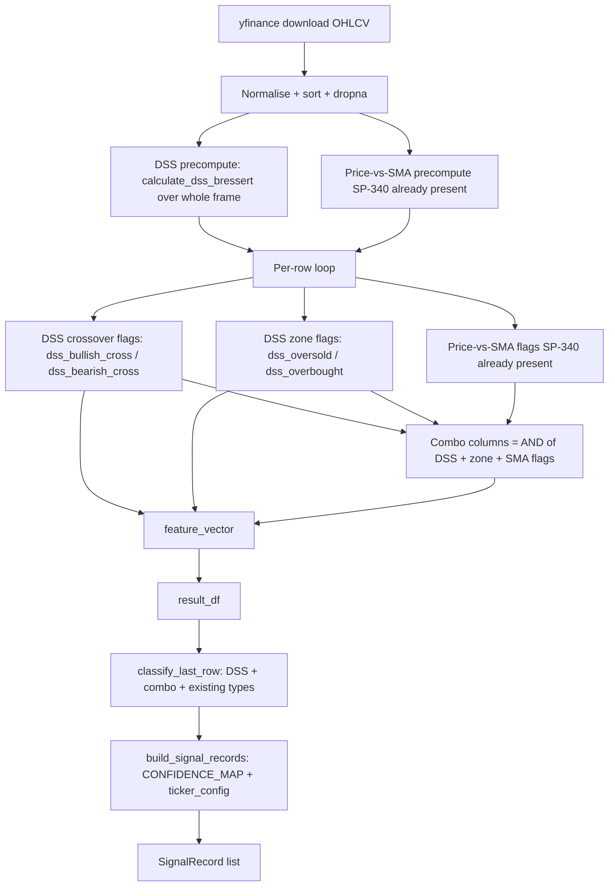

# Design Document

## Overview

SP-359 makes the Daily Signal Generator (`vpa/ml_validation/daily_signal.py`) a first-class producer and classifier of DSS Bressert crossover signals (`dss_bullish`, `dss_bearish`) and the ten DSS/SMA combo (confluence) signals. The classification layer (`signal_analysis.py` `classify_signals`) and the per-ticker config generator (SP-322) already know about these signal types, but the daily generator never emits the feature columns they depend on, so the matching config rules are inert at runtime. This feature closes that gap by mirroring the already-shipped `VPAFeatureExtractor.generate_dataset` behaviour inside `DailySignalGenerator.run`.

The work is deliberately narrow: it reuses existing, tested building blocks rather than inventing new ones.

- `vpa.dss_bressert.calculate_dss_bressert` computes the oscillator/trigger series (unchanged).
- The DSS precompute, warm-up, zone-flag, and combo-derivation logic already lives in `generate_dataset` Steps 3b/9/9a/9d; the daily run replicates that logic row-for-row so the two paths produce identical columns for identical input.
- `_COMBO_COLUMN_TO_TYPE` in `signal_analysis.py` already maps combo column names to `SignalType` members; `classify_last_row` reuses it so there is a single source of truth for the mapping.
- `SIGNAL_DIRECTIONS` already maps every DSS and combo type to a direction.

The scope of the change is three functions in `daily_signal.py` (`DailySignalGenerator.run`, `classify_last_row`, `build_signal_records` via `CONFIDENCE_MAP`), one config file (`vpa/config/ticker_signals.json` SPY entry), and a set of tests. RSI signals and standalone price-crossed-SMA signals are out of scope.

### Goals

- Compute `dss_bullish_cross` / `dss_bearish_cross`, the `dss_oversold` / `dss_overbought` zone flags, and the ten `combo_*` columns during the daily run, producing per row exactly the 0/1 value the feature extractor would produce for that row.
- Classify those columns on the latest candle via `classify_last_row`, reusing the column-present / not-NaN / equals-1 guards that `classify_signals` uses.
- Give `DSS_BULLISH`, `DSS_BEARISH`, and the ten combo types sensible default confidence levels in `CONFIDENCE_MAP`.
- Regenerate SPY's `ticker_signals.json` entry to include `dss_bullish`, `dss_bearish`, and the ten combo rules, matching the SP-322 generator schema, without disturbing the existing AAPL entry or SPY's non-DSS rules.
- Cover all of the above with tests runnable via `pytest -m ""`.

### Non-Goals

- Changing `calculate_dss_bressert`, `feature_extractor.generate_dataset`, or `signal_analysis.classify_signals`.
- Adding RSI classification or standalone price-crossed-SMA signal types to the daily output.
- Folding DSS/combo scores into `composite_score`.

## Architecture

The daily pipeline is unchanged in shape: download OHLCV, process it row-by-row through a rolling-window loop that reuses `VPAFeatureExtractor` internals, assemble a feature DataFrame, classify the last row, and build records. SP-359 inserts three precompute/derivation concerns into that existing loop, mirroring `generate_dataset`.



### Key design decision: mirror, don't share

`generate_dataset` and `DailySignalGenerator.run` are two separate copies of the same rolling-window algorithm (this duplication predates SP-359 — see the SP-340 price-vs-SMA precompute, which is already copied into both). SP-359 follows that established pattern rather than extracting a shared helper, because:

- The requirement (Req 2.6) is explicitly that the daily run produce *the same* 0/1 value the extractor produces for identical input. Mirroring the exact expressions is the most direct way to satisfy and test that equivalence.
- A refactor to share the loop would touch `generate_dataset`, which is a non-goal and would widen the blast radius on a Pi-deployed path.

The DSS gating, warm-up formula, finite-value guards, zone-flag logic, and combo expressions are copied verbatim from `generate_dataset` Steps 3b/9/9a/9d so the two paths cannot drift in their arithmetic. Equivalence is then locked in by tests (Req 7.9, 7.10).

### Where the DSS config comes from

`DailySignalGenerator.run` already instantiates a `VPAFeatureExtractor` to reach its internals (`_detect_signals`, `_extract_feature_vector`). The DSS configuration is read from `extractor._config.dss_bressert` (a `DSSBressertSettings` dataclass with `enabled`, `stochastic_period`, `smoothing_period`, `trigger_period`, `oversold_threshold`, `overbought_threshold`), exactly as `generate_dataset` reads `self._config.dss_bressert`. No new config loading is introduced.

## Components and Interfaces

### 1. `DailySignalGenerator.run` — DSS precompute (new block, mirrors `generate_dataset` Step 3b)

Before the per-row loop, after the OHLCV frame is sorted and validated, compute the DSS series once over the whole frame, gated by `DSS_Enabled`.

```python
dss_osc: list[float] | None = None
dss_trig: list[float] | None = None
dss_warmup = 0
dss_cfg = extractor._config.dss_bressert

def _valid_period(value: object) -> bool:
    return isinstance(value, int) and not isinstance(value, bool) and 1 <= value <= 500

def _valid_threshold(value: object) -> bool:
    return isinstance(value, int | float) and not isinstance(value, bool) and 0 <= value <= 100

dss_enabled = (
    bool(dss_cfg.enabled)
    and _valid_period(dss_cfg.stochastic_period)
    and _valid_period(dss_cfg.smoothing_period)
    and _valid_period(dss_cfg.trigger_period)
    and _valid_threshold(dss_cfg.oversold_threshold)
    and _valid_threshold(dss_cfg.overbought_threshold)
    and dss_cfg.oversold_threshold < dss_cfg.overbought_threshold
)

if dss_enabled:
    from vpa.dss_bressert import calculate_dss_bressert

    dss_osc, dss_trig = calculate_dss_bressert(
        df["High"].tolist(),
        df["Low"].tolist(),
        df["Close"].tolist(),
        dss_cfg.stochastic_period,
        dss_cfg.smoothing_period,
        dss_cfg.trigger_period,
    )
    dss_warmup = dss_cfg.stochastic_period + dss_cfg.smoothing_period + dss_cfg.trigger_period - 2
```

This `_valid_period` / `_valid_threshold` / `dss_enabled` definition is copied verbatim from `generate_dataset` so `DSS_Enabled` means exactly the same thing in both paths (Req 1.1, 1.2; satisfies the DSS_Enabled glossary definition). When disabled, `dss_osc` / `dss_trig` stay `None` and `calculate_dss_bressert` is never called (Req 1.5, 2.4).

### 2. `DailySignalGenerator.run` — per-row DSS crossover + zone + combo derivation (new, mirrors Steps 9/9a/9d)

Inside the existing `for pos, (_, row) in enumerate(df.iterrows())` loop, after the price-vs-SMA flags are computed (the SP-340 block already present), insert the crossover flags, zone flags, and combo columns. The SP-340 block already yields `price_above_sma`, `price_below_sma`, `price_crossed_above_sma`, `price_crossed_below_sma`; SP-359 must expose those four flag variables in the loop body (today the daily loop only produces the `price_vs_sma_signal_score`, so the four integer flags are added alongside, mirroring `generate_dataset` Step 9c).

```python
# DSS crossover flags (Step 9)
dss_bullish_cross = 0
dss_bearish_cross = 0
if dss_enabled and dss_osc is not None and dss_trig is not None and pos >= dss_warmup and pos > 0:
    current_dss = dss_osc[pos]
    current_trigger = dss_trig[pos]
    previous_dss = dss_osc[pos - 1]
    previous_trigger = dss_trig[pos - 1]
    if all(np.isfinite(v) for v in (current_dss, current_trigger, previous_dss, previous_trigger)):
        dss_bullish_cross = int(previous_dss <= previous_trigger and current_dss > current_trigger)
        dss_bearish_cross = int(previous_dss >= previous_trigger and current_dss < current_trigger)

# DSS zone flags (Step 9a) — no pos > 0 requirement
dss_oversold = 0
dss_overbought = 0
if dss_enabled and dss_osc is not None and pos >= dss_warmup:
    osc = dss_osc[pos]
    if np.isfinite(osc):
        dss_oversold = int(osc <= dss_cfg.oversold_threshold)
        dss_overbought = int(osc >= dss_cfg.overbought_threshold)

# Combo columns (Step 9d)
combo_dss_cross_sma_pos_bull = int(dss_bullish_cross and price_above_sma)
combo_dss_cross_sma_pos_bear = int(dss_bearish_cross and price_below_sma)
combo_dss_cross_sma_cross_bull = int(dss_bullish_cross and price_crossed_above_sma)
combo_dss_cross_sma_cross_bear = int(dss_bearish_cross and price_crossed_below_sma)
combo_dss_zone_sma_cross_bull = int(dss_oversold and price_crossed_above_sma)
combo_dss_zone_sma_cross_bear = int(dss_overbought and price_crossed_below_sma)
combo_dss_cross_from_zone_bull = int(dss_bullish_cross and dss_oversold)
combo_dss_cross_from_zone_bear = int(dss_bearish_cross and dss_overbought)
combo_dss_cross_sma_not_ob_bull = int(dss_bullish_cross and price_above_sma and not dss_overbought)
combo_dss_cross_sma_not_ob_bear = int(dss_bearish_cross and price_below_sma and not dss_oversold)
```

These eighteen values are passed into `extractor._extract_feature_vector(...)` as keyword arguments (the extractor already accepts them — the `FEATURE_COLUMNS` list and `_extract_feature_vector` signature already declare `dss_bullish_cross`, `dss_bearish_cross`, `dss_oversold`, `dss_overbought`, the four price flags, and the ten combo columns, all defaulting to 0). Because the daily loop reuses `extractor._extract_feature_vector`, every emitted feature row carries all eighteen columns as `int(...)` values (Req 1.7, 2.5), and the columns appear in the DataFrame passed to `classify_last_row`.

> Design note: the daily loop currently calls `_extract_feature_vector` with only `price_vs_sma_value` / `price_vs_sma_signal_score`. SP-359 extends that call with the DSS, zone, SMA-flag, and combo keyword arguments. When `dss_enabled` is false, all of these are 0 for every row (the guarded blocks never fire), satisfying Req 1.5, 2.4.

### 3. `classify_last_row` — DSS + combo classification (extended)

`classify_last_row` gains two concerns after its existing composite/acc-dist/price-vs-SMA logic, reusing the exact guard pattern from `classify_signals` so behaviour matches column-for-column:

```python
# DSS crossovers (Req 3)
for col, sig in (("dss_bullish_cross", SignalType.DSS_BULLISH),
                 ("dss_bearish_cross", SignalType.DSS_BEARISH)):
    if col in df.columns:
        val = last_row.get(col)
        if _is_valid_numeric(val) and float(val) == 1:
            signals.add(sig)

# Combo columns (Req 4) — single source of truth: _COMBO_COLUMN_TO_TYPE
for combo_col, combo_type in _COMBO_COLUMN_TO_TYPE.items():
    if combo_col in df.columns:
        val = last_row.get(combo_col)
        if _is_valid_numeric(val) and float(val) == 1:
            signals.add(combo_type)
```

`_COMBO_COLUMN_TO_TYPE` is imported from `signal_analysis.py`. The `col in df.columns` guard satisfies "absent column → omit, no error" (Req 3.3, 3.4, 4.3); `_is_valid_numeric` (already defined in the function) rejects NaN / non-numeric / absent and the `== 1` test rejects any other number (Req 3.5, 3.6, 4.4). The early `if df.empty: return set()` guard already covers the empty-frame case (Req 3.7, 4.5). Nothing above the new blocks changes, so the existing core and price-vs-SMA classifications are untouched (Req 3.8, 4.6).

Interface (unchanged signature): `classify_last_row(df: pd.DataFrame) -> set[SignalType]`.

### 4. `CONFIDENCE_MAP` — default confidence levels (extended)

Add twelve entries to the module-level `CONFIDENCE_MAP` dict in `daily_signal.py`:

```python
SignalType.DSS_BULLISH: "Medium-High",
SignalType.DSS_BEARISH: "Medium-High",
# Ten combo types, confluence => higher-conviction default band:
SignalType.COMBO_DSS_CROSS_SMA_POS_BULL: "Medium-High",
SignalType.COMBO_DSS_CROSS_SMA_POS_BEAR: "Medium-High",
... (all ten combo members) ...: "Medium-High",
```

`DSS_BULLISH` / `DSS_BEARISH` are set to `"Medium-High"` (strictly higher than `"Low"` in `CONFIDENCE_ORDER`, Req 5.1, 5.2). All ten combo types default to `"Medium-High"` (Req 5.3, 5.4) because combo signals are confluence (multi-condition) signals and should rank above single-condition signals by default; the band is a chosen default, not a hard requirement beyond membership in `CONFIDENCE_ORDER`.

### 5. `build_signal_records` — no code change required

`build_signal_records` is already generic over `SignalType`: it looks up `CONFIDENCE_MAP.get(sig_type, "Low")` for the default path, applies `ticker_rules.get(sig_type.value)` for the config path, skips `adjusted_direction == "NONE"` rules, defaults `adjusted_direction` to `"BUY"` and `suggested_hold_days` to `10`, and sorts by `_confidence_rank`. Once `CONFIDENCE_MAP` has the new entries and `SIGNAL_DIRECTIONS` has the directions (it already does), DSS and combo records flow through unchanged (Req 5.5–5.8). No edit to `build_signal_records` is anticipated; this is verified by the Req 7.7/7.8 tests.

### 6. `vpa/config/ticker_signals.json` — SPY entry (regenerated)

Add to the existing SPY object exactly one `dss_bullish` rule, one `dss_bearish` rule, and one rule for each of the ten combo column names, following the SP-322 generator schema (an object with `adjusted_direction`, and `confidence_level` + `suggested_hold_days` when the direction is not `"NONE"`; a bare `{"adjusted_direction": "NONE"}` when disabled). Existing SPY rules (`distribution`, `strong_bearish`, `strong_bullish`, `accumulation`) and the entire AAPL entry remain byte-for-byte unchanged apart from the additions (Req 6.1–6.7). The file must remain valid JSON (Req 6.6).

## Data Models

### DSS feature columns (per row, emitted by the daily run)

| Column | Type | Domain | Meaning |
|---|---|---|---|
| `dss_bullish_cross` | int | {0, 1} | Oscillator crossed above trigger this row |
| `dss_bearish_cross` | int | {0, 1} | Oscillator crossed below trigger this row |
| `dss_oversold` | int | {0, 1} | Oscillator ≤ `oversold_threshold` |
| `dss_overbought` | int | {0, 1} | Oscillator ≥ `overbought_threshold` |

### Price-vs-SMA flag columns (per row, surfaced in the daily loop by SP-359)

| Column | Type | Domain | Meaning |
|---|---|---|---|
| `price_above_sma` | int | {0, 1} | `close > sma` |
| `price_below_sma` | int | {0, 1} | `close < sma` |
| `price_crossed_above_sma` | int | {0, 1} | `prev_close <= prev_sma and close > sma` |
| `price_crossed_below_sma` | int | {0, 1} | `prev_close >= prev_sma and close < sma` |

### Combo columns (per row) and their derivation

All ten are `int(<AND expression>)` over the flags above. Column name equals the `SignalType` value (so `_COMBO_COLUMN_TO_TYPE` maps 1:1).

| Column | Expression |
|---|---|
| `combo_dss_cross_sma_pos_bull` | `dss_bullish_cross AND price_above_sma` |
| `combo_dss_cross_sma_pos_bear` | `dss_bearish_cross AND price_below_sma` |
| `combo_dss_cross_sma_cross_bull` | `dss_bullish_cross AND price_crossed_above_sma` |
| `combo_dss_cross_sma_cross_bear` | `dss_bearish_cross AND price_crossed_below_sma` |
| `combo_dss_zone_sma_cross_bull` | `dss_oversold AND price_crossed_above_sma` |
| `combo_dss_zone_sma_cross_bear` | `dss_overbought AND price_crossed_below_sma` |
| `combo_dss_cross_from_zone_bull` | `dss_bullish_cross AND dss_oversold` |
| `combo_dss_cross_from_zone_bear` | `dss_bearish_cross AND dss_overbought` |
| `combo_dss_cross_sma_not_ob_bull` | `dss_bullish_cross AND price_above_sma AND NOT dss_overbought` |
| `combo_dss_cross_sma_not_ob_bear` | `dss_bearish_cross AND price_below_sma AND NOT dss_oversold` |

### `SignalType` (unchanged — already defined in `signal_analysis.py`)

`DSS_BULLISH = "dss_bullish"`, `DSS_BEARISH = "dss_bearish"`, and the ten `COMBO_DSS_*` members already exist, as do their `SIGNAL_DIRECTIONS` entries (every `_BULL`/bullish → UP, every `_BEAR`/bearish → DOWN).

### `SignalRecord` (unchanged — `daily_signal.py`)

`ticker, date, signal_type, original_direction, adjusted_direction, confidence_level, suggested_hold_days`. DSS and combo signals produce `SignalRecord`s of the same shape as existing signals.

### SPY `ticker_signals.json` rule shape

```jsonc
"dss_bullish":  { "confidence_level": "High", "adjusted_direction": "BUY", "suggested_hold_days": 10 },
"dss_bearish":  { "adjusted_direction": "NONE" },
"combo_dss_cross_sma_pos_bull": { "confidence_level": "Medium-High", "adjusted_direction": "BUY", "suggested_hold_days": 10 }
// ... one object per combo column name ...
```

`adjusted_direction` ∈ {`"BUY"`, `"SELL"`, `"NONE"`} (values already in use). When not `"NONE"`, `confidence_level` is drawn from the existing set (e.g. `"High"`, `"Medium-High"`) and `suggested_hold_days` is an int ≥ 1. When `"NONE"`, the rule is `{"adjusted_direction": "NONE"}` with no other keys.

## Correctness Properties

*A property is a characteristic or behavior that should hold true across all valid executions of a system — essentially, a formal statement about what the system should do. Properties serve as the bridge between human-readable specifications and machine-verifiable correctness guarantees.*

The DSS crossover derivation, zone-flag derivation, combo confluence derivation, and the classification logic are pure, input-varying computations: ideal for property-based testing. The already-shipped `VPAFeatureExtractor.generate_dataset` and `SignalConditionalAnalyzer.classify_signals` serve as reference models, so the strongest properties are *model-based equivalence* properties that assert the new daily-run and daily-classification paths agree with those references on generated inputs.

A reflection pass removed redundancy. The single equivalence property subsumes the row-level crossover, zone, and combo arithmetic criteria (1.1, 1.3, 1.4, 2.1, 2.3, 2.6); the warm-up-boundary property covers the pre-warm-up and index-0 zero criteria (1.6, 2.2); the disabled property covers the disabled-zero criteria (1.5, 2.4); and the 0/1 invariant covers the integer-domain criteria (1.7, 2.5). Static `CONFIDENCE_MAP` and JSON-schema criteria (5.1–5.4, 6.1–6.7) are example, schema, and smoke tests rather than properties (see Testing Strategy).

### Property 1: Daily run reproduces the feature extractor's DSS, zone, and combo columns

*For any* OHLCV frame long enough to clear the warm-up and *any* valid DSS configuration, running `DailySignalGenerator.run` over that frame produces, for every emitted row, the same `dss_bullish_cross`, `dss_bearish_cross`, `dss_oversold`, `dss_overbought`, and ten `combo_*` column values that `VPAFeatureExtractor.generate_dataset` produces for the same row given identical input and configuration.

**Validates: Requirements 1.1, 1.3, 1.4, 2.1, 2.3, 2.6**

### Property 2: DSS disabled zeroes every DSS and combo column

*For any* OHLCV frame, when `DSS_Enabled` is false, every emitted feature row has all four DSS columns and all ten combo columns equal to 0, and `calculate_dss_bressert` is never called.

**Validates: Requirements 1.5, 2.4**

### Property 3: Pre-warm-up rows carry no DSS or combo signal

*For any* OHLCV frame and valid DSS configuration, every emitted feature row at a positional index less than `DSS_Warmup` (and the row at index 0 for the crossover columns) has all four DSS columns and all ten combo columns equal to 0.

**Validates: Requirements 1.6, 2.2**

### Property 4: DSS and combo columns are always 0 or 1 integers

*For any* OHLCV frame and configuration (enabled or disabled), every value in each of the four DSS columns and ten combo columns of the emitted feature DataFrame is an integer equal to 0 or 1.

**Validates: Requirements 1.7, 2.5**

### Property 5: A DSS or combo type is classified exactly when its final-row column equals 1

*For any* feature DataFrame, `classify_last_row` includes a given DSS type (`DSS_BULLISH` / `DSS_BEARISH`) or combo `SignalType` in its result if and only if that type's column is present in the frame and the final row's value in that column coerces to the number 1; an absent column, or a final-row value that is NaN, non-numeric, or any number other than 1, excludes the type and raises no error.

**Validates: Requirements 3.1, 3.2, 3.5, 3.6, 4.1, 4.4**

### Property 6: Daily combo classification agrees with `classify_signals`

*For any* feature DataFrame, the set of combo `SignalType`s that `classify_last_row` returns equals the set of combo types whose `classify_signals` matched-index list contains the final row's index — i.e. both resolve each combo column through `_COMBO_COLUMN_TO_TYPE` with the same column-present, not-NaN, equal-to-1 guard.

**Validates: Requirements 4.2**

### Property 7: Adding DSS and combo columns does not disturb other classifications

*For any* feature DataFrame, the membership of the core signal types (`STRONG_BULLISH`, `STRONG_BEARISH`, `ACCUMULATION`, `ACCUMULATION_TEST_PASS`, `DISTRIBUTION`) and the price-vs-SMA types in `classify_last_row`'s result is identical whether or not the DSS and combo columns are present; and the `DSS_BULLISH`/`DSS_BEARISH` membership is unaffected by the presence of the combo columns.

**Validates: Requirements 3.8, 4.6**

### Property 8: Default-path DSS and combo records use the mapped confidence, BUY, hold 10

*For any* set of DSS and combo signal types and a ticker with no matching config rule, `build_signal_records` assigns each resulting record the `CONFIDENCE_MAP` confidence for its type, an `adjusted_direction` of `"BUY"`, and a `suggested_hold_days` of 10.

**Validates: Requirements 5.5**

### Property 9: A matching rule overrides direction, confidence, and hold days (and NONE omits)

*For any* DSS or combo signal type and any ticker config rule, `build_signal_records` applies the rule's `adjusted_direction`, `confidence_level`, and `suggested_hold_days` when the rule's `adjusted_direction` is not `"NONE"`, and omits the signal entirely when it is `"NONE"`.

**Validates: Requirements 5.6, 5.7**

### Property 10: Records are ordered by confidence, High first, unknown last

*For any* set of DSS, combo, and existing signal types, the records `build_signal_records` returns are ordered by their confidence level according to `CONFIDENCE_ORDER` (`"High"` first), with any confidence level absent from `CONFIDENCE_ORDER` sorted last.

**Validates: Requirements 5.8**

## Error Handling

The feature introduces no new error paths; it preserves the daily generator's "graceful degradation to zero" contract.

- **DSS disabled or misconfigured.** `DSS_Enabled` is false whenever the config is absent, `enabled` is false, a period is not an int in 1..500, or the thresholds are invalid / not strictly ordered. In that case `calculate_dss_bressert` is never called and all DSS and combo columns are 0 — the feature silently becomes inert, exactly as today (Req 1.5, 2.4). No exception is raised.
- **Warm-up / short series.** `calculate_dss_bressert` already returns the neutral value (50.0) for warm-up rows and never raises on short input. The `pos >= dss_warmup`, `pos > 0`, and `np.isfinite(...)` guards ensure warm-up, first-row, and non-finite oscillator/trigger values yield 0 rather than spurious crossovers (Req 1.6, 2.2).
- **Classification robustness.** `classify_last_row` guards every new column with `col in df.columns` and the existing `_is_valid_numeric` helper, so an absent column, NaN, non-numeric, or empty frame returns a correct (possibly empty) set without raising (Req 3.3–3.7, 4.3–4.5).
- **Config load.** `_load_ticker_config` already swallows `json.JSONDecodeError` / `OSError` and returns `{}`, so a malformed `ticker_signals.json` degrades to default confidences rather than crashing. The SPY edit must keep the file valid JSON (Req 6.6); a dedicated schema/parse test guards this.
- **`build_signal_records`.** Unknown confidence levels from config sort last via `_confidence_rank` (no `ValueError`), and `adjusted_direction == "NONE"` rules are skipped — both behaviours are pre-existing and reused.

## Testing Strategy

The tests live under `vpa/tests/ml_validation/` alongside the existing `test_classify.py`, `test_combined_feature_columns.py`, and `test_ticker_config.py`, following their conventions (Hypothesis for properties, plain `pytest` classes for examples). All tests are FAST (pure functions, in-memory frames, no model training, no network) and therefore carry no `slow` marker; they run on the default `pytest` path and in the full `pytest -m ""` suite (Req 7.11).

### Dual approach

- **Property tests** (Hypothesis, minimum 100 iterations each) validate the universal properties above over generated OHLCV frames, flag combinations, final-row values, and config rules.
- **Unit / example tests** cover the specific behavioural assertions the requirements name explicitly (Req 7.1–7.8), the static `CONFIDENCE_MAP` contents (Req 5.1–5.4), the SPY JSON schema and regression (Req 6.1–6.7), and the empty-frame edge cases (Req 3.7, 4.5).

### Property-based testing library and configuration

- Library: **Hypothesis** (already used across the trading repo, e.g. `test_classify.py`, `test_price_vs_sma_features.py`).
- Each property test uses `@settings(max_examples=100)` (or higher) to satisfy the ≥100-iteration requirement.
- Each property test carries a tag comment referencing the design property, in the form:
  `# Feature: dss-daily-signal-classification, Property N: <property text>`
- Each of the ten correctness properties is implemented by a **single** property-based test.

Generators:
- OHLCV frames: generate `n` rows (n large enough to clear the largest warm-up under test, e.g. ≥ 40) of positive `Open/High/Low/Close/Volume` with `High >= max(O,C)` and `Low <= min(O,C)`, so the frames are realistic enough to drive `generate_dataset` and `run`. For Properties 1–4 the daily run is invoked against a stubbed/seeded config; `yfinance` download is monkeypatched to return the generated frame so the test is deterministic and offline.
- Final-row cell values for Property 5: `one_of` NaN, integers, floats, and non-numeric strings so the equals-1 / coercion / absent-column branches are all exercised.
- Config rules for Properties 8–10: generate `adjusted_direction` in {`"BUY"`, `"SELL"`, `"NONE"`}, `confidence_level` from `CONFIDENCE_ORDER` plus an unknown value, and `suggested_hold_days` as a small positive int.

### Property test → requirement map

| Property | Test focus | Requirements |
|---|---|---|
| 1 | Daily `run` columns == `generate_dataset` columns (model-based) | 1.1, 1.3, 1.4, 2.1, 2.3, 2.6 |
| 2 | Disabled config → all DSS/combo columns 0, no `calculate_dss_bressert` call | 1.5, 2.4 |
| 3 | Pre-warm-up / index-0 rows → 0 | 1.6, 2.2 |
| 4 | Column values ⊆ {0, 1}, integer | 1.7, 2.5 |
| 5 | `classify_last_row` includes type iff final-row column == 1 | 3.1, 3.2, 3.5, 3.6, 4.1, 4.4 |
| 6 | `classify_last_row` combo set == `classify_signals` last-index combo set | 4.2 |
| 7 | Non-interference with core / price-vs-SMA / DSS classifications | 3.8, 4.6 |
| 8 | Default-path confidence/direction/hold | 5.5 |
| 9 | Config override, NONE omits | 5.6, 5.7 |
| 10 | Confidence ordering | 5.8 |

### Example / unit tests (Req 7 deliverables and static checks)

- **Req 7.1 / 7.2:** final row `dss_bullish_cross == 1` → result contains `DSS_BULLISH`; `dss_bearish_cross == 1` → contains `DSS_BEARISH`.
- **Req 7.3:** both DSS columns absent → neither type present, no error.
- **Req 7.4:** final-row DSS value NaN or ≠ 1 → corresponding type absent.
- **Req 7.5:** for a given combo column == 1 → result contains that column's `SignalType` (parametrised over the ten columns).
- **Req 7.6:** combo column absent, or final value NaN/≠1 → corresponding type absent, no error.
- **Req 7.7:** no matching rule → record uses `CONFIDENCE_MAP` confidence for that type (DSS and combo).
- **Req 7.8:** matching rule → record uses the rule's `adjusted_direction`; and a `NONE` rule → record omitted.
- **Req 7.9:** `run` output has `dss_bullish_cross` / `dss_bearish_cross` matching the crossover logic post-warm-up, 0 pre-warm-up, 0 when disabled (example-level companion to Property 1/2/3 over a crafted frame).
- **Req 7.10:** `run` output has all ten combo columns matching the `Combo_Expressions`, 0 pre-warm-up, 0 when disabled.
- **Req 7.11:** the full suite passes under `pytest -m ""`.
- **Empty-frame edge cases (Req 3.7, 4.5):** `classify_last_row(pd.DataFrame())` returns `set()` without raising.
- **`CONFIDENCE_MAP` contents (Req 5.1–5.4):** assert `DSS_BULLISH` / `DSS_BEARISH` rank strictly above `"Low"` in `CONFIDENCE_ORDER`, and each of the ten combo types has an entry whose value is in `CONFIDENCE_ORDER` (and equals `"Medium-High"`).
- **SPY config schema + regression (Req 6.1–6.7):** load `ticker_signals.json`; assert SPY has exactly one `dss_bullish`, one `dss_bearish`, and one rule per combo column name; assert each DSS/combo rule's `adjusted_direction` ∈ {`"BUY"`, `"SELL"`, `"NONE"`} with valid `confidence_level` + int `suggested_hold_days ≥ 1` when not `"NONE"`; assert the file parses as valid JSON; and assert the pre-existing SPY non-DSS/non-combo rules and the whole AAPL entry are unchanged.

### Traceability, lint/format, and deployment (Req 8)

Not unit/property tested; enforced by process and CI:
- Branch `SP-359-...`, commits prefixed `SP-359:`.
- `ruff check .` and `ruff format --check .` must be clean before any push / PR / Done (the repo ships a ruff CI workflow; a tooling-written file can lose its trailing newline, so run the format check after writing).
- Full suite (`pytest -m ""`) green before push.
- Because the trading bot runs on the Raspberry Pi, the ticket stays in **Mostly Done** until the code is deployed (pull + rebuild container via the project build scripts) and verified on the Pi, and the completion comment records that both the deploy and the verification were done before moving to **Done**.
