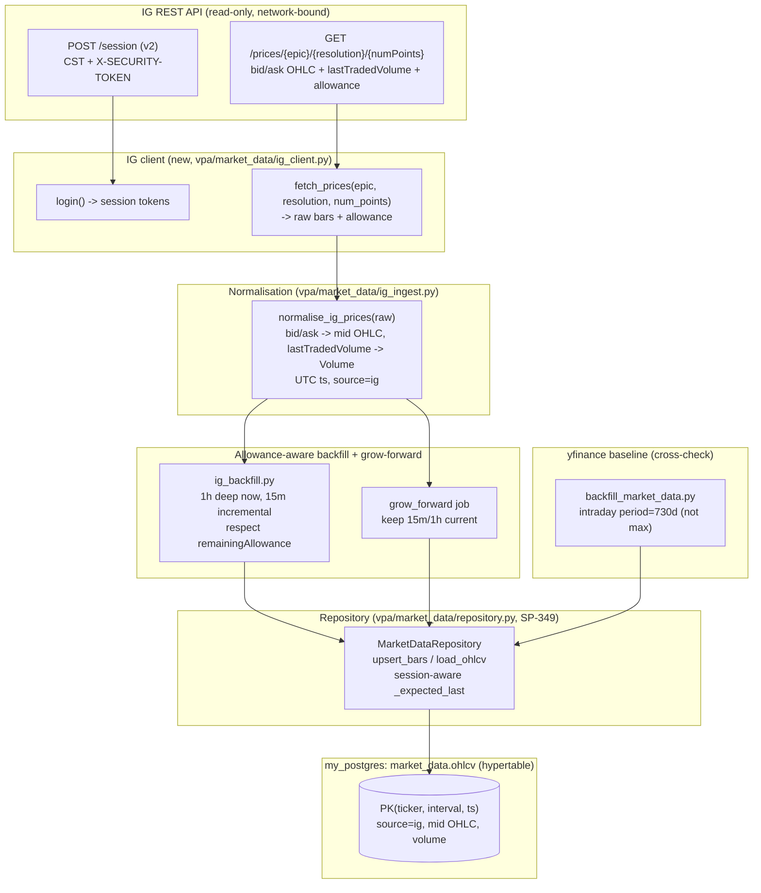
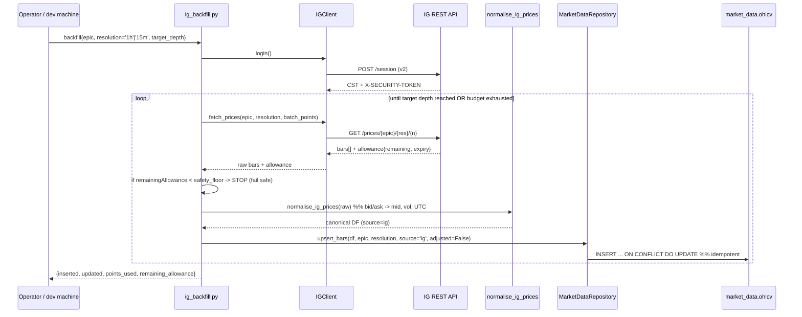
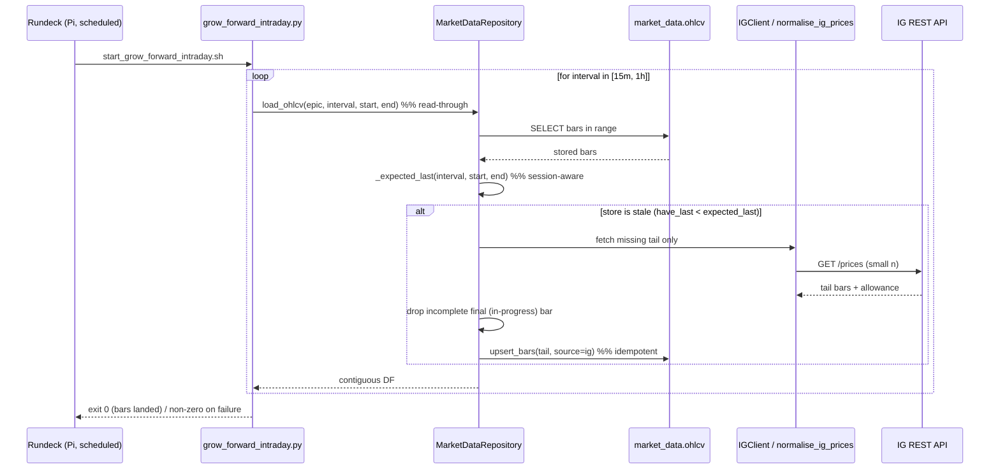
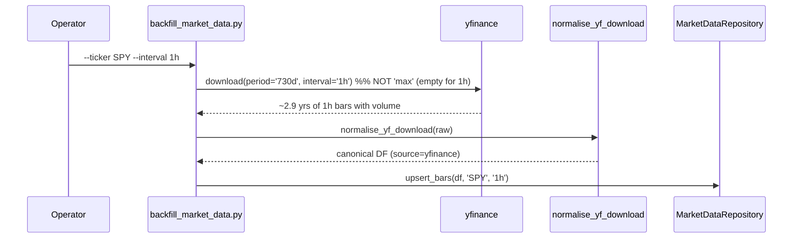

# Design Document: IG Intraday OHLCV Ingestion + Allowance-Aware Backfill (SP-379)

## Overview

SP-379 is the **BUILD** that implements the data-ingestion decision made by the
SP-342 spike: pull intraday OHLCV (15m / 1h / 4h) for the manually-traded **US 500**
spread-bet instrument from the **IG REST API**, normalise it to the canonical OHLCV
shape, and land it in the SP-349 market-data store. It adds an allowance-aware
backfill that seeds history within IG's 10,000-points/week budget, a grow-forward
maintenance job that keeps the store current, a yfinance intraday baseline fix, and
session-aware intraday read-through. This is the data enabler for the 0.7 intraday
spine and **blocks SP-350** (multi-timeframe VPA analysis).

The source, instrument, intervals, and storage are **already decided by SP-342** and
are not re-litigated here (the `4h` interval is the one scope addition made by SP-379 —
sourced from native IG `HOUR_4` if the epic supports it, otherwise derived by resampling
the stored `1h` bars):

- **Source:** IG REST API (live) as the primary intraday source; yfinance 1h as a free
  baseline / cross-check. IG is the real instrument traded manually, carries real
  volume at 15m/1h, and covers out-of-hours — none of which yfinance/SPY can match.
- **Instrument:** IG epic `IX.D.SPTRD.DAILY.IP` ("US 500", SPREADBET, GBP). yfinance
  proxy ticker: `SPY`.
- **Intervals:** `15m`, `1h`, and `4h`, all with **volume** (VPA is volume-driven).
  `15m`/`1h` are pulled natively from IG (SP-342 decision); `4h` is the SP-379 scope
  addition — native IG `HOUR_4` if the epic supports it, else derived by resampling the
  stored `1h` series (zero extra IG allowance in the derived path).
- **Sink:** the SP-349 `market_data.ohlcv` hypertable on the shared `my_postgres`
  server (PK `(ticker, interval, ts)`), reached through `MarketDataRepository`.
- **Binding constraint:** IG historical-data allowance of **10,000 points / week**
  (`allowanceExpiry` ~604800s). A 100-point pull consumes 100 points.

### Scope boundary (read-only)

This build is **strictly read-only** against IG: session login + `GET /prices` only.
No deal/order/position endpoints are implemented or imported. Live order placement and
automated trading are explicitly out of scope.

### Grounding in the existing codebase

The design is grounded in these real files (all under `d:\projects\trading` unless
noted). They were read before writing this design:

- `vpa/market_data/ohlcv_ingest.py` — `normalise_yf_download(raw)` (the canonical
  flatten/rename/dropna/sort), `fetch_yf(ticker, interval, start, end)`,
  `to_store_rows(df, ticker, interval, source, adjusted)` and the
  `_to_utc_bar_open(date_value)` helper (maps a `Date` to a tz-aware UTC bar-open
  `TIMESTAMPTZ`). `CANONICAL_COLUMNS = ["Date","Open","High","Low","Close","Volume"]`.
- `vpa/market_data/repository.py` — `MarketDataRepository` with `upsert_bars`
  (idempotent `ON CONFLICT (ticker,interval,ts) DO UPDATE`, batched commits of 500),
  `get_ohlcv` (offline read), `load_ohlcv` (read-through, fetches only the missing
  tail), `export_ohlcv`, and the `_expected_last(interval, start, end)` /
  `_drop_incomplete_final_bar(df, interval)` hooks. `_expected_last` currently falls
  back to `end` for every non-daily interval (the intraday gap we must close).
- `vpa/market_data/db.py` — `_parse_env_file(env_path)` (the tiny dependency-light
  `.env` parser SP-379 reuses for IG credentials), `_read_db_config`, `validate_env`,
  `connect`. `_DEFAULT_ENV_PATH` points at the project-root `.env`.
- `scripts/backfill_market_data.py` — the existing deepest-history backfill. It calls
  `yf.download(ticker, period="max", ...)`; SP-342 proved `period="max"` returns EMPTY
  for `1h`, so the intraday path must use `period="730d"` (follow-up #3, folded in).
- `vpa/tests/conftest.py` — the `no_network` fixture monkeypatches
  `vpa.market_data.ohlcv_ingest.yf.download` to raise `AssertionError("network access
  attempted")`. SP-379 must add an analogous guard for the IG HTTP layer so the suite
  stays hermetic (no live IG calls in tests).
- `vpa/jobs/Daily_VPA_Check_-_ALL_SP500.yaml` — the existing **Rundeck** job
  definition (cron-like `schedule`, invoking a shell script at
  `/usr/local/trading/vpa/scripts/...` on the Pi). The grow-forward job mirrors this.
- `bf_trader_py/scripts/deploy.sh` (sibling project) — the rebuild-not-repair deploy
  pattern (`git pull` -> validate `.env` -> `docker compose up -d --build` ->
  post-deploy verify) referenced by the ticket-standards deployment DoD.

> **Scheduler note (VERIFIED on the Pi).** A read-only SSH check of the live
> Raspberry Pi (Oct 2026) confirms the scheduler facts this design relies on, so the
> SP-319 "keep Rundeck" decision still holds:
> - **Rundeck is live** as a **direct systemd install** (`rundeckd`, Rundeck 5.10.0,
>   HTTP port 4440) — **not** a Docker container (which is why it never appears in
>   `docker ps`).
> - The **trading repo is deployed on the Pi at `/usr/local/trading`** (git repo
>   present) with the Rundeck entrypoint scripts in place
>   (`start_vpa_all_shares.sh`, `start_vpa.sh`, `start_vpa_forex.sh`).
> - The shared **`my_postgres` container runs `timescale/timescaledb:latest-pg16`**,
>   matching the SP-349 store design.
> - The `vpa/jobs/*.yaml` files are **exported snapshots** — a versioned record in the
>   repo, **not a deploy source**. A new job is installed via the **Rundeck UI/API**
>   (Rundeck keeps jobs in its own internal DB); committing a yaml does not schedule it.
> - The checked-in exports are **current** (operator re-exported them), except
>   `Daily_VPA_Check_-_ALL_SP500` is now **disabled** (`scheduleEnabled: false`); the
>   SPY and Forex (GBP/USD) jobs remain enabled.
>
> This design therefore targets **Rundeck on the Pi** — a new Rundeck job + shell
> entrypoint mirroring the confirmed existing jobs — installed via the Rundeck UI/API,
> with the exported yaml committed as the versioned record.

---

# Part 1 — High-Level Design

## Architecture



**Key architectural idea:** the IG client is a thin, read-only HTTP layer that mirrors
the existing `fetch_yf` -> `normalise_yf_download` -> `to_store_rows` -> `upsert_bars`
pipeline, but for IG. IG's bid/ask OHLC is collapsed to **mid-price** during
normalisation and tagged `source="ig"`, then flows through the *same*
`MarketDataRepository.upsert_bars` and the *same* `(ticker, interval, ts)` idempotency
guarantee as yfinance bars. yfinance 1h remains available as a free baseline/cross-check
under its own `source="yfinance"` rows — the two sources coexist in one table,
distinguished by `source`, never overwriting each other because they share no PK unless
ticker+interval+ts collide (they use different tickers: the IG epic vs `SPY`).
## Components and Interfaces

| Component | Module (proposed) | Responsibility |
|---|---|---|
| IG config/credentials | `vpa/market_data/ig_client.py` (top) | Read `IG_API_KEY` / `IG_USER_ID` / `IG_PWD` (live) or `IG_DEMO_*` (demo) from `.env` via the existing `_parse_env_file`. No new dependency, no hardcoded secrets. `validate_ig_env` reports all missing keys at once (mirrors `db.validate_env`). |
| IG client | `vpa/market_data/ig_client.py` | `IGClient` — read-only. `login()` does `POST /session` (v2), captures `CST` + `X-SECURITY-TOKEN` (12h session, reset-on-use). `fetch_prices(epic, resolution, num_points)` does `GET /prices/...`, returns raw bars + the `allowance` block. **No** deal/order/position methods. |
| IG normalisation | `vpa/market_data/ig_ingest.py` | `normalise_ig_prices(raw)` — map IG bid/ask OHLC to canonical `Date,Open,High,Low,Close,Volume` using **mid-price**, `lastTradedVolume` -> `Volume`, UTC `snapshotTime` -> `Date`. Reuses `ohlcv_ingest.to_store_rows` for the store mapping. |
| Allowance tracking | `vpa/market_data/ig_ingest.py` | `AllowanceState` + `plan_backfill(...)` — translate IG's `allowance.remainingAllowance` into a safe per-run point budget; fail safe *before* exhausting it. |
| Backfill (IG) | `scripts/ig_backfill.py` | Seed 1h deeply now (~2 yrs, well under one week's 10k); seed 15m incrementally across weeks within budget. Idempotent upsert; resumable. |
| Grow-forward job | `vpa/scripts/grow_forward_intraday.py` + `vpa/scripts/start_grow_forward_intraday.sh` | Scheduled job that keeps 15m/1h current via `MarketDataRepository.load_ohlcv` (read-through), landing new bars idempotently. The Rundeck shell entrypoint mirrors the existing jobs. |
| yfinance intraday fix | `scripts/backfill_market_data.py` | Use `period="730d"` for intraday (not `"max"`, which returns EMPTY for `1h` per SP-342). Daily path unchanged. |
| Intraday read-through | `vpa/market_data/repository.py` | Make `_expected_last` session-aware for intraday instead of blindly returning `end`. |

## Data Models

**No new schema** — SP-379 reuses the SP-349 `market_data.ohlcv` table.

SP-379 adds **no schema change**. The SP-349 table is already interval-ready and
source-tagged:

```sql
-- market_data.ohlcv (SP-349) — reused as-is
--   ticker      TEXT         -- 'IX.D.SPTRD.DAILY.IP' (IG) or 'SPY' (yfinance baseline)
--   interval    TEXT         -- '15m' | '1h' | '4h'  (free-text tag; no structural change)
--   ts          TIMESTAMPTZ  -- bar OPEN time, UTC
--   open/high/low/close  DOUBLE PRECISION   -- IG: MID price; yfinance: as provided
--   volume      DOUBLE PRECISION             -- IG: lastTradedVolume
--   adjusted    BOOLEAN      -- IG bars are not auto-adjusted -> FALSE
--   source      TEXT         -- 'ig' | 'yfinance'
--   PRIMARY KEY (ticker, interval, ts)
```

**Conventions SP-379 commits to:**
- **Ticker tag:** IG bars are stored under the **epic string** `IX.D.SPTRD.DAILY.IP`
  so they never collide with the yfinance `SPY` baseline. (Rationale surfaced in Design
  Decisions.)
- **Interval tags:** `'15m'`, `'1h'`, and `'4h'` — the exact tags SP-349 anticipated
  (SP-349 Decision #4 explicitly reserved `4h` as interval-ready). `4h` bars are either a
  native IG `HOUR_4` pull or derived by resampling the stored `1h` series; either way they
  carry `interval="4h"`.
- **Price stored:** **mid-price** `= (bid + ask) / 2` per OHLC field (SP-342 decision;
  revisit bid if fills matter — captured as an explicit decision).
- **`adjusted=FALSE`** for IG bars (spread-bet prices are not corporate-action adjusted
  the way yfinance `auto_adjust` series are). The yfinance baseline stays `TRUE`.
- **`source="ig"`** for IG bars; the yfinance baseline keeps `source="yfinance"`.
- **`ts`** is the bar-open instant in **UTC**, derived from IG's `snapshotTime`.
## Sequence Flows

### Flow A — IG allowance-aware backfill (seed history)



### Flow B — Grow-forward maintenance (keep current)



### Flow C — yfinance baseline (cross-check, free)



---

# Part 2 — Low-Level Design

## Module Layout

```
vpa/market_data/
    ig_client.py        # IG credentials + IGClient (read-only: login, fetch_prices)
    ig_ingest.py        # normalise_ig_prices(), probe_hour4(), resample_1h_to_4h(), AllowanceState, plan_backfill()
    repository.py        # (edit) _expected_last session-aware for intraday
    ohlcv_ingest.py      # (reuse) to_store_rows, _to_utc_bar_open, CANONICAL_COLUMNS
scripts/
    ig_backfill.py       # allowance-aware IG backfill (1h deep, 15m incremental)
    backfill_market_data.py   # (edit) intraday period=730d fix
vpa/scripts/
    grow_forward_intraday.py           # grow-forward entrypoint (uses load_ohlcv)
    start_grow_forward_intraday.sh     # Rundeck shell entrypoint (mirrors existing)
vpa/jobs/
    Grow_Forward_Intraday_IG.yaml      # new Rundeck job definition
vpa/tests/
    test_ig_client.py    # client login/fetch against mocked HTTP (no live calls)
    test_ig_ingest.py    # normalisation, mid-price, allowance planning (+ hypothesis)
    test_repository_intraday.py   # session-aware _expected_last behaviour
```

Language is **Python** throughout (the whole trading codebase is Python; `pandas` /
`psycopg2` already the stack). The IG client uses `requests` (already a transitive
dependency via yfinance; confirm in `requirements.txt` during Task 0 and pin if it is
not already a direct dependency — no exotic new package).

## 1. IG config + client (`vpa/market_data/ig_client.py`)

Credentials are read from `.env` via the existing `_parse_env_file` — **no new
dependency, no hardcoded secrets**. Live uses `IG_API_KEY` / `IG_USER_ID` / `IG_PWD`;
demo uses `IG_DEMO_API_KEY` / `IG_DEMO_USER_ID` / `IG_DEMO_PWD`. A `demo` flag selects
the key set and the base URL (`https://demo-api.ig.com` vs `https://api.ig.com`).

```python
IG_LIVE_KEYS = ["IG_API_KEY", "IG_USER_ID", "IG_PWD"]
IG_DEMO_KEYS = ["IG_DEMO_API_KEY", "IG_DEMO_USER_ID", "IG_DEMO_PWD"]
IG_LIVE_BASE = "https://api.ig.com/gateway/deal"
IG_DEMO_BASE = "https://demo-api.ig.com/gateway/deal"
SESSION_TTL_S = 12 * 60 * 60   # IG session ~12h; reset-on-use

def read_ig_config(demo: bool, env_path: str | None = None) -> dict:
    """Read IG_* (or IG_DEMO_*) from .env via _parse_env_file. Missing -> "" so
    validate_ig_env can report the full offending set (mirrors db.validate_env)."""

def validate_ig_env(config: dict, required_keys: list[str]) -> list[str]:
    """Return the subset of required_keys that are missing/empty."""

class IGClient:
    """Read-only IG REST client. Implements ONLY session login + GET /prices.
    No deal/order/position methods exist on this class by design (scope: read-only)."""

    def __init__(self, *, demo: bool = False, env_path=None, http=requests):
        # `http` is injectable so tests pass a mock transport (hermeticity, no live calls).

    def login(self) -> None:
        """POST {base}/session (v2) with X-IG-API-KEY header + {identifier, password}.
        Capture CST + X-SECURITY-TOKEN from response headers. Raise IGAuthError on
        non-200. Session cached with an expiry; re-login on expiry (reset-on-use)."""

    def fetch_prices(self, epic: str, resolution: str, num_points: int) -> dict:
        """GET {base}/prices/{epic}/{resolution}/{num_points} with auth headers +
        Version:2. Return {'prices': [...], 'allowance': {...}} parsed from JSON.
        resolution in {'MINUTE_15','HOUR'}. Read-only; never mutates account state."""
```

**Hermeticity (mirrors `no_network`).** `IGClient` takes an injectable `http`
transport. Tests inject a fake; a new autouse-opt-in guard (`no_ig_network`) in
`conftest.py` monkeypatches the real transport to raise `AssertionError("IG network
access attempted")`, so no test can reach live IG — the same defence-in-depth the
`no_network` fixture gives yfinance.

**Formal spec — `login`:**
- Preconditions: `validate_ig_env` returns `[]`.
- Postconditions: on success, `CST` and `X-SECURITY-TOKEN` are held with an expiry
  `now + SESSION_TTL_S`; no account-state mutation. On non-200, raises `IGAuthError`
  and holds no tokens.

**Formal spec — `fetch_prices`:**
- Preconditions: a valid (non-expired) session, else `login()` is invoked first.
- Postconditions: returns the parsed `prices` + `allowance`; performs exactly one
  `GET /prices` request; never calls a deal/order endpoint.

## 2. IG normalisation + mid-price (`vpa/market_data/ig_ingest.py`)

IG returns each OHLC field as a `{bid, ask, lastTraded}` object (`lastTraded` null on
the index) plus `lastTradedVolume` and a `snapshotTime`. Normalisation collapses
bid/ask to **mid** and reuses the SP-349 store mapping.

```python
IG_RESOLUTION = {"15m": "MINUTE_15", "1h": "HOUR", "4h": "HOUR_4"}  # our tag -> IG resolution
                                                     # (HOUR_4 used ONLY if the native probe succeeds)
IG_SNAPSHOT_FMT = "%Y:%m:%d-%H:%M:%S"                # IG snapshotTime format (UTC)

def _mid(field: dict) -> float:
    """mid = (bid + ask) / 2 for one IG OHLC field object. Raises if both are None."""

def normalise_ig_prices(raw: dict) -> pd.DataFrame:
    """Map an IG /prices payload to the canonical CANONICAL_COLUMNS DataFrame.

    For each bar in raw['prices']:
      Date   <- parse snapshotTime as UTC (tz-aware)
      Open   <- _mid(openPrice);  High <- _mid(highPrice)
      Low    <- _mid(lowPrice);   Close <- _mid(closePrice)
      Volume <- lastTradedVolume (float; None -> NaN, dropped by canonical dropna)
    Then: dropna(OHLCV), sort ascending by Date, return exactly CANONICAL_COLUMNS.
    Pure (no network). Mirrors normalise_yf_download's output contract so the rows
    flow through the SAME to_store_rows / upsert_bars path."""
```

**Normalisation pseudocode:**

```pascal
FUNCTION normalise_ig_prices(raw):
    rows <- []
    FOR bar IN raw["prices"] DO
        ts   <- parse_utc(bar["snapshotTime"], IG_SNAPSHOT_FMT)
        rows.append({
            Date:   ts,
            Open:   mid(bar["openPrice"]),
            High:   mid(bar["highPrice"]),
            Low:    mid(bar["lowPrice"]),
            Close:  mid(bar["closePrice"]),
            Volume: bar["lastTradedVolume"]
        })
    END FOR
    df <- DataFrame(rows)
    df <- df.dropna(subset=[Open,High,Low,Close,Volume])
    df <- df.sort_values("Date").reset_index(drop=True)
    RETURN df[CANONICAL_COLUMNS]
```

The resulting DataFrame is handed to the existing
`MarketDataRepository.upsert_bars(df, epic, interval, source="ig", adjusted=False)`,
which calls `to_store_rows` -> `_to_utc_bar_open` (already tz-aware-safe) -> the
idempotent `ON CONFLICT` upsert. **No change to `ohlcv_ingest.to_store_rows` is
required** — it already coerces OHLC/volume and maps `Date` to a UTC `TIMESTAMPTZ`.

### 2a. 4h sourcing — native-probe-then-derive (`vpa/market_data/ig_ingest.py`)

`4h` is the SP-379 scope addition. IG's documented `/prices/{epic}/{resolution}/{numPoints}`
resolution enum DOES include `HOUR_4` (full set: `MINUTE, MINUTE_2, MINUTE_3, MINUTE_5,
MINUTE_10, MINUTE_15, MINUTE_30, HOUR, HOUR_2, HOUR_3, HOUR_4, DAY, WEEK, MONTH`, per the
[IG Labs reference](https://labs.ig.com/reference/prices-epic-resolution-numpoints.html)),
but SP-342 only empirically validated `MINUTE_15` and `HOUR` for THIS epic, so whether
`HOUR_4` returns usable OHLC + volume for `IX.D.SPTRD.DAILY.IP` is **unverified until
probed at build time**. The design therefore commits to **native-if-available, else
derive-from-1h**:

```python
def probe_hour4(client, epic) -> bool:
    """Probe IG once for HOUR_4 on `epic`. Return True iff IG returns usable OHLC +
    volume (non-empty prices with mid-computable OHLC and a lastTradedVolume). Pure
    read: a single small GET /prices via the injected client transport."""

def resample_1h_to_4h(df_1h: pd.DataFrame) -> pd.DataFrame:
    """Derive canonical 4h bars from the stored 1h series on a fixed 4-hour grid aligned
    to the session. For each 4-hour window: Open = first 1h Open, High = max High,
    Low = min Low, Close = last 1h Close, Volume = sum of 1h Volume. Label each 4h bar
    by its bar-OPEN ts in UTC (the existing bar-open convention). Returns exactly
    CANONICAL_COLUMNS. Pure (no network); operates on the store, not a separate IG pull."""
```

**4h resample pseudocode (fallback path):**

```pascal
FUNCTION resample_1h_to_4h(df_1h):
    df_1h <- df_1h.sort_values("Date")           // ascending by bar-open
    windows <- group df_1h rows into fixed 4-hour windows aligned to the session grid
    rows <- []
    FOR EACH window IN windows DO
        IF window is empty THEN CONTINUE          // no 1h bars -> no 4h bar
        rows.append({
            Date:   window.first.Date,            // bar-OPEN ts of the first 1h bar (UTC)
            Open:   window.first.Open,
            High:   max(window.High),
            Low:    min(window.Low),
            Close:  window.last.Close,
            Volume: sum(window.Volume)
        })
    END FOR
    df <- DataFrame(rows).sort_values("Date").reset_index(drop=True)
    RETURN df[CANONICAL_COLUMNS]
```

Either path (native `HOUR_4` or derived) produces a canonical DataFrame handed to the
same `MarketDataRepository.upsert_bars(df, epic, "4h", source="ig", adjusted=False)`
path, so `4h` bars carry `source="ig"`, `interval="4h"`, `adjusted=FALSE`, bar-open UTC
`ts` — identical storage contract to `15m`/`1h`. The native path spends IG allowance like
`1h` (small, ~one point per bar); the **derived path spends ZERO extra allowance** because
it reads the already-stored `1h` series rather than issuing a fresh IG pull. The `1h`
series must be present/current first (the backfill seeds `1h` deeply), so in the fallback
path `4h` is produced from the store, not from a separate IG request.

## 3. Allowance-aware planning (`vpa/market_data/ig_ingest.py`)

```python
WEEKLY_ALLOWANCE = 10_000          # IG historical-data points / week (SP-342)
SAFETY_FLOOR = 500                 # stop before this many points remain (fail safe)

@dataclass
class AllowanceState:
    remaining: int                 # allowance.remainingAllowance from last response
    expiry_s: int                  # allowance.allowanceExpiry (seconds to reset)

def plan_backfill(target_points: int, batch_points: int,
                  state: AllowanceState) -> dict:
    """Decide how much to pull this run WITHOUT exhausting the weekly allowance.

    budget   = max(0, state.remaining - SAFETY_FLOOR)
    this_run = min(target_points, budget)         # never spend into the floor
    batches  = ceil(this_run / batch_points)
    returns {'this_run': this_run, 'batches': batches,
             'deferred': target_points - this_run}  # deferred -> future weeks
    """
```

**Backfill strategy (concrete, from SP-342 numbers):**
- **1h deep now:** ~2 yrs ≈ **3.5k points** — a single run fits comfortably under one
  week's 10k budget. Run once (from the dev machine is fine; it writes to the shared Pi
  store).
- **15m incremental:** ~2 yrs ≈ **50k points** ≈ 5+ weekly budgets. Seed in weekly
  slices: each run spends down to `SAFETY_FLOOR`, records how far back it reached, and
  the next run (next week, once allowance resets) resumes from there. Resumability comes
  for free from the idempotent PK — re-pulling an overlapping window inserts nothing new.

**Fail-safe invariant:** a run **must not** drive `remainingAllowance` below
`SAFETY_FLOOR`. `plan_backfill` enforces this before any fetch, and the backfill loop
re-checks the live `allowance.remainingAllowance` after each batch and stops early if a
batch consumed more than projected.

## 4. Session-aware intraday `_expected_last` (`repository.py` edit)

Today `_expected_last` returns `end` for every non-daily interval, so the read-through
can never detect an intraday gap correctly (it thinks the store should always be
current to `end`, even outside market hours). SP-379 makes it session-aware for the
US 500 trading calendar.

```python
INTRADAY_MINUTES = {"15m": 15, "1h": 60}

@staticmethod
def _expected_last(interval, start, end):
    if interval == "1d":
        ... # unchanged (business-day logic)
    if interval in INTRADAY_MINUTES:
        # The last COMPLETED bar-open on/before `end`, floored to the interval grid
        # within the instrument's trading session. Out-of-hours, this is the last
        # bar of the most recent session, NOT `end`. US 500 spread bet trades nearly
        # 24x5, so the session calendar is "weekday, excluding the ~1h daily break";
        # the floor-to-grid + weekend exclusion is sufficient for gap detection.
        return _floor_to_session_grid(end, INTRADAY_MINUTES[interval])
    # Non-intraday, non-daily fallback: previous behaviour (end).
    return _normalise_end(end)
```

`_drop_incomplete_final_bar` (already a hook) is wired to drop the in-progress final
intraday bar before persisting — so a mid-bar grow-forward run never stores a partial
bar. For daily it stays a no-op (the day closes before the scheduled run).

**Formal spec — intraday `_expected_last`:**
- Returns the open-time of the last **completed** `interval` bar at or before `end`
  within a trading session; returns `None` when `[start, end]` contains no session
  time (e.g. a weekend-only range), so no tail fetch is triggered.
- Monotonic: a later `end` never yields an earlier expected-last.

## 5. Grow-forward job (`vpa/scripts/grow_forward_intraday.py`)

```python
EPIC = "IX.D.SPTRD.DAILY.IP"
INTERVALS = ["15m", "1h", "4h"]

def grow_forward(epic=EPIC, intervals=INTERVALS, repo=None, now=None) -> dict:
    """For each interval, read-through load_ohlcv over a recent window so only the
    missing tail is fetched from IG and upserted idempotently. Returns a per-interval
    summary {interval: {fetched, inserted, updated}} and exits non-zero on failure so
    Rundeck surfaces the failure.

    4h handling: if the build-time probe found native HOUR_4 support, 4h grows forward
    exactly like 15m/1h (read-through tail fetch from IG). If 4h is DERIVED, grow-forward
    does NOT make a separate IG call for 4h — after the 1h tail is refreshed it
    recomputes/upserts the affected 4h bars from the freshly-updated 1h tail
    (resample_1h_to_4h), which is idempotent via the (ticker, interval, ts) PK and costs
    zero extra IG allowance. 1h is therefore grown forward before 4h in the derived
    path."""
```

The read-through is wired to IG by giving `MarketDataRepository` an injectable
intraday fetcher (defaulting to an IG-backed `fetch_prices` adapter) so `load_ohlcv`'s
"fetch the missing tail" step uses IG for `source="ig"` tickers while the daily path
keeps using `fetch_yf`. This keeps the one read-through algorithm; only the tail
fetcher differs by source.

The Rundeck entrypoint `start_grow_forward_intraday.sh` mirrors
`start_vpa_all_shares.sh` (activate venv, `cd /usr/local/trading`, run the module,
propagate exit code). `Grow_Forward_Intraday_IG.yaml` follows the **confirmed** Rundeck
export shape (verified from the current exports): a single-item YAML list whose entry
carries `name`, `id`, `uuid`, `description`, `loglevel`, `defaultTab: nodes`,
`executionEnabled: true`, `nodeFilterEditable: false`, `plugins: {ExecutionLifecycle: {}}`,
`scheduleEnabled`, a `schedule` block (`month: '*'`, `time: {hour, minute, seconds}`,
`weekday: {day}`, `year: '*'`), and a `sequence.commands[].scriptfile` pointing at
`/usr/local/trading/vpa/scripts/start_grow_forward_intraday.sh` with `keepgoing: false`
and `strategy: node-first`. Following the observed cron conventions (weekday jobs use
`weekday.day: '2,3,4,5,6'` = Mon–Fri; the SPY job uses `'*'`), the intraday job uses the
weekday pattern `weekday.day: '2,3,4,5,6'` with an **hourly-across-the-session** cadence
(instead of the daily jobs' single morning fire); the exact hours are set with the
operator at install time. The yaml is a **versioned snapshot committed to the repo** —
the job itself is installed via the **Rundeck UI/API**, and the yaml is re-exported after
install to keep the record current.

## Design Decisions (surfaced explicitly)

1. **IG epic string as the `ticker` tag (CONFIRMED default).** IG bars are stored under
   `IX.D.SPTRD.DAILY.IP`, not `SPY`. Rationale: it is the real traded instrument, keeps
   IG bars PK-distinct from the yfinance `SPY` baseline, and makes `source` + `ticker`
   together unambiguous. Consumers select IG data by that ticker explicitly.
2. **Mid-price stored by default (SP-342 decision).** `(bid + ask) / 2` per OHLC field.
   Revisit storing the **bid** series (as separate rows or a second source tag) only if
   fill-accuracy matters for execution — out of scope now, noted as a future option.
3. **`adjusted = FALSE` for IG.** Spread-bet prices are not corporate-action adjusted;
   flagging them `FALSE` keeps them honestly distinct from the yfinance `auto_adjust`
   baseline.
4. **Fail safe before the allowance floor.** The backfill never spends `remaining`
   below `SAFETY_FLOOR` (default 500), so an accidental over-pull cannot lock the
   account out of historical data for the rest of the week.
5. **Read-only client, enforced by omission.** `IGClient` has no deal/order/position
   method at all — the read-only guarantee is structural, not a runtime check.
6. **Scheduler = Rundeck on the Pi** (see the scheduler note in Part 1): now **VERIFIED
   live on the Pi** (direct systemd install, `rundeckd` 5.10.0, port 4440) — not merely
   inferred from the SP-319 decision. Matches the existing `vpa/jobs/*.yaml` export
   pattern, rather than a hypothetical replacement.
7. **4h: native IG `HOUR_4` preferred if the epic supports it, else derived from 1h
   (SP-379 scope addition).** IG's documented resolution enum includes `HOUR_4`
   ([IG Labs reference](https://labs.ig.com/reference/prices-epic-resolution-numpoints.html)),
   but SP-342 only empirically validated `MINUTE_15` and `HOUR` for this epic, so support
   is **probed at build time**. If the native probe returns usable OHLC + volume, `4h` is
   pulled natively on the same path as `15m`/`1h`. Otherwise `4h` is **derived by
   resampling the stored `1h` series** (`Open` = first `1h` Open, `High` = max, `Low` =
   min, `Close` = last `1h` Close, `Volume` = sum, over a fixed 4-hour grid aligned to the
   session, labelled by the bar-OPEN ts in UTC). The derived path costs **zero extra IG
   allowance** and is deterministic — exactly what **SP-349 Decision #4** anticipated
   ("4h is derived (resample from 1h) later ... the schema is already interval-ready").
   Either path stores `source="ig"`, `interval="4h"`, `adjusted=FALSE`.

## Error Handling

| Scenario | Response | Recovery |
|---|---|---|
| Missing IG `.env` keys | `validate_ig_env` returns the full missing set; backfill/job exits non-zero before any HTTP call | Operator adds `IG_*` keys to the Pi `.env` |
| IG `POST /session` non-200 | `IGClient.login` raises `IGAuthError`; no tokens held | Check creds / demo-vs-live base URL; retry |
| Session token expired mid-run | reset-on-use: `fetch_prices` re-logins transparently | Inherent |
| `remainingAllowance` near floor | `plan_backfill` / loop stops early, reports `deferred` points | Resume next week after allowance reset (idempotent) |
| IG returns empty `prices` | normalisation yields empty DF; upsert is a no-op; warning logged | Next scheduled run retries |
| IG `HOUR_4` not supported for the epic (probe fails/empty) | fall back to deriving `4h` from the stored `1h` series via `resample_1h_to_4h`; no native 4h IG call made | Inherent (derive path; zero extra allowance) |
| Partial in-progress final bar | `_drop_incomplete_final_bar` drops it before persist | Inherent |
| Duplicate bar re-pulled | `ON CONFLICT DO UPDATE` — one row, refreshed `ingested_at` | Inherent (resumability) |
| yfinance `max` empty for 1h | fixed: intraday uses `period="730d"` | Inherent (the fix) |

## Testing Strategy

Per the workspace testing steering: the fast suite stays green (`pytest`), and
`pytest -m ""` (full, incl. slow) is run before any push / PR / marking Done. Ruff lint
+ format checks run before the final test run. **No live IG calls in the suite** —
respect the `no_network` pattern and add `no_ig_network`.

- **Unit (mocked HTTP):** `IGClient.login` captures tokens from mocked response headers;
  `fetch_prices` builds the right URL/headers and parses `prices` + `allowance`;
  `IGClient` has no order/deal attribute (assert the read-only surface).
- **Unit (pure):** `_mid` on bid/ask objects; `normalise_ig_prices` on a representative
  IG payload (mid computation, UTC `snapshotTime` parse, `lastTradedVolume` -> Volume,
  dropna, sort, exact `CANONICAL_COLUMNS`); `plan_backfill` budget maths.
- **Property-based (hypothesis, already a dependency):** for arbitrary bid/ask pairs,
  `_mid` is within `[min(bid,ask), max(bid,ask)]`; `plan_backfill(this_run)` never
  exceeds `max(0, remaining - SAFETY_FLOOR)` and never exceeds `target_points`;
  `normalise_ig_prices` output is sorted ascending and has exactly the canonical columns.
- **Repository intraday:** `_expected_last` for `15m`/`1h` returns the last completed
  session bar (not `end`) and `None` for weekend-only ranges; read-through fetches only
  the missing tail via the injected IG fetcher (asserted with a fake that records calls).
- **Idempotency:** upserting the same IG bars twice changes the row set by zero; a
  resumed 15m seed over an overlapping window inserts nothing new.
- **4h resample integrity (Property 9):** `resample_1h_to_4h` on a representative/arbitrary
  1h series yields `Open`=first, `High`=max, `Low`=min, `Close`=last, `Volume`=sum per
  4-hour window, labelled by bar-open UTC; derived (and native) 4h rows carry
  `source="ig"`, `interval="4h"`, `adjusted=FALSE`. `probe_hour4` falls back to the derive
  path when the mocked IG transport returns empty/unsupported for `HOUR_4`.

## Deployment (Pi is prod) — Definition of Done

Per the ticket-standards "Definition of Done for deployable work", SP-379 is **not
Done until deployed and verified on the Raspberry Pi**. Until then it sits in
**Mostly Done**. Steps (see the `pi-access` steering for how to reach the Pi — SSH is
read-only by default; the actual deploy/write steps require explicit operator
go-ahead):

1. Live `IG_*` credentials present in the Pi's `.env` (gitignored, never committed).
2. Ingestion code pulled onto the Pi and the container rebuilt via the project's deploy
   mechanism (mirrors `bf_trader_py/scripts/deploy.sh`: `git pull` -> validate `.env`
   -> `docker compose up -d --build` -> post-deploy verify).
3. The grow-forward Rundeck job is installed and scheduled **on the Pi** (not just this
   dev machine) and runs.
4. Verify 15m/1h bars with `source='ig'` actually land in the Pi `my_postgres` store
   (spot-check row counts / latest `ts` via a read-only `psql` SELECT).
5. Completion comment on SP-379 notes the deploy was done and verified.

**Dev-vs-prod split (allowed):** development, the test suite, and the **initial deep 1h
backfill** may be run from this Windows dev machine against the shared Pi store. Only
the recurring grow-forward job must run on the Pi.

## Example Usage

```python
# One-off deep 1h backfill (dev machine OK; writes to shared Pi store)
#   python scripts/ig_backfill.py --epic IX.D.SPTRD.DAILY.IP --interval 1h --years 2

# Incremental 15m seed (run weekly until target depth reached; resumable)
#   python scripts/ig_backfill.py --epic IX.D.SPTRD.DAILY.IP --interval 15m --years 2

# 4h seed: native HOUR_4 if the probe succeeds (spends allowance like 1h), else
# derived from the already-stored 1h series (ZERO extra IG allowance)
#   python scripts/ig_backfill.py --epic IX.D.SPTRD.DAILY.IP --interval 4h --years 2

# yfinance 1h baseline cross-check (free)
#   python scripts/backfill_market_data.py --ticker SPY --interval 1h

# Grow-forward (what Rundeck runs on the Pi)
#   python -m vpa.scripts.grow_forward_intraday
```


## Correctness Properties

Invariants the implementation must uphold; each maps to a hypothesis / unit test in the
Testing Strategy. Requirement references point at the requirements.md authored from this
design.

### Property 1: Mid is bracketed
For any OHLC field, `_mid(field)` lies in `[min(bid, ask), max(bid, ask)]`; with
`bid == ask` it equals both.
**Validates: Requirements 2.2**

### Property 2: Canonical output shape
`normalise_ig_prices(raw)` always returns exactly `CANONICAL_COLUMNS` in order, sorted
ascending by `Date`, with no NaN in any OHLCV column (rows missing a value are dropped).
**Validates: Requirements 2.1, 2.3**

### Property 3: UTC bar-open
Every stored IG `ts` is tz-aware UTC and equals the bar-open instant parsed from
`snapshotTime`; no naive timestamps reach the store.
**Validates: Requirements 2.4**

### Property 4: Idempotent ingestion
Upserting the same IG bars twice changes the row count by zero; re-pulling an
overlapping backfill window inserts no new rows (PK invariant on `(ticker, interval, ts)`).
**Validates: Requirements 3.4, 5.2**

### Property 5: Allowance never over-spent
`plan_backfill(...).this_run` satisfies `0 <= this_run <= target_points` and
`this_run <= max(0, remaining - SAFETY_FLOOR)`; a run never drives `remainingAllowance`
below `SAFETY_FLOOR`.
**Validates: Requirements 3.1, 3.2, 3.3**

### Property 6: Session-aware expectation
Intraday `_expected_last` returns the last *completed* session bar-open on/before `end`
(never `end` itself mid-bar or out-of-hours) and `None` for a range containing no
session time; it is monotonic in `end`.
**Validates: Requirements 5.1**

### Property 7: Read-only surface
`IGClient` exposes only `login` and `fetch_prices`; it has no attribute or method that
places, amends, or closes a deal/order/position.
**Validates: Requirements 1.3**

### Property 8: Source isolation
IG rows (`source="ig"`, ticker = epic) and the yfinance baseline (`source="yfinance"`,
ticker = `SPY`) never overwrite each other.
**Validates: Requirements 2.5, 4.2**

### Property 9: 4h resample integrity
For any contiguous `1h` series, a derived `4h` bar has `Open` = the first `1h` bar's
`Open`, `High` = max of the window's `High`, `Low` = min of the window's `Low`,
`Close` = the last `1h` bar's `Close`, and `Volume` = the sum of the window's `Volume`,
over its fixed 4-hour window, labelled by the bar-OPEN ts in UTC. Whether sourced
natively (`HOUR_4`) or derived, every `4h` bar carries `source="ig"`, `interval="4h"`,
and `adjusted=FALSE`.
**Validates: Requirements 2.6, 3.5, 5.4**
