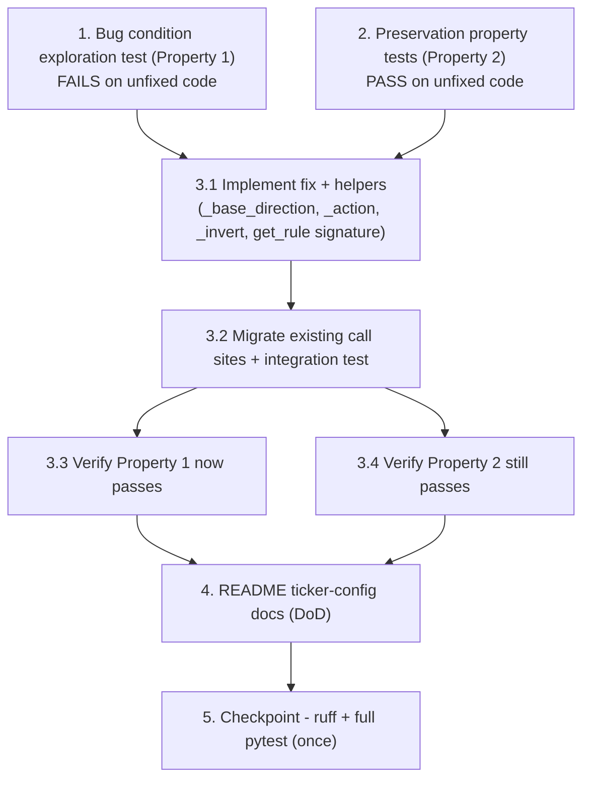

# Implementation Plan

Jira: SP-360 (In Progress, sprint Sienna). Branch `SP-360-signal-direction-derivation`,
commits prefixed `SP-360: ...`.

Fix target: `scripts/import_ticker_signals.py`. Tests extend the existing
`vpa/tests/test_ticker_config.py`. Base-direction symbols (`SignalType`, `SignalDirection`,
`SIGNAL_DIRECTIONS`) import from `vpa.ml_validation.signal_analysis`. Follow the design's
two-phase testing strategy: surface the bug on the UNFIXED code first, then fix and preserve.

- [x] 1. Write bug condition exploration test
  - **Property 1: Bug Condition** - adjusted_direction is derived from base direction and band
  - **CRITICAL**: This test MUST FAIL on unfixed code — failure confirms the bug exists
  - **DO NOT attempt to fix the test or the code when it fails** at this step
  - **NOTE**: This test encodes the expected behaviour — it validates the fix once it passes after implementation
  - **GOAL**: Surface counterexamples proving `get_rule` hardcodes `"BUY"` independent of `SIGNAL_DIRECTIONS`
  - **Scoped PBT Approach**: the buggy region is a small closed set; scope assertions to the three concrete `(base, band)` combinations from the design
  - Add tests to `vpa/tests/test_ticker_config.py`. Because unfixed `get_rule(row)` takes only `row`, express these at the `build_ticker_config` level (which carries the `signal_type` string) so they run against both old and new code:
    - DOWN strong-signal: `signal_type="distribution"`, `hit_rate=0.62`, `p_value=0.01` -> expect `adjusted_direction == "SELL"` *(Req 2.1)*
    - DOWN weak-edge: `signal_type="strong_bearish"`, `hit_rate=0.57`, `p_value=0.02` -> expect `"SELL"` *(Req 2.5)*
    - UP contrarian: `signal_type="accumulation"`, `hit_rate=0.40`, `p_value=0.01` -> expect `"SELL"` (invert UP -> DOWN) *(Req 2.2)*
  - Confirm the base directions of `distribution`/`strong_bearish` (DOWN) and `accumulation` (UP) against `SIGNAL_DIRECTIONS` before asserting
  - Run on UNFIXED code: `& "d:\projects\trading\.venv\Scripts\python.exe" -m pytest vpa/tests/test_ticker_config.py`
  - **EXPECTED OUTCOME**: these three assertions FAIL (unfixed code emits `"BUY"`) — this is correct and proves the bug
  - Document the counterexamples found (unfixed `build_ticker_config` returns `"BUY"` for all three)
  - Mark complete when the test is written, run, and the failure is documented
  - _Requirements: 1.1, 1.2, 1.3, 1.4; Design Property 1 (Fix Checking)_

- [x] 2. Write preservation property tests (BEFORE implementing fix)
  - **Property 2: Preservation** - non-buggy inputs behave identically
  - **IMPORTANT**: Follow the observation-first methodology — observe UNFIXED outputs, then assert the fixed code matches
  - Add to `vpa/tests/test_ticker_config.py`. Observe and record outputs on the unfixed code for the non-buggy region, then encode them:
    - DOWN contrarian still BUY: `distribution`, `hit_rate=0.40`, `p_value=0.01` -> `"BUY"` (the AAPL case) *(Req 2.4, 3.3)*
    - UP strong-signal still BUY: `accumulation`, `hit_rate=0.62`, `p_value=0.01` -> `"BUY"` *(Req 2.3)*
    - UP weak-edge still BUY: `accumulation`, `hit_rate=0.57`, `p_value=0.02` -> `"BUY"`
    - Noise band still NONE: `hit_rate=0.50`, `p_value=0.01` -> `{"adjusted_direction": "NONE"}` *(Req 3.1)*
    - Not significant still NONE: `hit_rate=0.40`, `p_value=0.20` -> `{"adjusted_direction": "NONE"}` *(Req 3.2)*
    - Missing hit_rate still NONE: `hit_rate=NaN`, `p_value=0.01` -> `{"adjusted_direction": "NONE"}` *(Req 3.2)*
    - Unknown `signal_type` -> NONE, no raise: `build_ticker_config` with `signal_type="mystery_signal"`, `hit_rate=0.62`, `p_value=0.01` -> `{"adjusted_direction": "NONE"}` and no exception *(Req 2.6, 3.6)*
    - confidence_level / suggested_hold_days unchanged per actionable band (contrarian `"High"` if `hit_rate<0.35` else `"Medium-High"`; strong-signal `"High"`; weak-edge `"Low-Medium"`; hold-days from `horizon_days`) *(Req 3.4)*
    - `build_ticker_config` grouping / NONE fallback when `select_row` returns None unchanged *(Req 3.6)*
  - **Property-based test (hypothesis, already used in this repo)**: add ONE focused property over the NON-buggy region — generate `(base_direction, hit_rate, p_value, horizon_days)` closed over `SIGNAL_DIRECTIONS` keys, restricted to the complement of the bug condition, and assert the derived action equals the original hardcoded result (`"BUY"` for non-buggy actionable bands, `"NONE"` otherwise). Keep generators small and proportional to this single-function change
  - **Optional**: a second hypothesis property over the buggy region asserting `action(invert(base))` for contrarian and `action(base)` for strong-signal/weak-edge (the Fix Checking property)
  - Leave the existing `select_row` tests untouched *(Req 3.5)*
  - Run on UNFIXED code
  - **EXPECTED OUTCOME**: all preservation tests PASS on unfixed code (confirms the baseline to preserve). The unknown-type test must also pass (unfixed code hits the NONE path without raising)
  - Mark complete when tests are written, run, and passing on unfixed code
  - _Requirements: 2.3, 2.4, 2.6, 3.1, 3.2, 3.3, 3.4, 3.5, 3.6; Design Property 2 (Preservation Checking)_

- [x] 3. Fix: derive adjusted_direction from base direction and band in `scripts/import_ticker_signals.py`

  - [x] 3.1 Implement the derivation and helpers
    - Add imports from `vpa.ml_validation.signal_analysis`: `SignalType`, `SignalDirection`, `SIGNAL_DIRECTIONS`
    - Add a local `_base_direction(signal_type_string: str) -> SignalDirection | None` helper: `try: sig_type = SignalType(signal_type_string) except ValueError: return None`, then `return SIGNAL_DIRECTIONS.get(sig_type)` (mirrors the `direction_for` precedent in `vpa/backtesting/pnl.py`; the local guard adds the string-to-enum safety the script needs)
    - Add `_action(direction: SignalDirection) -> str`: `UP -> "BUY"`, `DOWN -> "SELL"`
    - Add `_invert(direction: SignalDirection) -> SignalDirection`: `UP <-> DOWN`
    - Change the signature to `get_rule(row: pd.Series, base_direction: SignalDirection | None) -> dict`
    - Inside `get_rule`, keep the band structure, confidence levels, and hold-days byte-for-byte; after the NaN/not-significant NONE guard, add `if base_direction is None: return none_rule` (unknown type -> NONE, Req 2.6); contrarian band (`hit_rate < 0.45`) uses `_action(_invert(base_direction))`; strong-signal (`hit_rate >= 0.60`) and weak-edge (`0.55 < hit_rate < 0.60`) use `_action(base_direction)`
    - Update the `get_rule` docstring: the action is derived from the base direction (contrarian inverts, strong-signal and weak-edge keep), replacing the "invert to BUY" assumption
    - Update the single call site in `build_ticker_config`: resolve `base_direction = _base_direction(sig_type)` from the `groupby` key and call `get_rule(chosen, base_direction)`; keep the `select_row`-returns-None NONE fallback unchanged
    - _Bug_Condition: isBugCondition(X) — DOWN strong-signal, DOWN weak-edge, or UP contrarian (expected action ≠ "BUY")_
    - _Expected_Behavior: expectedBehavior(X, result) — contrarian: action(invert(base)); strong-signal/weak-edge: action(base)_
    - _Preservation: DOWN contrarian / UP strong-signal / UP weak-edge still "BUY"; noise / not-significant / missing / unknown-type still "NONE"; confidence_level, suggested_hold_days, select_row, build_ticker_config grouping unchanged_
    - _Requirements: 1.4, 2.1, 2.2, 2.3, 2.4, 2.5, 2.6, 3.4, 3.6_

  - [x] 3.2 Migrate the two existing single-argument `get_rule(row)` call sites
    - In `vpa/tests/test_ticker_config.py`, update `test_get_rule_hold_days_from_horizon` and `test_get_rule_noise_band_is_none` to the two-argument `get_rule(row, base_direction)` signature
    - Re-anchor `test_get_rule_hold_days_from_horizon` (contrarian `hit_rate=0.40`): pass an explicit `SignalDirection` and assert the derived action — `SignalDirection.DOWN` -> `"BUY"` (invert) or `SignalDirection.UP` -> `"SELL"`; keep `confidence_level == "Medium-High"` and `suggested_hold_days == 10`
    - `test_get_rule_noise_band_is_none` still asserts `{"adjusted_direction": "NONE"}`; pass any `base_direction` (noise band returns NONE before direction is consulted)
    - Leave `select_row` tests untouched *(Req 3.5)*
    - Update `test_build_ticker_config_collapses_horizons`: `distribution` DOWN-base contrarian still asserts `"BUY"` (preserved); add/adjust a strong-signal DOWN case asserting `"SELL"` to exercise the derived SELL path end-to-end
    - _Requirements: 3.4, 3.5, 3.6_

  - [x] 3.3 Verify bug condition exploration test now passes
    - **Property 1: Expected Behavior** - adjusted_direction is derived from base direction and band
    - **IMPORTANT**: Re-run the SAME tests from task 1 — do NOT write new tests
    - Also add the direct `get_rule` Fix-Checking calls from the design: `get_rule(row(0.62, 0.01, 10), SignalDirection.DOWN)` -> `"SELL"`/`"High"`/`10`; `get_rule(row(0.57, 0.02, 5), SignalDirection.DOWN)` -> `"SELL"`/`"Low-Medium"`/`5`; `get_rule(row(0.40, 0.01, 3), SignalDirection.UP)` -> `"SELL"`/`"Medium-High"`/`3`
    - Run: `& "d:\projects\trading\.venv\Scripts\python.exe" -m pytest vpa/tests/test_ticker_config.py`
    - **EXPECTED OUTCOME**: the task-1 assertions now PASS (bug fixed)
    - _Requirements: 2.1, 2.2, 2.5; Design Property 1_

  - [x] 3.4 Verify preservation tests still pass
    - **Property 2: Preservation** - non-buggy inputs behave identically
    - **IMPORTANT**: Re-run the SAME tests from task 2 — do NOT write new tests
    - Run the preservation unit tests and the hypothesis property over the non-buggy region
    - **EXPECTED OUTCOME**: all pass (no regressions)
    - _Requirements: 2.3, 2.4, 2.6, 3.1, 3.2, 3.3, 3.4, 3.5, 3.6; Design Property 2_

- [x] 4. Update README ticker-config documentation (ticket DoD)
  - First verify the current state: the `trading` README does not currently describe `import_ticker_signals.py`, ticker-signal config, or `adjusted_direction` derivation (confirmed — no matching content). If a relevant section is added elsewhere in the meantime, extend that instead of duplicating
  - Add a short section documenting how `adjusted_direction` is derived: base direction resolved from `SIGNAL_DIRECTIONS` combined with the interpretation band (contrarian inverts, strong-signal and weak-edge keep), mapped `UP -> "BUY"` / `DOWN -> "SELL"`; unknown signal types fall back to `{"adjusted_direction": "NONE"}`
  - Keep it concise and aligned with the design's Overview/Glossary wording
  - _Requirements: SP-360 Definition of Done (documentation)_

- [x] 5. Checkpoint - final verification gate (run ONCE, at the end)
  - Per repo testing rules, run the gate one time after all edits, before any push/PR/marking Done:
    - `& "d:\projects\trading\.venv\Scripts\python.exe" -m ruff check .`
    - `& "d:\projects\trading\.venv\Scripts\python.exe" -m ruff format --check .`
    - then the full suite: `& "d:\projects\trading\.venv\Scripts\python.exe" -m pytest -m ""`
  - Fix anything ruff flags (`ruff check --fix .` / `ruff format .`); files written by tooling can lose a trailing newline — correct here if the format check flags them
  - Ensure all tests pass. Ask the user if questions arise
  - _Requirements: all (1.1-1.4, 2.1-2.6, 3.1-3.6)_

## Task Dependency Graph



```json
{
  "waves": [
    { "wave": 1, "tasks": ["1", "2"], "dependsOn": [] },
    { "wave": 2, "tasks": ["3.1"], "dependsOn": ["1", "2"] },
    { "wave": 3, "tasks": ["3.2"], "dependsOn": ["3.1"] },
    { "wave": 4, "tasks": ["3.3", "3.4"], "dependsOn": ["3.2"] },
    { "wave": 5, "tasks": ["4"], "dependsOn": ["3.3", "3.4"] },
    { "wave": 6, "tasks": ["5"], "dependsOn": ["4"] }
  ]
}
```
