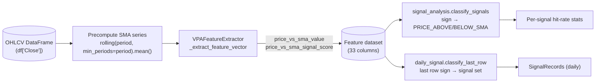

# Design Document: SP-340 — Price vs SMA ML Integration

## Overview

This design integrates the live SP-326 **price vs SMA** signal into the ML feature-extraction and signal-analysis path as a standalone, independently backtestable signal. It follows the settled scope decision in `requirements.md`: **Option B — standalone**, no composite fold, inline reimplementation (never calling `MarketAnalyzer`), and a byte-for-byte unchanged `composite_score`.

The signal mirrors the live implementation exactly, including the **optional crossover** contribution: the combined `price_vs_sma_signal_score` is the position-based score plus the optional crossover score (e.g. `+5` position + `+3` cross-above = `+8`). Crossover only contributes when `price_vs_sma.detect_crossover` is enabled (it defaults to `false`, so default behaviour is position-only and matches the prior absence of the feature).

The change touches four modules, mirroring the existing DSS Bressert integration precedent at every step:

1. `vpa/ml_validation/feature_extractor.py` — two new feature columns (`price_vs_sma_value`, `price_vs_sma_signal_score`), 31 → 33.
2. `vpa/ml_validation/signal_analysis.py` — two new `SignalType` members, their `SIGNAL_DIRECTIONS` entries, column-guarded classification.
3. `vpa/ml_validation/daily_signal.py` — `CONFIDENCE_MAP` entries and `classify_last_row` wiring.
4. Tests + stale-count corrections — new unit tests, a composite-score regression guard, and corrected hardcoded counts.

## Architecture

The data flows across the four modules as follows. The feature extractor produces the two new columns; `signal_analysis` and `daily_signal` consume `price_vs_sma_signal_score` by sign.



The key architectural choice — precomputing the SMA series over the whole frame — matches the existing DSS precedent (`generate_dataset` already precomputes `dss_osc`/`dss_trig` over `df` and indexes them by the positional `pos` for previous-row access). This makes the "previous row" close/SMA access for crossover trivial and keeps the extractor consistent with how DSS crossover is already handled.

## Components and Interfaces

### 1. `VPAFeatureExtractor` (`feature_extractor.py`)

#### 1.1 FEATURE_COLUMNS (31 → 33)

Two entries are appended to `FEATURE_COLUMNS`. They are placed **after** `rsi_signal_score` and **before** `dss_bullish_cross`, grouping the price-vs-SMA pair with the other scalar signal scores and keeping DSS/composite/up_bar_current at the tail. The exact chosen order:

```
... "rsi_value", "rsi_signal_score",
    "price_vs_sma_value", "price_vs_sma_signal_score",   # NEW (positions 27, 28)
    "dss_bullish_cross", "dss_bearish_cross",
    "composite_score", "up_bar_current",
```

The emitted `feature_vector` dict MUST insert the two keys at the **same relative position** so dict insertion order matches `FEATURE_COLUMNS` (Req 2.4). Any fixed-order consumer (CSV header, `extract_feature_importance`) then stays aligned.

> Design note on ordering: inserting mid-list (rather than appending at the end) will shift the committed characterisation fixture (`test_feature_extraction_characterisation.py`) and `test_scoring_params_preservation.py`, whose `EXPECTED_COLUMNS = [*FEATURE_COLUMNS, *METADATA_COLUMNS, "next_day_direction"]` is derived from the live list — so those tests follow `FEATURE_COLUMNS` automatically, but the committed fixture CSV must be regenerated (`REGEN_VPA_CHARACTERISATION_FIXTURE=1`). This is called out in Testing Strategy. If regenerating the slow fixture is undesirable, the alternative is to append the two columns at the very end; appending at the end is simpler for the fixture but visually separates the SMA value/score from the other score columns. **Decision: insert after `rsi_signal_score`** for readability, and regenerate the fixture. (The composite-score column value is unchanged either way — see §1.4.)

#### 1.2 Inline SMA computation — precomputed series over the frame

Mirroring the DSS precedent, `generate_dataset` precomputes a single SMA series over `df["Close"]` before the row loop, using the live SP-326 formula from `MarketAnalyzer.compute_price_vs_sma_column`:

```python
price_vs_sma_cfg = self._config.price_vs_sma
pvs_enabled = bool(price_vs_sma_cfg.enabled)
sma_series: list[float] | None = None
if pvs_enabled:
    period = price_vs_sma_cfg.period
    sma_series = (
        df["Close"].rolling(window=period, min_periods=period).mean().tolist()
    )
```

This is identical to the live `self.myDF["Close"].rolling(window=period, min_periods=period).mean()`. `min_periods=period` means the first `period - 1` rows are `NaN` (warm-up): no partial-window SMA is emitted, matching the live behaviour and Req 3.2.

**Why a precomputed series rather than reading `period_three` closes (the RSI pattern)?** RSI reads `deque_dictionary["period_three"]` closes because its warm-up is already gated by `period_three_length`. Price-vs-SMA's `period` (default 10) is **independent** of `period_three_length` and the crossover rule needs the *previous row's* close and SMA. A rolling series over the whole `df["Close"]`:

- gives the exact live SMA value per row (same pandas call), and
- makes previous-row access `sma_series[pos - 1]` / `df["Close"].iloc[pos - 1]` trivial, exactly as DSS does with `dss_osc[pos - 1]`.

Reading closes from a deque would not reach back to the previous row's SMA cleanly and would couple the SMA window to the deque window. The precomputed-series approach is the cleaner, more consistent option and is the chosen design.

#### 1.3 Scoring — position + optional crossover

`_extract_feature_vector` gains the positional row index and the precomputed SMA series so it can read current and previous close/SMA. The scoring reproduces `MarketAnalyzer.detect_price_vs_sma_signals` exactly:

```python
# Inputs: pos (positional index), closes (df["Close"] as a list),
#         sma_series (precomputed), price_vs_sma_cfg, pvs_enabled.
price_vs_sma_value = 50.0      # neutral sentinel when unavailable (see note)
price_vs_sma_signal_score = 0.0

if pvs_enabled and sma_series is not None:
    sma_value = sma_series[pos]
    close = closes[pos]
    if not (pd.isna(sma_value) or pd.isna(close)):
        price_vs_sma_value = float(sma_value)
        scores = price_vs_sma_cfg.scores
        # Position-based (Req 3.3-3.5, 3.7)
        if close > sma_value:
            price_vs_sma_signal_score += float(scores.above)
        elif close < sma_value:
            price_vs_sma_signal_score -= float(scores.below)
        # Optional crossover (Req 3.8-3.12), requires a valid previous row
        if price_vs_sma_cfg.detect_crossover and pos > 0:
            prev_sma = sma_series[pos - 1]
            prev_close = closes[pos - 1]
            if not (pd.isna(prev_sma) or pd.isna(prev_close)):
                cx = price_vs_sma_cfg.crossover_scores
                if prev_close <= prev_sma and close > sma_value:
                    price_vs_sma_signal_score += float(cx.cross_above)
                elif prev_close >= prev_sma and close < sma_value:
                    price_vs_sma_signal_score -= float(cx.cross_below)
```

This matches the live code's branch structure line-for-line: position first, then (optionally) crossover added on top, with the identical `<=` / `>=` previous-side comparisons and strict `>` / `<` current-side comparisons. The combined score is therefore position + crossover (Req 3.12).

> Note on `price_vs_sma_value` when unavailable: during warm-up / disabled / NaN, the SMA is genuinely undefined. The score is `0.0` (Req 3.2, 3.6). For the *value* column we emit a numeric sentinel so the column stays numeric (Req 2.3), consistent with how `rsi_value` emits `50.0` when RSI is unavailable. The design uses `50.0`-style neutrality only for the score's sibling value; the **score** is the field consumed by classification, and it is `0.0` → classified as neither signal. The exact sentinel for the value column is an implementation detail that does not affect any requirement (no requirement classifies on `price_vs_sma_value`); the design records `50.0` for parity with `rsi_value`, but `NaN` would also satisfy Req 2.3 if a numeric NaN is acceptable to downstream consumers — implementation should pick whichever keeps the characterisation fixture and importance report numeric.

#### 1.4 Composite score — unchanged (hard constraint)

The composite line stays **byte-for-byte** as it is today, and the new score is **not** added:

```python
# UNCHANGED — price_vs_sma_signal_score is NOT a term here:
composite_score = single_candle_score + trend_score + multiple_bar_score + acc_dist_score + rsi_signal_score
```

This is the zero-regression guarantee (Req 4.1-4.3), identical to how `ma_crossover_signal_score` is already excluded from the composite.

#### 1.5 Threading the series into `_extract_feature_vector`

`_extract_feature_vector`'s signature gains optional parameters so both call sites (the extractor's own `generate_dataset` and `daily_signal`'s inline loop) can supply them:

```python
def _extract_feature_vector(
    self, candle, signals, adx_values, acc_dist_result, deque_dictionary,
    dss_bullish_cross: int = 0, dss_bearish_cross: int = 0,
    price_vs_sma_value: float = 50.0,
    price_vs_sma_signal_score: float = 0.0,
) -> dict:
```

The scoring in §1.3 is computed in the **caller** (the row loop that has `pos` and the SMA series) and passed in, exactly as `dss_bullish_cross` / `dss_bearish_cross` are computed in the loop (using `pos`) and passed in. This keeps `_extract_feature_vector` free of positional-index logic and matches the DSS pattern precisely. When a caller does not supply the values (defaults), the columns are emitted as neutral/zero — which is the correct behaviour for any path that has not opted into the feature.

#### 1.6 Warm-up and previous-row interaction (worked out)

Two independent warm-ups coexist:

- **Deque warm-up** (existing): the row loop `continue`s until `period_three` is full, so no feature row is emitted before then. `pos` still advances for every row in `df` (it is `enumerate(df.iterrows())`), so `pos` is the absolute position in the frame — the same index space the SMA series uses.
- **SMA warm-up**: `sma_series[pos]` is `NaN` for the first `price_vs_sma.period - 1` rows. In practice `period_three_length` (deque warm-up) is typically ≥ the SMA period, so by the time rows are emitted the SMA is usually already valid; but the `pd.isna` guard in §1.3 makes the code correct regardless of the relative sizes (score 0.0 whenever the current SMA is NaN).

Because the SMA is a precomputed series indexed by `pos`, "previous row" is simply `pos - 1`:

- `pos == 0` → no previous row → no crossover contribution (Req 3.10). (In practice `pos == 0` is inside the deque warm-up and emits no row at all, but the `pos > 0` guard matches the live `row_index > 0` guard exactly.)
- `sma_series[pos - 1]` or `closes[pos - 1]` is `NaN` → no crossover contribution (Req 3.10).

This is the direct analogue of the DSS block's `pos > 0` + `np.isfinite(previous_dss, previous_trigger)` guards. No extra "previous close/previous SMA" state variables are needed because the series gives O(1) look-back; this is simpler and less error-prone than carrying `prev_close`/`prev_sma` across loop iterations.

### 2. `signal_analysis.py`

#### 2.1 New `SignalType` members and directions

```python
class SignalType(Enum):
    ...
    PRICE_ABOVE_SMA = "price_above_sma"
    PRICE_BELOW_SMA = "price_below_sma"

SIGNAL_DIRECTIONS = {
    ...
    SignalType.PRICE_ABOVE_SMA: SignalDirection.UP,
    SignalType.PRICE_BELOW_SMA: SignalDirection.DOWN,
}
```

(Req 5.1-5.3.) `result` in `classify_signals` is initialised as `{st: [] for st in SignalType}`, so the two new types start empty automatically — matching the DSS "absent column leaves empty list" behaviour.

#### 2.2 Column-guarded, NaN-safe classification

Following the exact `if "dss_bullish_cross" in df.columns:` pattern, appended to `classify_signals`:

```python
if "price_vs_sma_signal_score" in df.columns:
    pvs_valid = df["price_vs_sma_signal_score"].notna()
    above_mask = pvs_valid & (df["price_vs_sma_signal_score"] > 0)
    below_mask = pvs_valid & (df["price_vs_sma_signal_score"] < 0)
    result[SignalType.PRICE_ABOVE_SMA] = df.index[above_mask].tolist()
    result[SignalType.PRICE_BELOW_SMA] = df.index[below_mask].tolist()
```

- Column present, positive score → `PRICE_ABOVE_SMA` (Req 5.4).
- Column present, negative score → `PRICE_BELOW_SMA` (Req 5.5).
- Column absent → both lists stay empty (Req 5.6).
- Score is `NaN` → excluded from both via the `notna()` mask (Req 5.7).
- Score exactly `0` → matches neither mask (`> 0` and `< 0` both false), the correct "price equals SMA / warm-up / disabled" outcome.

### 3. `daily_signal.py`

#### 3.1 `CONFIDENCE_MAP` entries

`CONFIDENCE_ORDER = ["High", "Medium-High", "Low-Medium", "Low"]`. The existing map encodes the project's **contrarian** convention — the strongest *bearish* VPA reading (`DISTRIBUTION`) is the highest-confidence BUY, and `STRONG_BULLISH` is low. Price-vs-SMA is a plain trend/position signal, not a high-conviction accumulation/distribution event, so it should sit at the lower-conviction end rather than displacing the existing bands:

```python
CONFIDENCE_MAP = {
    SignalType.DISTRIBUTION: "High",
    SignalType.STRONG_BEARISH: "Medium-High",
    SignalType.STRONG_BULLISH: "Low-Medium",
    SignalType.ACCUMULATION: "Low",
    SignalType.PRICE_ABOVE_SMA: "Low",   # NEW
    SignalType.PRICE_BELOW_SMA: "Low",   # NEW
}
```

**Justification:** both are mapped to `"Low"` (Req 6.1, 6.2 require only a label drawn from `CONFIDENCE_ORDER`). Price-vs-SMA is a simple, high-frequency positional signal whose standalone edge is unproven (that is exactly what the backtest in §2 is meant to measure), so it earns the lowest confidence band. Using `"Low"` for both also keeps the contrarian inversion logic untouched: `build_signal_records` still emits `adjusted_direction="BUY"` with `original_direction` taken from `SIGNAL_DIRECTIONS`, and the `"Low"` rank sorts them last — they never outrank an accumulation/distribution signal in the daily output.

#### 3.2 `classify_last_row` wiring

Appended to `classify_last_row`, guarded and NaN-safe to mirror §2.2 for a single row:

```python
pvs_score = last_row.get("price_vs_sma_signal_score")
if _is_valid_numeric(pvs_score):
    score = float(pvs_score)
    if score > 0:
        signals.add(SignalType.PRICE_ABOVE_SMA)
    elif score < 0:
        signals.add(SignalType.PRICE_BELOW_SMA)
```

- Positive → add `PRICE_ABOVE_SMA` (Req 6.3).
- Negative → add `PRICE_BELOW_SMA` (Req 6.4).
- Absent (`.get` → `None`) or `NaN` → `_is_valid_numeric` is false → neither added (Req 6.5).
- `0` → neither branch → neither added (price equals SMA / warm-up / disabled).

`_is_valid_numeric` already exists in `classify_last_row`; it returns `False` for `None` and for `NaN`, giving the absent/NaN handling for free.

#### 3.3 daily_signal's inline extractor loop (design consideration)

`DailySignalGenerator.run` runs its **own** inline loop and calls `extractor._extract_feature_vector(...)` **without** DSS args and without precomputing any series — so today its rows carry `dss_bullish_cross=0`/`dss_bearish_cross=0` by default. For price-vs-SMA to actually fire in the daily path, that loop must precompute the SMA series over its `df["Close"]` and pass `price_vs_sma_value` / `price_vs_sma_signal_score` into `_extract_feature_vector`, computing the per-row score with the §1.3 logic using its own positional index.

The default parameter values (§1.5) mean that if the daily loop is **not** updated, `classify_last_row` simply never sees a non-zero price-vs-SMA score and adds neither signal — safe, no crash, but the daily signal would be inert for this feature. **Decision: update the daily loop to precompute and pass the series**, so the daily path is consistent with `generate_dataset` and Req 6.3/6.4 are actually exercisable end-to-end. This is the same shape of change as the extractor loop and is covered by a daily-signal wiring unit test (§Testing Strategy).

## Data Models

No new persistent data structures are introduced; the feature is two new columns on the existing per-row feature vector and two new enum members.

### Feature vector additions

| Key | Type | Meaning | When unavailable |
|---|---|---|---|
| `price_vs_sma_value` | float | SMA of close over `price_vs_sma.period` for the current row | neutral sentinel (`50.0`, mirroring `rsi_value`) |
| `price_vs_sma_signal_score` | float | position score ± optional crossover score | `0.0` |

`FEATURE_COLUMNS` length: **31 → 33**. Column order (new entries in **bold**):

```
..., rsi_value, rsi_signal_score, **price_vs_sma_value**, **price_vs_sma_signal_score**,
dss_bullish_cross, dss_bearish_cross, composite_score, up_bar_current
```

### Config model (already present — reference only)

`PriceVsSMASettings` in `vpa/config/settings.py`, read via `self._config.price_vs_sma`:

| Field | Type | Default |
|---|---|---|
| `enabled` | bool | `True` |
| `period` | int | `10` |
| `scores.above` / `scores.below` | float | `5` |
| `detect_crossover` | bool | `False` |
| `crossover_scores.cross_above` / `crossover_scores.cross_below` | float | `3` |

### Enum additions

```python
SignalType.PRICE_ABOVE_SMA = "price_above_sma"   # SIGNAL_DIRECTIONS → UP
SignalType.PRICE_BELOW_SMA = "price_below_sma"   # SIGNAL_DIRECTIONS → DOWN
```

### Stale feature-count audit (Req 7)

Every location that hardcodes the raw feature-column count, found via a repository search for `27 feature` / `29 feature` / `31 feature` / `== 31`:

| File | Location | Current | Correct to |
|---|---|---|---|
| `feature_extractor.py` | `_extract_feature_vector` docstring ("all 29 feature columns") | 29 | 33 |
| `feature_extractor.py` | `generate_dataset` docstring ("all 27 feature columns") | 27 | 33 |
| `feature_extractor.py` | `FEATURE_COLUMNS` leading comment ("the 31-feature vector") | 31 | 33 |
| `tests/ml_validation/test_integration.py` | `test_feature_importance_csv_headers` → `assert len(df) == 31` | 31 | 33 |
| `tests/ml_validation/test_integration.py` | `test_dataset_csv_headers` docstring + "All 27 feature columns" comment | 27 | 33 |

**Audit of other matches (reviewed, action noted):**

- `analysis.py` line ~145 comment "keep only the 27 feature columns" — stale prose; the code derives feature columns dynamically (`columns - METADATA - label`), so it is correct at runtime. Update the comment to 33 for accuracy (Req 7.5).
- `test_feature_extraction_characterisation.py` and `test_scoring_params_preservation.py` — their `EXPECTED_COLUMNS` is **derived** from `VPAFeatureExtractor.FEATURE_COLUMNS`, so they track the real list automatically; only the docstring prose says "31 features". The committed fixture CSV must be regenerated (see Testing Strategy). Update the "31 features" docstring prose to 33 (Req 7.5).
- `test_analysis.py`, `test_baseline.py`, `test_reproducibility.py` — these build **synthetic** datasets described as "27 feature columns" and some iterate `FEATURE_COLUMNS` dynamically. Where they hardcode the raw count or the comment, correct to 33; where they derive from `FEATURE_COLUMNS`, leave the logic and fix only stale prose. Each is re-run under the full suite to confirm (Req 7.5, 8.1).

The design treats "33" as the single source of truth = `len(FEATURE_COLUMNS)`; wherever practical, assertions should prefer `len(VPAFeatureExtractor.FEATURE_COLUMNS)` over a literal to prevent future drift.

## Correctness Properties

*A property is a characteristic or behavior that should hold true across all valid executions of a system — essentially, a formal statement about what the system should do. Properties serve as the bridge between human-readable specifications and machine-verifiable correctness guarantees.*

The price-vs-SMA logic is pure input/output computation over close/SMA values and the config, with meaningful variation across input series, periods, score weights, and the crossover flag — so property-based testing applies. The six properties below are the result of folding the per-criterion prework analysis and removing redundancy (the position/equality/crossover criteria 3.3–3.10 are subsumed by the model-based oracle in Property 2).

### Property 1: SMA value equals the reference rolling mean

*For all* close-price series and all valid `price_vs_sma.period` values, wherever the SMA is defined (at least `period` closes available), the emitted `price_vs_sma_value` equals the pandas `rolling(window=period, min_periods=period).mean()` of close at that row, within floating-point tolerance.

**Validates: Requirements 3.1, 3.2**

### Property 2: Combined score equals the MarketAnalyzer oracle

*For all* close-price series and all `price_vs_sma` configurations (any `scores.above` / `scores.below`, `detect_crossover` on or off, any `crossover_scores`), the extractor's combined `price_vs_sma_signal_score` for a row equals the score that `MarketAnalyzer.detect_price_vs_sma_signals` produces for the same row and configuration (used only as a test oracle, never called from production code). This subsumes the position branches (close above/below/equal SMA), the cross-above and cross-below contributions, the valid-previous-row guard (first row and NaN-previous add no crossover), and the position-plus-crossover sum.

**Validates: Requirements 3.3, 3.4, 3.5, 3.7, 3.8, 3.9, 3.10, 3.12**

### Property 3: Crossover disabled yields the position-only score

*For all* close-price series, the combined `price_vs_sma_signal_score` computed with `detect_crossover = false` equals the combined score computed with the crossover branch removed (position-only); toggling `detect_crossover` from true to false changes the score only by the crossover term and never by the position term.

**Validates: Requirements 3.11**

### Property 4: Composite score is invariant under price-vs-SMA configuration

*For all* input rows and *for all* pairs of `price_vs_sma` configurations (including enabled/disabled and crossover on/off), the emitted `composite_score` is identical, and equals `single_candle_score + trend_score + multiple_bar_score + acc_dist_score + rsi_signal_score`. No `price_vs_sma` term ever enters the composite.

**Validates: Requirements 4.1, 4.2, 4.3**

### Property 5: classify_signals partitions rows by score sign

*For all* feature DataFrames that contain `price_vs_sma_signal_score`, `classify_signals` returns `PRICE_ABOVE_SMA` exactly for the row indices whose score is non-NaN and strictly positive, `PRICE_BELOW_SMA` exactly for the row indices whose score is non-NaN and strictly negative, and places every row whose score is zero or NaN in neither list.

**Validates: Requirements 5.4, 5.5, 5.7**

### Property 6: classify_last_row reflects the last row's score sign

*For all* feature DataFrames, `classify_last_row` includes `PRICE_ABOVE_SMA` if and only if the last row's `price_vs_sma_signal_score` is non-NaN and strictly positive, includes `PRICE_BELOW_SMA` if and only if it is non-NaN and strictly negative, and includes neither when the score is absent, NaN, or zero.

**Validates: Requirements 6.3, 6.4, 6.5**

## Error Handling

The feature follows the live code's **graceful degradation** convention — it never raises for data conditions; it returns a neutral/zero contribution instead.

| Condition | Handling | Mirrors |
|---|---|---|
| `price_vs_sma.enabled == false` | SMA series not computed; `price_vs_sma_value` = sentinel, score = `0.0` | live `detect_price_vs_sma_signals` early return |
| Fewer than `period` closes (warm-up) | `sma_series[pos]` is `NaN` → `pd.isna` guard → score `0.0` | live `min_periods=period` + NaN guard |
| Current close or SMA is `NaN` | `pd.isna` guard → score `0.0` | live NaN guard |
| `detect_crossover` true but `pos == 0` | `pos > 0` guard → no crossover term | live `row_index > 0` guard |
| Previous close or previous SMA is `NaN` | `pd.isna` guard → no crossover term | live NaN guard |
| `price_vs_sma_signal_score` column absent in `classify_signals` | `in df.columns` guard → both match lists stay empty | DSS `in df.columns` guard |
| `price_vs_sma_signal_score` NaN in a row | `.notna()` mask → row excluded from both matches | DSS `.notna()` mask |
| `price_vs_sma_signal_score` absent/NaN in `classify_last_row` | `_is_valid_numeric` false → neither signal added | existing `classify_last_row` guards |

The `composite_score` computation is untouched, so no new error path can affect it (zero-regression constraint).

## Testing Strategy

### Dual approach

- **Property-based tests** (library: **Hypothesis**, already used in this repo — see `.hypothesis/`) implement each of the six correctness properties with a single property test each, minimum **100 iterations**, tagged with the property reference.
- **Unit / example tests** cover specific scenarios, structural facts, guard branches, and the captured-baseline regression.
- **Integration / gate**: full suite + ruff.

Each property test carries a comment of the form:
`# Feature: sp-340-price-vs-sma-ml-integration, Property N: <property text>`

### Property tests (one per property, ≥100 iterations)

| Property | Test focus | Generators |
|---|---|---|
| P1 | emitted `price_vs_sma_value` == reference rolling mean | random float close series, random `period` |
| P2 | combined score == `MarketAnalyzer.detect_price_vs_sma_signals` oracle | random close series + random config (scores, crossover flag, crossover scores) |
| P3 | crossover-off score == position-only score | random close series; compare `detect_crossover` true-term-removed vs false |
| P4 | `composite_score` invariant across two `price_vs_sma` configs | random extractor inputs + two configs |
| P5 | `classify_signals` sign partition (>0 / <0 / 0 / NaN) | random DataFrames with injected scores incl. zeros and NaNs |
| P6 | `classify_last_row` last-row sign (>0 / <0 / 0 / NaN / absent) | random DataFrames + absent-column case |

> Oracle note for P2: `MarketAnalyzer` is instantiated **only in the test** with a temp config and a prepared `SMA_price_vs` column (the pattern already used by `vpa/tests/test_price_vs_sma.py`). Production code never imports or calls `MarketAnalyzer` — the inline reimplementation constraint is preserved.

### Unit / example tests

- **Extractor columns** (new): position above (`+scores.above`), below (`-scores.below`), equal (`0.0`); warm-up (< period closes) → `0.0`; `enabled=false` → `0.0`; crossover **on** cross-above (`+position +cross_above`), cross-below (`-position -cross_below`); crossover **off** → position-only; first-row / NaN-previous → no crossover term.
- **FEATURE_COLUMNS structure**: both names present (Req 2.1); `len == 33` (Req 2.2); emitted dict key order matches `FEATURE_COLUMNS` for the two keys (Req 2.4).
- **signal_analysis**: members exist + `SIGNAL_DIRECTIONS` UP/DOWN (Req 5.1–5.3); column-absent → empty lists (Req 5.6).
- **daily_signal wiring**: `CONFIDENCE_MAP` has both keys with labels in `CONFIDENCE_ORDER` (Req 6.1, 6.2); the inline daily loop (§3.3) precomputes the SMA series and `classify_last_row` returns the expected member for a crafted positive/negative/zero last row.
- **Composite-score baseline regression** (Req 8.2): capture `composite_score` for a fixed input dataset (and/or assert the derived characterisation fixture is unchanged for the composite column), proving the composite is byte-for-byte unchanged after the feature is added.
- **Stale-count assertion** (Req 7.3): `test_feature_importance_csv_headers` asserts `len(df) == 33` (prefer `len(VPAFeatureExtractor.FEATURE_COLUMNS)`), and `{"price_vs_sma_value", "price_vs_sma_signal_score"} <= set(df["feature_name"])`.

### Fixture regeneration (slow)

Inserting the two columns mid-list shifts the committed characterisation oracle. Regenerate with `REGEN_VPA_CHARACTERISATION_FIXTURE=1` and re-run the slow characterisation + scoring-params-preservation tests so the oracle reflects the 33-column schema **with the composite column value unchanged**. The regeneration must be reviewed to confirm only the two new columns were added and `composite_score` values are identical to the prior fixture.

### Full-suite and lint/format gate (before marking Done)

Per the repo testing rules, bare `pytest` is the fast path and **deselects** the slow ML tests. Before any push / PR / marking the Jira task Done, run, in order:

1. `ruff check .` — lint clean (CI enforces this).
2. `ruff format --check .` — formatting clean (run after any tool-written file, which can drop trailing newlines).
3. `pytest -m ""` — the **full** suite including the slow ML tests (`-m slow`), not bare `pytest`.

(Req 8.1, 8.3, 8.4, 8.5.) A CI pipeline, if added, must use `pytest -m ""` so the slow ML tests are not silently skipped.

## Design Decisions

- **Option B — standalone signal.** Added as its own feature pair and its own `SignalType`, mirroring RSI (feature) and DSS (signal). Not merged into any existing signal. (Settled in requirements; recorded here for traceability.)
- **No composite fold.** `price_vs_sma_signal_score` is excluded from `composite_score`, exactly like `ma_crossover_signal_score`. The composite line stays byte-for-byte unchanged — the hard zero-regression constraint.
- **Inline reimplementation, never calls MarketAnalyzer.** The ML path reproduces the SP-326 logic inline; `MarketAnalyzer` is a behavioural reference and appears only as a **test oracle** (Property 2), never in production imports.
- **Crossover included (mirrors live).** The optional crossover contribution is reproduced exactly: cross-above adds `+cross_above`, cross-below subtracts `cross_below`, gated by `detect_crossover` (default `false`) and a valid previous row. Default behaviour is position-only, so defaults match the prior absence of the feature. Combined score = position + crossover.
- **SMA via precomputed series over the frame (not per-row deque).** Chosen over the RSI-style "read `period_three` closes from the deque" approach because (a) `price_vs_sma.period` is independent of the deque window, and (b) the crossover rule needs the previous row's close **and** SMA, which a precomputed series indexed by `pos` provides in O(1) — identical to how DSS crossover already reads `dss_osc[pos-1]`. This is the most consistent and least error-prone option; no per-row `prev_close`/`prev_sma` state is carried across the loop.
- **Confidence = "Low" for both new types.** Price-vs-SMA is a simple positional signal whose standalone edge is unproven (the backtest is what measures it), so it sits at the lowest `CONFIDENCE_ORDER` band and never outranks accumulation/distribution signals in the daily output.
- **Column insert position after `rsi_signal_score`.** Groups the SMA value/score with the other scalar scores for readability, at the cost of regenerating the slow characterisation fixture (reviewed to confirm the composite column is unchanged).
