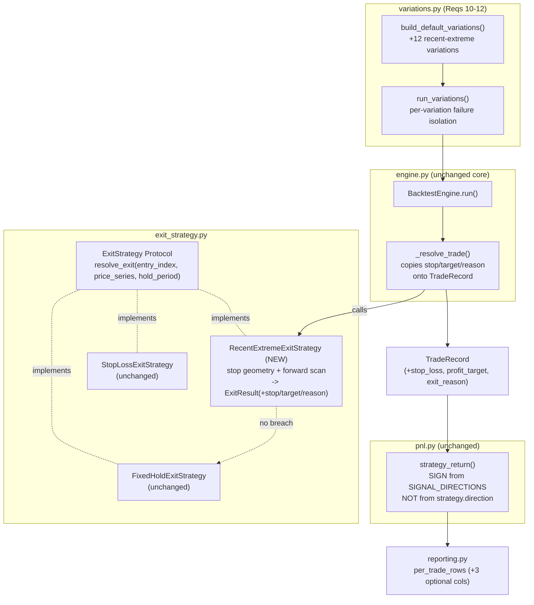

# Design Document: SP-354 Recent-Extreme Stop / Risk-Based Target Exit Strategy

## Overview

SP-354 adds an opt-in exit strategy to the VPA backtesting engine
(`vpa/backtesting/`): a **recent-extreme stop loss** paired with a
**risk-based profit target**. The stop is placed from a recent price extreme
(lowest `low` for longs, highest `high` for shorts) measured over a configurable
lookback window of bars strictly before entry; the target is derived from the
resulting risk distance via a reward-to-risk multiplier. The strategy scans
forward OHLC bars and exits on the first stop or target breach, falling back to
a fixed-hold exit when neither level is touched inside the hold window.

The feature is delivered without rewriting the engine core. It plugs into the
existing `ExitStrategy` protocol established in SP-317 and extended by SP-333's
`StopLossExitStrategy`:

```python
def resolve_exit(self, entry_index: int, price_series: list[PricePoint], hold_period: int) -> ExitResult: ...
```

The design is faithful to the code already in the repo. In particular it
respects three existing facts that shape every decision below:

1. `BacktestEngine._resolve_trade` computes `return_pct = exit_price / entry_price - 1`
   **direction-agnostically**, and direction-aware P&L is applied *later* by
   `pnl.strategy_return` using `direction_for(trade.signal_type)` from
   `SIGNAL_DIRECTIONS` — never from any `direction` field on the exit strategy.
2. `_resolve_trade` already treats a non-`None` `ExitResult.reason` as a
   `SkippedSignal`, so a strategy signals "skip this trade" simply by returning
   an `ExitResult` with a reason set.
3. `StopLossExitStrategy` is a frozen dataclass that reads only `price_series`,
   returns raw prices (the engine validates them via `_is_valid_price`), and
   delegates its no-breach case to a wrapped `FixedHoldExitStrategy`. The new
   strategy mirrors this shape exactly.

### Scope

In scope: the new `RecentExtremeExitStrategy`, two new `SkipReason` values,
additive `TradeRecord` output fields (`stop_loss`, `profit_target`,
`exit_reason`) threaded through `ExitResult` and `_resolve_trade`, three extra
optional per-trade CSV columns, and twelve new default variations in
`build_default_variations()`.

Out of scope (per requirements.md): changing the engine simulation loop beyond
consuming the new strategy and additive fields; direction-aware return math
(stays in `pnl.py`); modifying `FixedHoldExitStrategy` or `StopLossExitStrategy`
behaviour; trailing stops, partial exits, or multiple targets.

## Design Decisions

### Decision 1: Mirror `StopLossExitStrategy` as a frozen dataclass implementing the existing protocol

`RecentExtremeExitStrategy` is a `@dataclass(frozen=True)` implementing the
`ExitStrategy` protocol, structurally identical to `StopLossExitStrategy`: it
carries configuration fields, a wrapped `_fixed_hold: FixedHoldExitStrategy`
built via `field(default_factory=FixedHoldExitStrategy)`, and a single
`resolve_exit` method that reads only `price_series`. Reusing the established
shape means the engine, config, and variation harness consume it with zero
new wiring (SP-354 Req 1.1, 1.2; Req 8 — existing strategies untouched).

### Decision 2: Validate at construction via `__post_init__`

`StopLossExitStrategy` performs no validation today. SP-354 Req 2.3-2.5 require
fail-fast construction-time validation, so the new strategy adds a
`__post_init__`. Because the dataclass is frozen, assignment inside
`__post_init__` is not needed — it only reads and raises. `bool` is explicitly
rejected as a non-int lookback (Python treats `bool` as a subclass of `int`),
matching the defensive pattern already used in `variations.validate_hold_period`
(SP-354 Req 2.3).

### Decision 3: The strategy's `direction` field governs GEOMETRY ONLY; P&L sign comes from `SIGNAL_DIRECTIONS` (critical)

This is the subtlety that drives the variation design. The engine writes
`TradeRecord.return_pct = exit_price / entry_price - 1` with no notion of long
vs short. The P&L layer (`pnl.strategy_return`) later resolves the sign from the
signal, not the strategy:

```python
# pnl.py (existing)
direction = direction_for(trade.signal_type)          # from SIGNAL_DIRECTIONS
if direction == SignalDirection.UP:
    return trade.return_pct                            # long basis
return (trade.entry_price / trade.exit_price) - 1 - round_trip_cost   # short basis
```

So `RecentExtremeExitStrategy.direction` controls only *where the stop and
target sit and which bar field triggers them* (lowest-low stop + `low`-crosses
for UP; highest-high stop + `high`-crosses for DOWN). It does **not** flip the
P&L sign. For a short recent-extreme variation to be internally consistent, the
trades it prices must also be classified DOWN by `SIGNAL_DIRECTIONS`. Therefore
every direction-specific variation (Decision 8) filters its signal log to
signals whose `SIGNAL_DIRECTIONS` value matches the variation's geometry
direction. A DOWN variation that admitted UP signals would compute short
geometry but long P&L — a silent correctness bug. This decision ties SP-354
Req 9.3 (geometry from the strategy's direction) to Req 11.2 (variations carry
explicit direction) and keeps geometry and P&L consistent.

### Decision 4: Signal skip via `ExitResult.reason` (reuse existing engine path)

Degenerate runtime cases (insufficient prior bars, zero/wrong-side risk) do not
raise; they return an `ExitResult(None, None, <SkipReason>)`. The engine's
`_resolve_trade` already converts a non-`None` reason into a `SkippedSignal`
with that reason, so no engine change is needed to record these skips (SP-354
Req 6.4). Two new enum values — `UNAVAILABLE_RECENT_EXTREME` and
`DEGENERATE_RISK_DISTANCE` — are added to `SkipReason` (Req 6.5).

### Decision 5: Thread stop/target/reason back through `ExitResult` (single return channel)

`ExitResult` is extended with three optional fields (`stop_loss`,
`profit_target`, `exit_reason`), all defaulting to `None`. This keeps the exit
strategy's single return value as the one channel carrying resolution detail
back to the engine. `FixedHoldExitStrategy` and `StopLossExitStrategy` leave the
new fields at their `None` default, so their `ExitResult`s are unchanged in
meaning. The alternative — a side channel or a second return value — would
force a signature change on the protocol and break the two existing strategies,
violating SP-354 Req 8. (Design Decision (a): single return channel.)

### Decision 6: Additive, defaulted `TradeRecord` fields keep the frozen dataclass backward-compatible

`TradeRecord` gains `stop_loss: float | None = None`,
`profit_target: float | None = None`, and `exit_reason: ExitReason | None = None`,
**appended after** the existing fields with defaults. Appending defaulted fields
to a frozen dataclass is backward-compatible: every existing positional/keyword
construction site still works and existing consumers (`pnl`, `metrics`,
`equity_curve`, `reporting`, `data_export`) read only the original fields
(SP-354 Req 7.1, 7.2, 7.5). `_resolve_trade` copies the three fields off the
`ExitResult`; when they are `None` (fixed-hold / percentage-stop), the
`TradeRecord` is byte-identical to the pre-SP-354 record (Req 7.4, 8.3).

### Decision 7: A small `ExitReason` enum rather than a bare string

`exit_reason` is typed as an `ExitReason` enum (`STOP`, `TARGET`, `FIXED_HOLD`)
rather than a free string. Tradeoff: an enum adds one tiny type but gives
exhaustiveness, prevents typos, and renders cleanly to CSV via `.name`. A bare
string would be marginally less code but reintroduce the stringly-typed
ambiguity the rest of the module avoids (`SkipReason`, `PositionMode`, and
`SignalDirection` are all enums). The enum wins for consistency and type safety.

### Decision 8: Direction-specific variations via zero-arg factory closures + direction-matched filters

Each recent-extreme variation binds its `lookback`, `reward_risk`, and
`direction` into a zero-argument `exit_strategy_factory` closure using default
arguments to avoid late-binding in the build loop — exactly mirroring the
existing `Stop_Loss` loop's `lambda t=threshold: StopLossExitStrategy(threshold=t)`.
Each variation also carries a `signal_filter` that admits only signals whose
`SIGNAL_DIRECTIONS` value equals the variation's direction (new `_include_long`
/ `_include_short` filters following the `_include_known_direction` pattern),
enforcing the geometry/P&L consistency from Decision 3 (SP-354 Req 10.3, 11.2).

### Decision 9: Degenerate configs skip rather than raise, so they do not surface as `VariationFailure`

`run_variations` already isolates per-variation failures by catching any
`Exception`. The recent-extreme strategy's degenerate runtime cases return a
`SkipReason` rather than raising, so individual bad trades are skipped, not
promoted to a `VariationFailure`. Only a construction-time `ValueError` (invalid
`lookback`/`buffer`/`reward_risk`) would surface as a failure, and the default
catalogue is built entirely from valid values, so no default recent-extreme
variation is expected to fail. This is stated honestly for SP-354 Req 12.1
rather than claiming failure isolation covers something it does not.

### Decision 10: Append three optional CSV columns, preserve existing column order

`reporting.PER_TRADE_HEADER` currently has seven fixed columns. SP-354 appends
`stop_loss`, `profit_target`, and `exit_reason` **after** the existing seven,
rendering `None` as the empty string. Existing columns keep their order and
position, so consumers that read by index or by the original header are
unaffected (SP-354 Req 12.3, 12.4). This mirrors the additive-field philosophy
of Decision 6 at the CSV boundary.

## Architecture

The new strategy is a leaf plugged into the unchanged engine/reporting pipeline.
The engine still owns the simulation loop, price validation, and `TradeRecord`
construction; the strategy owns only stop/target geometry and the forward scan;
`pnl.py` still owns the direction-aware P&L sign.



Key architectural invariants preserved:

- **One return channel.** `resolve_exit` returns a single `ExitResult`; the new
  stop/target/reason ride on it (Decision 5).
- **Engine stays direction-agnostic.** `_resolve_trade` never consults the
  strategy's `direction`; it only copies through the three new optional fields
  (Decision 3, 6).
- **Fallback by composition.** The no-breach case delegates to a wrapped
  `FixedHoldExitStrategy`, reusing its horizon/`INSUFFICIENT_FUTURE_DATA_EXIT`
  handling verbatim (SP-354 Req 5.9).

## Components and Interfaces

### 1. `ExitReason` enum (new, `models.py`)

```python
class ExitReason(Enum):
    """How a trade resolved (SP-354 Req 7)."""

    STOP = "stop"              # Stop_Loss breach (Req 5.2, 5.4)
    TARGET = "target"          # Profit_Target breach (Req 5.3, 5.5)
    FIXED_HOLD = "fixed_hold"  # neither breached; fixed-hold fallback (Req 5.9)
```

### 2. New `SkipReason` values (extend existing enum, `models.py`)

```python
class SkipReason(Enum):
    ...                                # existing values unchanged
    UNAVAILABLE_RECENT_EXTREME = "unavailable_recent_extreme"  # Req 6.1, 6.5
    DEGENERATE_RISK_DISTANCE = "degenerate_risk_distance"      # Req 6.2, 6.3, 6.5
```

### 3. Extended `ExitResult` (`models.py`)

Three optional fields are appended with `None` defaults so the two existing
strategies construct it unchanged (Decision 5).

```python
@dataclass(frozen=True)
class ExitResult:
    """Outcome of an Exit_Strategy resolution."""

    exit_index: int | None
    exit_price: float | None
    reason: SkipReason | None            # set when exit cannot be resolved (Req 7.2 engine spec)
    stop_loss: float | None = None       # SP-354 Req 7.1 (recent-extreme only)
    profit_target: float | None = None   # SP-354 Req 7.1
    exit_reason: ExitReason | None = None  # SP-354 Req 7.1
```

### 4. Extended `TradeRecord` (`models.py`)

```python
@dataclass(frozen=True)
class TradeRecord:
    entry_date: str
    exit_date: str
    entry_price: float
    exit_price: float
    return_pct: float
    signal_type: SignalType
    # SP-354 additive, defaulted fields (Req 7.1, 7.2) — appended last for
    # backward compatibility. None => resolved by a strategy that supplies no
    # stop/target/reason (fixed-hold, percentage-stop).
    stop_loss: float | None = None
    profit_target: float | None = None
    exit_reason: ExitReason | None = None
```

### 5. `RecentExtremeExitStrategy` (new, `exit_strategy.py`)

```python
@dataclass(frozen=True)
class RecentExtremeExitStrategy:
    """Recent-extreme stop + risk-based target exit (SP-354 Req 1-9).

    GEOMETRY ONLY: ``direction`` selects long vs short stop/target placement and
    which bar field triggers a breach. It does NOT set the P&L sign — that is
    resolved downstream by ``pnl.strategy_return`` from ``SIGNAL_DIRECTIONS``
    (see Design Decision 3).

    Pure: reads only ``price_series`` (Req 1.4), returns RAW prices (the engine
    validates them via ``_is_valid_price``), never mutates inputs (Req 1.5), and
    is deterministic (Req 1.6).
    """

    lookback: int                       # L, positive int (Req 2.1, 2.3)
    reward_risk: float                  # M, strictly > 0 (Req 2.1, 2.5)
    buffer: float = 0.0                 # >= 0, default 0 at the extreme (Req 2.1, 2.4, 2.6)
    direction: SignalDirection = SignalDirection.UP  # default UP/long (Req 2.2)
    _fixed_hold: FixedHoldExitStrategy = field(default_factory=FixedHoldExitStrategy)

    def __post_init__(self) -> None:
        # Reject bool-as-int before the int check, mirroring validate_hold_period.
        if isinstance(self.lookback, bool) or not isinstance(self.lookback, int):
            raise ValueError(f"lookback must be a positive int, got {self.lookback!r}")  # Req 2.3
        if self.lookback < 1:
            raise ValueError(f"lookback must be a positive int, got {self.lookback}")    # Req 2.3
        if self.buffer < 0:
            raise ValueError(f"buffer must be >= 0, got {self.buffer}")                  # Req 2.4
        if not self.reward_risk > 0:
            raise ValueError(f"reward_risk must be > 0, got {self.reward_risk}")         # Req 2.5

    def resolve_exit(self, entry_index: int, price_series: list[PricePoint], hold_period: int) -> ExitResult:
        last_index = len(price_series) - 1

        # --- Recent extreme over bars strictly before entry (Req 3.1-3.3, 6.1) ---
        start = entry_index - self.lookback
        if start < 0:  # fewer than L prior bars exist
            return ExitResult(None, None, SkipReason.UNAVAILABLE_RECENT_EXTREME)  # Req 6.1
        window = price_series[start:entry_index]  # indices entry_index-L .. entry_index-1

        is_long = self.direction is SignalDirection.UP
        if is_long:
            extreme = min(bar.low for bar in window)   # lowest low (Req 3.1)
            stop = extreme - self.buffer               # Req 3.4
        else:
            extreme = max(bar.high for bar in window)  # highest high (Req 3.2)
            stop = extreme + self.buffer               # Req 3.5

        # --- Risk distance + target (Req 4) ---
        entry_price = price_series[entry_index].close  # Req 4.1
        risk = abs(entry_price - stop)                 # Req 4.1
        # Degenerate: zero risk, or stop on the wrong (non-adverse) side (Req 6.2, 6.3).
        if risk == 0 or (is_long and stop >= entry_price) or (not is_long and stop <= entry_price):
            return ExitResult(None, None, SkipReason.DEGENERATE_RISK_DISTANCE)  # Req 6.2, 6.3
        target = entry_price + risk * self.reward_risk if is_long else entry_price - risk * self.reward_risk  # Req 4.2, 4.3

        # --- Forward scan: first breach wins, stop-first on same bar (Req 5) ---
        horizon = min(entry_index + hold_period, last_index)  # Req 5.1
        for j in range(entry_index + 1, horizon + 1):
            bar = price_series[j]
            if is_long:
                if bar.low <= stop:                            # stop breach (Req 5.2); stop-first (Req 5.6)
                    exit_price = bar.open if bar.open <= stop else stop        # gap-through (Req 5.7)
                    return ExitResult(j, exit_price, None, stop, target, ExitReason.STOP)
                if bar.high >= target:                         # target breach (Req 5.3)
                    exit_price = bar.open if bar.open >= target else target    # gap-through (Req 5.8)
                    return ExitResult(j, exit_price, None, stop, target, ExitReason.TARGET)
            else:
                if bar.high >= stop:                           # stop breach (Req 5.4); stop-first (Req 5.6)
                    exit_price = bar.open if bar.open >= stop else stop        # gap-through (Req 5.7)
                    return ExitResult(j, exit_price, None, stop, target, ExitReason.STOP)
                if bar.low <= target:                          # target breach (Req 5.5)
                    exit_price = bar.open if bar.open <= target else target    # gap-through (Req 5.8)
                    return ExitResult(j, exit_price, None, stop, target, ExitReason.TARGET)

        # --- No breach: delegate to fixed-hold fallback and carry stop/target (Req 5.9) ---
        fallback = self._fixed_hold.resolve_exit(entry_index, price_series, hold_period)
        if fallback.reason is not None:
            return fallback  # horizon past series end -> INSUFFICIENT_FUTURE_DATA_EXIT, no extras
        return ExitResult(
            fallback.exit_index, fallback.exit_price, None, stop, target, ExitReason.FIXED_HOLD
        )
```

Note the stop-first ordering (Req 5.6): the stop test precedes the target test
within each bar, so when both could breach on one bar, the stop wins. This
matches the gap-through-at-open convention already used by
`StopLossExitStrategy` for the stop, now extended to the target (Req 5.8).

### 6. Minimal `_resolve_trade` change (`engine.py`)

The engine copies the three optional fields off the `ExitResult` onto the
`TradeRecord`. This is the only change inside the engine, and it is additive:

```python
# engine.py, _resolve_trade, at the TradeRecord construction (end of method):
return TradeRecord(
    entry_date=price_series[entry_index].date,
    exit_date=price_series[exit_index].date,
    entry_price=entry_price,
    exit_price=exit_price,
    return_pct=net,
    signal_type=entry.signal_type,
    stop_loss=exit_result.stop_loss,        # SP-354 Req 7.3 (None for fixed-hold/pct-stop -> Req 7.4)
    profit_target=exit_result.profit_target,
    exit_reason=exit_result.exit_reason,
)
```

Because `FixedHoldExitStrategy` and `StopLossExitStrategy` leave the three
`ExitResult` extras at `None`, the resulting `TradeRecord` is identical to the
pre-SP-354 record for those strategies (Req 7.4, 8.3).

### 7. Per-trade CSV extension (`reporting.py`)

```python
PER_TRADE_HEADER = [
    "entry_date", "exit_date", "entry_price", "exit_price",
    "signal_type", "signal_direction", "strategy_return",
    "stop_loss", "profit_target", "exit_reason",   # SP-354 appended (Req 12.3)
]

# In per_trade_rows(...), append the three columns, rendering None as "":
rows.append([
    trade.entry_date, trade.exit_date,
    str(trade.entry_price), str(trade.exit_price),
    trade.signal_type.name, priced.direction.name, str(priced.strategy_return),
    "" if trade.stop_loss is None else str(trade.stop_loss),
    "" if trade.profit_target is None else str(trade.profit_target),
    "" if trade.exit_reason is None else trade.exit_reason.name,
])
```

Existing columns keep their order and index, so index- or header-based consumers
are unaffected (Req 12.4).

### 8. Default-catalogue additions (`variations.py`)

```python
def _include_long(entry: SignalEntry) -> bool:
    """Admit only signals whose SIGNAL_DIRECTIONS value is UP (Decision 3, Req 11.2)."""
    return SIGNAL_DIRECTIONS.get(entry.signal_type) is SignalDirection.UP


def _include_short(entry: SignalEntry) -> bool:
    """Admit only signals whose SIGNAL_DIRECTIONS value is DOWN (Decision 3, Req 11.2)."""
    return SIGNAL_DIRECTIONS.get(entry.signal_type) is SignalDirection.DOWN


# Appended at the END of build_default_variations(), after the existing
# variations, preserving their presence/names/ordering (Req 10.4):
for reward in (1, 2, 3):               # Req 11.1
    for lookback in (5, 10):           # Req 11.1
        for direction in (SignalDirection.UP, SignalDirection.DOWN):  # Req 11.1
            is_long = direction is SignalDirection.UP
            side = "Long" if is_long else "Short"
            variations.append(
                StrategyVariation(
                    name=f"Recent_Extreme_{side}_R{reward}_LB{lookback}",  # distinct slug (Req 11.5)
                    signal_filter=_include_long if is_long else _include_short,
                    # Default-arg binding avoids loop late-binding (mirrors Stop_Loss loop).
                    exit_strategy_factory=(
                        lambda r=reward, lb=lookback, d=direction: RecentExtremeExitStrategy(
                            lookback=lb, reward_risk=r, buffer=0.0, direction=d  # buffer 0 (Req 11.3)
                        )
                    ),
                )
            )
```

This yields exactly twelve new variations (3 × 2 × 2) with distinct, descriptive
names encoding direction, reward, and lookback (Req 11.1, 11.5), each carrying
its direction explicitly (Req 11.2) and `buffer=0` (Req 11.3), appended after
the existing catalogue (Req 10.4).

## Data Models

| Model | Location | Change | Requirements |
|---|---|---|---|
| `ExitReason` | `models.py` | New enum: `STOP`, `TARGET`, `FIXED_HOLD` | 7.1 |
| `SkipReason` | `models.py` | Add `UNAVAILABLE_RECENT_EXTREME`, `DEGENERATE_RISK_DISTANCE` | 6.1, 6.2, 6.5 |
| `ExitResult` | `models.py` | Append `stop_loss`, `profit_target`, `exit_reason` (all `None` default) | 5, 7.1 |
| `TradeRecord` | `models.py` | Append `stop_loss`, `profit_target`, `exit_reason` (all `None` default) | 7.1, 7.2 |
| `RecentExtremeExitStrategy` | `exit_strategy.py` | New frozen dataclass implementing `ExitStrategy` | 1, 2, 9 |
| `StrategyVariation` | `variations.py` | No shape change; 12 new instances in `build_default_variations()` | 10, 11 |

Field semantics for `RecentExtremeExitStrategy`:

| Field | Type | Constraint | Default | Requirement |
|---|---|---|---|---|
| `lookback` | `int` | positive int, `bool` rejected | — | 2.1, 2.3 |
| `reward_risk` | `float` | strictly `> 0` | — | 2.1, 2.5 |
| `buffer` | `float` | `>= 0` | `0.0` | 2.1, 2.4, 2.6 |
| `direction` | `SignalDirection` | geometry only | `UP` | 2.2, 9.3 |
| `_fixed_hold` | `FixedHoldExitStrategy` | — | `field(default_factory=...)` | 5.9 |

Derived quantities (not stored; computed per `resolve_exit`): `Recent_Extreme`
(min low / max high over `price_series[entry_index-L:entry_index]`), `Stop_Loss`
(`extreme ∓ buffer`), `Risk_Distance` (`abs(entry_price - stop)`),
`Profit_Target` (`entry_price ± risk * reward_risk`).

## Correctness Properties

*A property is a characteristic or behavior that should hold true across all
valid executions of a system — essentially, a formal statement about what the
system should do. Properties serve as the bridge between human-readable
specifications and machine-verifiable correctness guarantees.*

Each property below maps to one or more SP-354 acceptance criteria and will be
implemented as a single Hypothesis test tagged
`# Feature: sp-354-recent-extreme-stop-target, Property N: ...` at
`@settings(max_examples=100)`. The prework consolidated several criteria:
scan-window bounds (5.1) and direction-by-strategy (9.3) are subsumed by the
first-breach, fallback, and geometry properties; purity (1.4, 9.1) is covered by
the immutability and determinism properties.

### Property 1: Recent-extreme stop geometry

*For any* Price_Series with at least `L` bars strictly before the Entry_Index,
any `buffer >= 0`, and either direction, the Stop_Loss used by the strategy
equals `min(low)` over indices `entry_index-L .. entry_index-1` minus the buffer
for UP, and `max(high)` over the same indices plus the buffer for DOWN, using
only bars strictly before entry.

**Validates: Requirements 3.1, 3.2, 3.3, 3.4, 3.5, 2.6**

### Property 2: Risk distance and profit target by direction

*For any* valid geometry (non-degenerate risk), the Risk_Distance equals
`abs(entry_price - stop)` and the Profit_Target equals
`entry_price + risk * M` for UP and `entry_price - risk * M` for DOWN, where
`entry_price = close[entry_index]`.

**Validates: Requirements 4.1, 4.2, 4.3**

### Property 3: First breach wins, with stop-first precedence

*For any* Price_Series, the returned `exit_index` is the first scanned bar
(`entry_index+1 .. min(entry_index+hold_period, last_index)`) whose stop or
target condition holds; when a single bar satisfies both the stop and target
conditions, the exit resolves as a Stop_Loss breach (`exit_reason == STOP`).

**Validates: Requirements 5.1, 5.2, 5.3, 5.4, 5.5, 5.6, 9.3**

### Property 4: Gap-through-at-open exit pricing

*For any* breach bar, the `exit_price` is the bar's `open` when the open has
already gapped through the breached level (open past the stop for a stop breach,
or past the target for a target breach), and is the breached level itself
otherwise — applied to both the stop side and the target side.

**Validates: Requirements 5.7, 5.8**

### Property 5: No-breach delegates identically to the fixed-hold fallback

*For any* Price_Series in which neither the Stop_Loss nor the Profit_Target is
breached within the scan window, the strategy's `exit_index` and `exit_price`
equal those returned by `FixedHoldExitStrategy.resolve_exit` for the same
arguments, and the `exit_reason` is `FIXED_HOLD`.

**Validates: Requirements 5.9**

### Property 6: Unavailable recent extreme skips

*For any* `entry_index < L` (fewer than `L` bars strictly before entry), the
strategy returns an `ExitResult` with `SkipReason.UNAVAILABLE_RECENT_EXTREME`
and both `exit_index` and `exit_price` unset.

**Validates: Requirements 6.1**

### Property 7: Degenerate risk distance skips

*For any* configuration producing a zero Risk_Distance, or a Stop_Loss on the
non-adverse side (`stop >= entry_price` for UP, `stop <= entry_price` for DOWN),
the strategy returns an `ExitResult` with
`SkipReason.DEGENERATE_RISK_DISTANCE` and both `exit_index` and `exit_price`
unset.

**Validates: Requirements 6.2, 6.3**

### Property 8: Inputs are never mutated (immutability)

*For any* Price_Series and configuration, the Price_Series and every PricePoint
element are byte-for-byte equal before and after `resolve_exit` returns.

**Validates: Requirements 1.5**

### Property 9: Determinism

*For any* identical `entry_index`, `price_series`, `hold_period`, and
configuration, two successive `resolve_exit` calls return equal `ExitResult`
values.

**Validates: Requirements 1.6, 1.4, 9.1**

### Property 10: Recent-extreme per-trade output carries stop/target/reason

*For any* recent-extreme variation run, every per-trade CSV row for a trade
resolved by the Recent_Extreme_Exit_Strategy includes the appended `stop_loss`,
`profit_target`, and `exit_reason` columns populated with the resolved values,
while the original seven columns retain their position and order.

**Validates: Requirements 7.3, 12.3**

### Property 11: Backward-compatible output for non-supplying strategies

*For any* backtest run configured with `FixedHoldExitStrategy` or the
percentage-based `StopLossExitStrategy`, every resulting `TradeRecord` has
`stop_loss`, `profit_target`, and `exit_reason` equal to `None`, every other
`TradeRecord` field is identical to the pre-SP-354 value for the same inputs,
and every per-trade CSV row renders the three appended columns as empty strings
with the original seven columns unchanged.

**Validates: Requirements 7.4, 8.3, 12.4**

> Properties 11's "byte-identical pre-SP-354 TradeRecords" aspect is a
> regression concern: it is implemented as a property over random series/signals
> (the three new fields are `None`; the rest is recomputed and compared) *and*
> backed by an example-based regression test against a stored baseline for one
> fixed input, since there is no separate oracle for "the old behaviour" other
> than the unchanged code paths.

## Error Handling

SP-354 distinguishes three error channels, each matching an existing convention
in the codebase:

### 1. Construction-time `ValueError` (fail fast)

Invalid configuration is rejected in `__post_init__` before any backtest work,
so a misconfigured strategy never reaches the engine (SP-354 Req 2.3-2.5):

| Condition | Raised | Requirement |
|---|---|---|
| `lookback` not a positive int (incl. `bool`) | `ValueError` | 2.3 |
| `buffer < 0` | `ValueError` | 2.4 |
| `reward_risk <= 0` | `ValueError` | 2.5 |

In the comparison harness, a construction-time `ValueError` raised inside a
variation's `exit_strategy_factory` is caught by `run_variations` and recorded
as a `VariationFailure(name, error)`; the remaining variations continue
(SP-354 Req 12.1). The default catalogue uses only valid values, so no default
recent-extreme variation is expected to fail this way.

### 2. Runtime graceful skip (`ExitResult` with a `SkipReason`)

Degenerate situations that are discovered only against the actual Price_Series
do not raise — they return an `ExitResult` carrying a `SkipReason` with
`exit_index`/`exit_price` unset:

| Condition | `SkipReason` | Requirement |
|---|---|---|
| Fewer than `L` prior bars (`entry_index - L < 0`) | `UNAVAILABLE_RECENT_EXTREME` | 6.1 |
| `Risk_Distance == 0` | `DEGENERATE_RISK_DISTANCE` | 6.2 |
| Stop on the non-adverse side | `DEGENERATE_RISK_DISTANCE` | 6.3 |

### 3. Engine skip recording (unchanged)

`BacktestEngine._resolve_trade` already treats a non-`None`
`ExitResult.reason` by appending a `SkippedSignal(signal_date, signal_type,
reason)` and returning `None` (no trade). The new `SkipReason` values flow
through this existing path with no engine change (SP-354 Req 6.4). Raw prices
returned by the strategy continue to be validated by the engine's
`_is_valid_price`, so a NaN/zero/inf stop or target price is caught by the
existing `INVALID_EXIT_PRICE` path rather than by the strategy.

Fallback horizon errors are inherited verbatim: when neither level is breached
and the fixed-hold horizon runs past the series end, the wrapped
`FixedHoldExitStrategy` returns `INSUFFICIENT_FUTURE_DATA_EXIT`, which the new
strategy passes straight through (no stop/target extras attached).

## Testing Strategy

Testing follows the repo's existing stack — `pytest` + `hypothesis` + `ruff` —
and the workspace testing rules: iterate with the fast default `pytest`, run the
full suite (`pytest -m ""`) and `ruff check . && ruff format --check .` before
any push, PR, or marking the ticket Done.

### Property-based tests (Hypothesis)

Property-based testing applies here because the strategy is a pure function of
`(config, entry_index, price_series, hold_period)` with universal properties
(geometry invariants, first-breach selection, round-trip-style fallback
equivalence, immutability, determinism) over a large structured input space.

- One Hypothesis test per Correctness Property (Properties 1-11), each at
  `@settings(max_examples=100)` (minimum 100 iterations).
- Each test is tagged with a comment:
  `# Feature: sp-354-recent-extreme-stop-target, Property N: <property text>`.
- A shared `@composite` strategy generates a valid ascending-date Price_Series
  of OHLC bars (with `low <= open,close <= high`), plus `lookback`,
  `reward_risk`, `buffer >= 0`, `direction`, `entry_index`, and `hold_period`.
  Property-specific strategies then shape the forward path to force a known
  first stop breach, a known target breach, a both-breach bar, gap/no-gap
  opens, or a flat in-band path for the fallback case.
- Properties 6 and 7 (skip cases) and construction-validation (Req 2.3-2.5) are
  covered as Hypothesis properties over the invalid regions plus a handful of
  explicit parametrized examples (`0`, `-1`, `1.5`, `True` for `lookback`;
  negatives for `buffer`; `0`/negatives for `reward_risk`).

### Example-based unit tests (`pytest`)

- **Hand-computed oracle (Req 9.2):** a tiny fixed Price_Series with
  hand-computed `exit_index`/`exit_price` for each of the three outcomes — stop
  breach, target breach, and fixed-hold fallback — in both directions.
- **Enum / default checks (Req 2.2, 6.5):** default `direction == UP`; the two
  new `SkipReason` members and the `ExitReason` members exist.
- **Protocol conformance (Req 1.1):** `isinstance(strategy, ExitStrategy)`.
- **Default-catalogue composition (Req 10.1, 10.4, 11.1-11.5):** the leading
  slice of `build_default_variations()` names equals the known pre-SP-354 list
  (order preserved); the twelve expected `Recent_Extreme_{Long,Short}_R{r}_LB{lb}`
  names are all present; each new variation's `exit_strategy_factory()` returns
  a `RecentExtremeExitStrategy` with the expected `lookback`, `reward_risk`,
  `buffer == 0`, and `direction`; all `reporting.variation_filename` slugs are
  unique.

### Integration / regression tests

- **Engine skip recording (Req 6.4):** run the engine on signals that trigger
  each new `SkipReason`; assert a `SkippedSignal` with that reason.
- **Engine field population (Req 7.3):** run the engine with a recent-extreme
  strategy; assert resolved `TradeRecord`s carry `stop_loss`, `profit_target`,
  and `exit_reason`.
- **Backward compatibility (Req 7.4, 7.5, 8.1, 8.2, 8.3, 12.4):** run the full
  `report_backtest` pipeline on a fixed-hold and a percentage-stop variation;
  assert the pipeline runs unchanged, all `TradeRecord` extras are `None`, and
  the appended CSV columns are empty.
- **Harness isolation (Req 12.1, 12.2):** inject a variation whose factory
  raises and assert it is recorded as a `VariationFailure` while the other
  variations (including recent-extreme ones) still complete with metrics + CSVs.

### Tooling

- Property tests: minimum 100 iterations via `@settings(max_examples=100)`.
- Each property test references its design property via the tag comment above.
- Run `ruff check .` and `ruff format --check .` before the full
  `pytest -m ""` run and before any push / PR / marking SP-354 Done.
