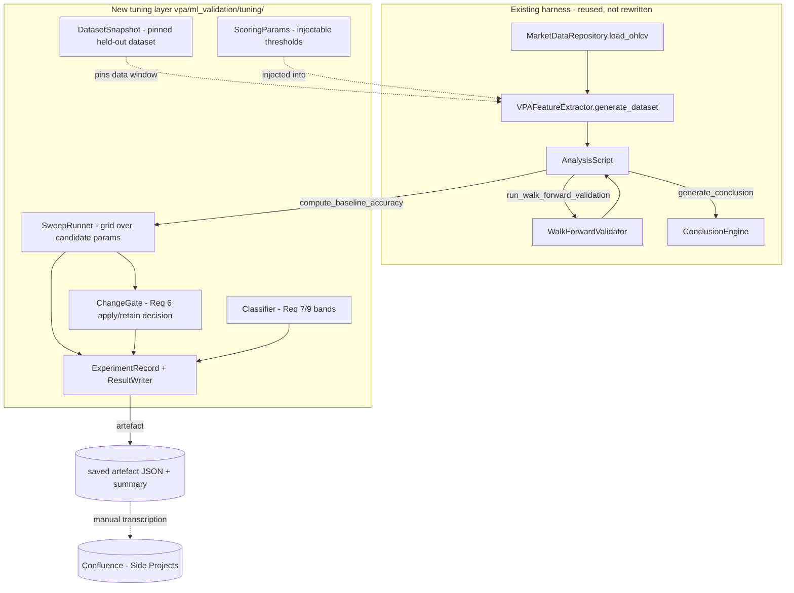

# Design Document

## Overview

SP-313 is an experimental, analysis-driven feature with three independent-but-related workstreams, all building on the existing ML validation harness in `vpa/ml_validation/` and the rule-based scoring in `vpa/app.py`:

1. **Threshold tuning** (Requirements 2–6): sweep candidate values for the most-predictive VPA inputs identified in SP-312 (`is_shooting_star`, `acc_dist_score`, period-three spread, and the zero-importance `vol_backed_p1`/`vol_backed_p2`), measure the effect on `Baseline_Accuracy`, and apply a change **only** when it clears a measured-improvement gate (Req 6: +≥3.09pp).
2. **SPY re-validation** (Requirements 7–8): re-run `python -m vpa.ml_validation.run_analysis --ticker SPY` after VPA 0.5, compare against the SP312 baseline (52.34% rule-based / 50.59% ± 3.09% ML), classify the movement, and apply the pursue / do-not-pursue decision rule (Req 8: >54% ML → pursue).
3. **Multi-ticker runs** (Requirement 9): run the harness on 3–5 individual S&P 500 stocks chosen for a spread of realized volatility, and classify each ticker's edge relative to SPY.

All findings are written to the Side Projects Confluence space with a single explicit recommendation (Requirement 10).

The guiding design constraints are **reproducibility** (Req 1) and **non-destructiveness**: the production scoring path must behave identically unless a change clears the gate. We achieve this by introducing a thin, parameterised experiment layer *around* the existing harness rather than rewriting it, and by extracting today's hardcoded thresholds into injectable parameters whose defaults reproduce current behaviour exactly.

### Scope boundary (explicit)

Per the user's scope decision, this feature does **not** tune RSI thresholds or MA-crossover thresholds. Those VPA 0.5 features are exercised only indirectly, through the SPY re-validation run (Req 7), which measures their aggregate effect on the composite score. The tunable surface is limited to: shooting-star multipliers (Req 2), acc/dist percentile + test count (Req 3), period-three composite weighting (Req 4), and the `vol_backed_p1`/`vol_backed_p2` contributions (Req 5).

### Grounding in the existing code

Key facts the design relies on (verified against the source):

- **Entry point & seeding.** `run_analysis.main(ticker, output_dir, config_path)` sets `np.random.seed(42)` *once*, before dataset generation. `WalkForwardValidator` passes `random_state=42` to `XGBClassifier`. Any programmatic sweep that bypasses `main()` must replicate both seeds, so the experiment layer centralises seeding in one helper (Req 1.1).
- **Dataset generation.** `VPAFeatureExtractor.generate_dataset(days=3650, repo=None)` loads OHLCV through `MarketDataRepository.load_ohlcv` (a read-through store), warms up until `period_three` (50 bars) is full, extracts the 31-column feature vector per row, labels `next_day_direction`, drops the final row, and raises `InsufficientDataError` if `< 2000` labelled rows.
- **Baseline accuracy.** `AnalysisScript.compute_baseline_accuracy()` = accuracy of `sign(composite_score > 0)` vs `next_day_direction` over rows with non-null `composite_score`. This is a **pure function of the dataset** — it does not re-run the model — which makes it cheap to call across a sweep grid.
- **Composite score composition.** In `VPAFeatureExtractor._extract_feature_vector`, `composite_score = single_candle_score + trend_score + multiple_bar_score + acc_dist_score + rsi_signal_score`. Period weighting is implicit in the per-period loops of `_detect_signals`; the volume-backed doubling (`score_adjustment * 2`) lives there too.
- **Where the tunables live today (this drives the whole design):**
  - **Shooting-star multipliers** are class constants on `Candle` in `vpa/app.py`: `CONFIG_SHOOTING_STAR_UPPER_WICK_X_TIMES_BIGGER_THAN_SPREAD = 2` and `..._BIGGER_THAN_LOWER_WICK = 2`. **Not** in `config.json`.
  - **Acc/dist percentile and test count** are hardcoded literals inside `identify_acc_or_dist(period_three, period_one)` in `vpa/app.py`: `np.percentile(volume_stats_list, [65, 90])` and `if high_volume_count >= 3`.
  - **Period-three weighting** and the **vol_backed doubling** live in `VPAFeatureExtractor._detect_signals`.

These must become injectable parameters whose defaults equal the current literals, so the production path is unchanged until the gate says otherwise.

## Architecture

The feature adds a new sub-package, `vpa/ml_validation/tuning/`, that orchestrates sweeps and comparisons while delegating all heavy lifting to the existing harness components. Nothing in the existing production scoring path changes behaviour unless a tuned value is explicitly applied to `config.json` after clearing the Req 6 gate.



### Reproducibility: pinning the data window (Requirement 1.4)

`generate_dataset` computes `end_date = datetime.datetime.now().date()` and `start_date = end_date - timedelta(days=3650)`. Because `end_date` moves every day, two runs on different days see different data windows, so results are **not** bit-for-bit reproducible across days even with a fixed seed. Requirement 1.4 demands that identical data + thresholds + seed give identical `Baseline_Accuracy` and mean `ML_Accuracy` to two decimal places. The design resolves this tension with a **pinned dataset snapshot**:

- The first run of the experiment generates the dataset once and persists it as the canonical held-out CSV — reusing the harness's existing `{ticker}_vpa_features.csv` output (already written by `AnalysisScript.save_outputs`). This CSV carries the full 31-column feature vector plus metadata and `next_day_direction`.
- Every subsequent sweep/comparison for that ticker loads that pinned CSV via a `DatasetSnapshot` loader and runs `compute_baseline_accuracy` / `run_walk_forward_validation` against it. The data window is therefore frozen: the recorded data date range (Req 1.2) is the snapshot's first/last `date`, not "today minus 3650 days".
- This directly satisfies Requirements 2.1, 3, 4.1, and 5.1, which all require evaluating candidates on "the same fixed dataset".

A `DatasetSnapshot` is identified by `(ticker, data_start, data_end, seed)`. The experiment layer refuses to mix candidates evaluated against different snapshots (a precondition check), so a sweep is always apples-to-apples.

> **Important nuance for threshold sweeps.** The hardcoded thresholds we are tuning (shooting-star multipliers, acc/dist percentile/test-count, period weighting, vol_backed doubling) are consumed *during feature extraction*, not during `compute_baseline_accuracy`. A single pre-extracted CSV captures features at *one* threshold setting only. Therefore the sweep must **re-extract features per candidate** from the *same pinned raw OHLCV window*, not from the single post-extraction CSV. The design handles this by snapshotting at the **raw-OHLCV** boundary: the pinned window is `(data_start, data_end)` and the `MarketDataRepository` read-through store already guarantees the same stored bars are returned for the same window. Each candidate re-runs `generate_dataset` over that frozen window with its own `ScoringParams`, then `compute_baseline_accuracy` on the resulting dataset. The post-extraction `{ticker}_vpa_features.csv` remains the artefact for the *current* (baseline) threshold set and for the SPY re-validation (Req 7), where no re-extraction is needed.

To pin the window without changing production defaults, `generate_dataset` gains an optional `end_date` parameter (default `None` → today's date, preserving current behaviour). The experiment layer always passes an explicit `end_date` so the window is deterministic for the life of the experiment.

### Making thresholds sweepable without breaking production (Requirements 2, 3, 4, 5)

A single immutable `ScoringParams` dataclass carries every tunable value. Its defaults equal today's literals, so constructing `ScoringParams()` and threading it through reproduces current scoring exactly. The extraction points:

- **Shooting-star multipliers (Req 2).** Replace the two `Candle` class constants with constructor parameters `shooting_star_spread_mult` and `shooting_star_lower_wick_mult`, both defaulting to `2`. The class constants remain as the default values so existing callers and the production path are unaffected. `VPAFeatureExtractor` passes the values from `ScoringParams` when it constructs each `Candle`. Candidate validation (Req 2.5) rejects any multiplier `< 1` or non-positive *before* extraction, recording a rejection message.
- **Acc/dist percentile + test count (Req 3).** Extract the hardcoded `[65, 90]` percentile pair and the `>= 3` test-count literal from `identify_acc_or_dist` into parameters `acc_dist_volume_percentile` (default 65; the 90th percentile stays a fixed companion unless a candidate overrides it) and `acc_dist_test_count` (default 3). The function signature becomes `identify_acc_or_dist(period_three, period_one, *, volume_percentile=65, test_count=3)`, keeping positional back-compatibility. `_detect_signals` and `generate_dataset` both call it, so both read the values from `ScoringParams`. Candidate validation (Req 3.1/3.2) enforces integer percentile in `1..99` and test count `>= 1`.
- **Period-three composite weighting (Req 4).** `_detect_signals` builds `multiple_bar_signal_score` by summing per-period `score_adjustment` values. Introduce per-period multipliers `period_weight_p1/p2/p3` (all default `1.0`) applied to each period's contribution. An "increased period-three weighting" is any configuration where `period_weight_p3` strictly exceeds the combined `p1 + p2` contribution, matching Req 4.1's "combined Period_Three contribution above combined Period_One and Period_Two". Because the weights are factored out, the default `(1.0, 1.0, 1.0)` reproduces today's unweighted sum.
- **vol_backed p1/p2 reduction (Req 5).** The volume-backed doubling (`score_adjustment * 2`) is the mechanism that gives `vol_backed_p1`/`vol_backed_p2` their weight. Introduce per-period `vol_backed_mult_p1/p2/p3` (default `2.0`, matching the current doubling). Setting `vol_backed_mult_p1 = vol_backed_mult_p2 = 1.0` removes the extra contribution (reduces the volume-backed bonus to the same weight as a non-volume-backed signal); `0.0`-style removal is expressed by setting the multiplier so the bonus term vanishes. The multipliers are constrained non-negative (Req 5.1). Crucially, a scored bar still always produces a `composite_score` (Req 5.3) because reducing a multiplier only changes magnitude, never removes the score term.

All of these are **injected**, not globally mutated. The production code reads the current (default) values unless the experiment layer supplies alternatives, so concurrent production scoring is never disturbed by a sweep.

### Sweep execution (Requirements 2.1–2.4, 3.1–3.4, 4.1–4.3, 5.1–5.4)

`SweepRunner.run(snapshot, baseline_params, candidate_params_list)`:

1. Validates each candidate against its dimension's range rules; out-of-range candidates are excluded and a rejection message recorded (Req 2.5, 3.1/3.2, 5.1).
2. For each valid candidate (and the baseline), re-extracts the dataset over the pinned window with that `ScoringParams`, then computes `Baseline_Accuracy`.
3. Records the measured accuracy for **every** evaluated candidate, beneficial or not (Req 3.4).
4. If an individual candidate cannot be evaluated (e.g. extraction error, zero rows), it is excluded from selection and an error recorded, while previously recorded results are retained (Req 3.6).

Selection and gating are separated so the "measured improvement margin" differs correctly per requirement:
- Per-dimension *recording* margins: Req 2.2/2.3 use **+0.5pp** over the current threshold; Req 3.3 uses **+0.1pp**; Req 4.2 uses **+0.10pp**; Req 5.2 uses a **≥ −0.10pp** tolerance (reduction is acceptable if it does not materially hurt).
- The *apply-to-config* gate (Req 6) is stricter: a tuned value is applied only if it increases `Baseline_Accuracy` by **≥ 3.09pp** (the SP312 ML std) over the value currently in effect; otherwise the in-effect value is retained. The per-dimension recording thresholds surface candidates worth noting; the Req 6 gate decides what actually changes `config.json`.

Tie-breaking for shooting-star (Req 2.3): among candidates clearing +0.5pp, pick the highest accuracy; break an exact tie toward the candidate nearest the current value (2).

### SPY re-validation and multi-ticker runs (Requirements 7, 9)

These reuse `run_analysis.main` directly (no re-extraction sweep). For SPY (Req 7) the harness produces `Baseline_Accuracy` and mean `ML_Accuracy ± std`; the comparison layer records signed differences vs the SP312 baseline (52.34% / 50.59%) and classifies the movement (Req 7.4). For individual tickers (Req 9) the layer runs 3–5 tickers chosen so their realized daily-return volatility over the window differs pairwise by ≥10% of the lowest selected ticker's volatility, computes each ticker's baseline-vs-SPY difference, and classifies edge as stronger / weaker / comparable using the ±3.09pp band (Req 9.4). A ticker yielding `< 2000` labelled rows triggers `InsufficientDataError`; the layer records the error, writes no result for that ticker, and prompts selecting a replacement that still satisfies the volatility spread (Req 9.5).

### Decision and documentation (Requirements 8, 10)

`PursueDecision.decide(spy_ml_accuracy_pct)` returns `"pursue"` when the SPY mean `ML_Accuracy > 54.0%`, else `"do not pursue"`, always carrying the supporting accuracy value (Req 8.1–8.3). If SPY produced no mean `ML_Accuracy`, it returns a "no recommendation / unavailable" result (Req 8.4). The `ResultWriter` serialises every `ExperimentRecord` to a machine-readable artefact (JSON) plus a human-readable summary; the Analyst transcribes these into the Side Projects Confluence space (Req 10), where any missing value is written with an explicit "unavailable + reason" marker (Req 10.6).

## Components and Interfaces

All new code lives in `vpa/ml_validation/tuning/`. Existing files gain small, backward-compatible parameters only.

### `ScoringParams` (new — `tuning/scoring_params.py`)

Immutable dataclass carrying every tunable value. Defaults reproduce current production scoring exactly.

```python
@dataclass(frozen=True)
class ScoringParams:
    # Requirement 2
    shooting_star_spread_mult: float = 2.0
    shooting_star_lower_wick_mult: float = 2.0
    # Requirement 3
    acc_dist_volume_percentile: int = 65     # integer in 1..99
    acc_dist_test_count: int = 3             # integer >= 1
    # Requirement 4 (implicit weight = 1.0 reproduces current unweighted sum)
    period_weight_p1: float = 1.0
    period_weight_p2: float = 1.0
    period_weight_p3: float = 1.0
    # Requirement 5 (2.0 reproduces current volume-backed doubling)
    vol_backed_mult_p1: float = 2.0
    vol_backed_mult_p2: float = 2.0
    vol_backed_mult_p3: float = 2.0

    def validate(self) -> list[str]:
        """Return a list of rejection messages; empty list == valid.
        Enforces Req 2.5 (mult >= 1, positive), Req 3.1 (percentile int 1..99),
        Req 3.2 (test_count int >= 1), Req 5.1 (vol_backed mult >= 0)."""
```

`ScoringParams.default()` is the canonical "current configuration". Equality/hash on the frozen dataclass gives free idempotence checks for the correctness properties.

### `VPAFeatureExtractor` (modified — `feature_extractor.py`)

- `__init__` gains `scoring_params: ScoringParams | None = None` (default `None` → `ScoringParams.default()`).
- `generate_dataset(days=3650, repo=None, end_date=None)` — new optional `end_date` (default `None` → `datetime.datetime.now().date()`, preserving behaviour). The experiment layer always passes an explicit `end_date` to pin the window (Req 1.4).
- When constructing each `Candle`, pass `shooting_star_spread_mult` / `shooting_star_lower_wick_mult` from `scoring_params`.
- `_detect_signals` reads `acc_dist_volume_percentile` / `acc_dist_test_count` (via `identify_acc_or_dist`), applies `period_weight_pN` to each period's `multiple_bar` contribution, and uses `vol_backed_mult_pN` in place of the hardcoded `* 2`.

### `Candle` (modified — `app.py`)

Constructor gains two keyword-only params with defaults equal to the existing class constants:

```python
def __init__(self, time, volume, candle_open, high, low, close,
             *, shooting_star_spread_mult=CONFIG_SHOOTING_STAR_UPPER_WICK_X_TIMES_BIGGER_THAN_SPREAD,
             shooting_star_lower_wick_mult=CONFIG_SHOOTING_STAR_UPPER_WICK_X_TIMES_BIGGER_THAN_LOWER_WICK):
```

The shooting-star test uses the parameters instead of the class constants. Every existing caller (which passes six positional args) keeps today's behaviour unchanged.

### `identify_acc_or_dist` (modified — `app.py`)

```python
def identify_acc_or_dist(period_three, period_one, *, volume_percentile=65, test_count=3):
    ...
    period_three_volume_percentiles = np.percentile(volume_stats_list, [volume_percentile, 90])
    ...
    if high_volume_count >= test_count and near_lows:
        return True, "Acc"
    elif high_volume_count >= test_count and near_highs:
        return True, "Dist"
```

Keyword-only extras with current defaults; all existing positional callers are unaffected.

### `DatasetSnapshot` (new — `tuning/snapshot.py`)

Pins the raw-OHLCV window for an experiment.

```python
@dataclass(frozen=True)
class DatasetSnapshot:
    ticker: str
    data_start: date
    data_end: date       # pinned end_date passed to generate_dataset
    seed: int = 42

    def extract(self, params: ScoringParams, repo=None) -> pd.DataFrame:
        """Set seed, run VPAFeatureExtractor.generate_dataset over the pinned
        window with `params`, return the labelled dataset. Centralises Req 1.1 seeding."""
```

### `SweepRunner` (new — `tuning/sweep.py`)

```python
class SweepRunner:
    def run(self, snapshot: DatasetSnapshot, baseline: ScoringParams,
            candidates: list[ScoringParams]) -> SweepResult:
        """Validate candidates (exclude + record out-of-range, Req 2.5/3.1/3.2/5.1);
        for baseline + each valid candidate, extract on the pinned snapshot and call
        AnalysisScript.compute_baseline_accuracy; record accuracy for every evaluated
        candidate (Req 3.4); on per-candidate failure, exclude from selection and record
        error while retaining prior results (Req 3.6)."""
```

`SweepResult` holds the baseline accuracy, a list of `CandidateResult(params, accuracy_pct, status)` (status ∈ `evaluated | rejected_out_of_range | eval_error`), and rejection/error messages.

### `ChangeGate` (new — `tuning/gate.py`)

Pure decision functions, one per requirement margin, plus the Req 6 apply gate:

```python
def exceeds_margin(candidate_pct, baseline_pct, margin_pp) -> bool: ...   # strict > for Req 3.3/4.2
def record_shooting_star(...) -> SelectionOutcome: ...                    # +0.5pp, tie-break (Req 2.2-2.4)
def should_apply_to_config(candidate_pct, in_effect_pct) -> bool:        # Req 6.1/6.2
    return (candidate_pct - in_effect_pct) >= 3.09
```

`SelectionOutcome` records: selected value (or "retain current"), prior/applied values, prior/new accuracy, and the justifying difference (Req 6.3), or "no change beneficial" (Req 2.4/3.5/4.3/5.4).

### `Classifier` (new — `tuning/classify.py`)

Pure band functions:

```python
def classify_ml_vs_sp312(ml_pct) -> str:    # Req 7.4: increased >53.68, decreased <47.50, within-band otherwise
def classify_baseline_vs_sp312(base_pct) -> str:  # Req 7.4: increased/decreased/unchanged vs 52.34
def classify_ticker_edge(ticker_base_pct, spy_base_pct) -> str:  # Req 9.4: stronger/weaker/comparable, ±3.09pp
def pursue_decision(spy_ml_pct: float | None) -> PursueResult:   # Req 8: >54 pursue else do-not-pursue; None -> unavailable
```

### `ExperimentRecord` + `ResultWriter` (new — `tuning/record.py`)

Serialises the per-run record (see Data Models) to a JSON artefact and a human-readable summary. Mirrors the existing `AnalysisScript.save_outputs` convention and resilience (log-and-continue on write failure). Req 1.5 is enforced *before* writing: if a run produced zero labelled rows or data is unavailable, no partial artefact is written and an error identifying the ticker is raised.

### Multi-ticker selection helper (new — `tuning/ticker_selection.py`)

```python
def realized_daily_volatility(dataset: pd.DataFrame) -> float: ...  # std of daily close-to-close returns over the window
def volatility_spread_ok(vols: list[float]) -> bool:                # Req 9.1: pairwise diff >= 10% of min
```

## Data Models

### `ExperimentRecord` (the single saved artefact per run — Requirements 1.2, 1.3)

One record is written per harness run (baseline, each candidate, SPY re-validation, each ticker). It is the artefact that satisfies Req 1.2/1.3 and feeds the Confluence documentation (Req 10). All numeric values are stored to at least two decimal places.

| Field | Type | Source | Requirement |
|---|---|---|---|
| `ticker` | str | run input | 1.2, 7, 9 |
| `data_start` | ISO date | snapshot first `date` | 1.2 |
| `data_end` | ISO date | snapshot last `date` (pinned) | 1.2, 1.4 |
| `labelled_row_count` | int | `len(dataset)` | 1.2, 9.5 |
| `seed` | int (42) | `DatasetSnapshot.seed` | 1.1, 10.5 |
| `scoring_params` | ScoringParams (serialised) | run input | 1.3, 10.5 |
| `baseline_accuracy_pct` | float (2dp) | `compute_baseline_accuracy()*100` | 1.2 |
| `ml_mean_accuracy_pct` | float (2dp) \| null | `WalkForwardResult.mean_accuracy*100` | 1.2, 7, 8 |
| `ml_std_accuracy_pct` | float (2dp) \| null | `WalkForwardResult.std_accuracy*100` | 1.2, 7 |
| `skipped_folds` | list[int] | `WalkForwardResult.skipped_folds` | 1.2 |
| `top5_feature_importance` | list[{name, score}] | `extract_feature_importance().head(5)` | 1.2 |
| `realized_volatility` | float \| null | `realized_daily_volatility(dataset)` | 9.1 |
| `run_completed` | bool | pipeline status | 1.5, 7.2, 8.4 |
| `error` | str \| null | failure reason (ticker-identifying) | 1.5, 7.2, 9.5 |

`scoring_params` is serialised as a flat dict of the `ScoringParams` fields so the exact threshold values in effect are recoverable (Req 1.3, 10.5).

### `SweepResult` / `CandidateResult`

```
SweepResult:
  dimension: str                 # "shooting_star" | "acc_dist" | "period_weight" | "vol_backed"
  snapshot_id: (ticker, start, end, seed)
  baseline_accuracy_pct: float
  candidates: list[CandidateResult]
  rejection_messages: list[str]  # Req 2.5/3.1/3.2/5.1 out-of-range
  eval_errors: list[str]         # Req 3.6 per-candidate failures

CandidateResult:
  params: ScoringParams
  accuracy_pct: float | None     # None when status != evaluated
  status: "evaluated" | "rejected_out_of_range" | "eval_error"
  delta_pp: float | None         # accuracy_pct - baseline_accuracy_pct
```

### `SelectionOutcome` (gating — Requirements 2.3/2.4, 3.5, 4.3, 5.4, 6)

```
SelectionOutcome:
  dimension: str
  changed: bool                  # False => "no change beneficial"
  prior_value / applied_value    # Req 6.3
  prior_accuracy_pct / new_accuracy_pct   # Req 6.3
  justifying_delta_pp: float | None       # Req 6.3; >= 3.09 when applied via Req 6 gate
  note: str                      # e.g. "no candidate cleared the apply gate"
```

### `ComparisonRecord` (Requirements 7.3/7.4, 9.3/9.4)

```
ComparisonRecord:
  spy_baseline_pct / spy_ml_mean_pct
  sp312_baseline_pct = 52.34 / sp312_ml_pct = 50.59
  baseline_delta_pp = spy_baseline_pct - 52.34        # signed (Req 7.3)
  ml_delta_pp = spy_ml_mean_pct - 50.59               # signed (Req 7.3)
  ml_classification: str      # Req 7.4 band
  baseline_classification: str
  per_ticker: list[{ticker, baseline_pct, ml_mean_pct,
                    delta_vs_spy_pp, edge_classification}]   # Req 9.3/9.4
```

### `PursueResult` (Requirement 8, 10.4)

```
PursueResult:
  recommendation: "pursue" | "do not pursue" | "no recommendation"
  supporting_ml_accuracy_pct: float | null
  unavailable_reason: str | null     # Req 8.4 / 10.6
```

### Constants (single source of truth)

```
SP312_BASELINE_PCT = 52.34
SP312_ML_MEAN_PCT  = 50.59
SP312_ML_STD_PCT   = 3.09          # also the Req 6 apply gate and Req 9.4 band
PURSUE_ML_THRESHOLD_PCT = 54.0     # Req 8
ML_BAND_LOW  = 47.50               # 50.59 - 3.09  (Req 7.4)
ML_BAND_HIGH = 53.68               # 50.59 + 3.09  (Req 7.4)
MIN_LABELLED_ROWS = 2000           # Req 9.5
RANDOM_SEED = 42                   # Req 1.1
```

## Correctness Properties

*A property is a characteristic or behavior that should hold true across all valid executions of a system — essentially, a formal statement about what the system should do. Properties serve as the bridge between human-readable specifications and machine-verifiable correctness guarantees.*

### Property 1: Default-params behaviour preservation (most important)

*For any* pinned raw-OHLCV window, extracting the labelled feature dataset through `DatasetSnapshot.extract(ScoringParams.default())` SHALL produce a dataset that is identical — column-for-column, including `composite_score` and `next_day_direction` — to the dataset produced by the current/legacy production extraction path over the same window. The injectable-params refactor is behaviour-preserving: constructing `ScoringParams.default()` and threading it through must reproduce today's scoring exactly.

**Validates: Requirements 2, 3, 4, 5 (non-regression)**

### Property 2: Determinism / reproducibility

*For any* `DatasetSnapshot` and `ScoringParams`, two independent extractions-and-evaluations performed at seed 42 (set before dataset generation and before model training) SHALL yield `Baseline_Accuracy` values that are equal to two decimal places and mean `ML_Accuracy` values that are equal to two decimal places.

**Validates: Requirements 1.4**

### Property 3: Baseline accuracy range

*For any* valid labelled dataset, `AnalysisScript.compute_baseline_accuracy()` SHALL return a value in the closed interval [0, 1], and the recorded `baseline_accuracy_pct` SHALL lie in the closed interval [0, 100].

**Validates: Requirements 1.2**

### Property 4: Composite score totality

*For any* valid `ScoringParams` (including configurations where `vol_backed_mult_p1`/`vol_backed_mult_p2` are reduced), every scored bar in the extracted dataset SHALL still have a non-null `composite_score`; reducing a multiplier changes the score's magnitude but never removes the score term.

**Validates: Requirements 5.3**

### Property 5: Candidate validation biconditional

*For any* `ScoringParams` instance, `ScoringParams.validate()` SHALL return a non-empty rejection list **if and only if** at least one field is out of range, where out-of-range means: a shooting-star multiplier (`shooting_star_spread_mult`, `shooting_star_lower_wick_mult`) less than 1 or non-positive; `acc_dist_volume_percentile` not an integer in 1..99 inclusive; `acc_dist_test_count` not an integer ≥ 1; or any `vol_backed_mult_pN` negative. When every field is in range, `validate()` SHALL return an empty list.

**Validates: Requirements 2.5, 3.1, 3.2, 5.1**

### Property 6: Apply-gate threshold and idempotence

*For any* pair of accuracy values `(candidate_pct, in_effect_pct)`, `ChangeGate.should_apply_to_config(candidate_pct, in_effect_pct)` SHALL be `True` if and only if `candidate_pct - in_effect_pct >= 3.09`. Consequently, *for any* candidate that does not clear this gate, applying the gate decision SHALL leave the configuration unchanged — the resulting `ScoringParams` SHALL be equal (by dataclass equality) to the prior in-effect `ScoringParams`, so a non-beneficial change is a no-op.

**Validates: Requirements 6.1, 6.2, 6.3**

### Property 7: Classification band partition

*For any* real-valued accuracy input, each classifier SHALL return exactly one band from its defined set and SHALL select the correct band at every boundary:
- `Classifier.classify_ml_vs_sp312(ml_pct)` → `increased` when `ml_pct > 53.68`, `decreased` when `ml_pct < 47.50`, otherwise `within-band` (inclusive of 47.50 and 53.68) — Req 7.4.
- `Classifier.classify_ticker_edge(ticker_base_pct, spy_base_pct)` → `stronger` when the ticker exceeds SPY by more than 3.09pp, `weaker` when below SPY by more than 3.09pp, otherwise `comparable` (within ±3.09pp inclusive) — Req 9.4.
- `Classifier.pursue_decision(spy_ml_pct)` → `pursue` when `spy_ml_pct` is strictly greater than 54.0, else `do not pursue`; when `spy_ml_pct` is `None`, the result is `no recommendation` with an unavailable reason — Req 8.

**Validates: Requirements 7.4, 9.4, 8**

## Error Handling

Error handling follows the harness's existing conventions and the reproducibility/non-destructiveness constraints. The guiding rule is **fail without a partial artefact**: a run either produces a complete, recordable result or it records an identifying error and writes nothing partial.

- **Zero labelled rows / unavailable input data (Req 1.5).** If `generate_dataset`/`DatasetSnapshot.extract` yields zero labelled rows, or the requested ticker's OHLCV is unavailable, the harness SHALL halt before `ResultWriter` writes anything, raise an error that identifies the ticker, and leave no partial `ExperimentRecord` artefact on disk. The Req 1.5 check runs *before* the write step described in `ResultWriter`.

- **SPY run failure (Req 7.2).** If the SPY run via `run_analysis.main` fails or SPY data is unavailable, the harness SHALL NOT emit a `Baseline_Accuracy` or `ML_Accuracy`; the `ExperimentRecord` for SPY SHALL be written with `run_completed = false` and an `error` describing the failure, so the Analyst can record that the run did not complete.

- **Out-of-range sweep candidates (Req 2.5, 3.1, 3.2, 5.1).** `SweepRunner.run` validates each candidate with `ScoringParams.validate()` before extraction. A candidate with a non-empty rejection list is excluded from evaluation, its rejection message is appended to `SweepResult.rejection_messages`, and the sweep continues with the remaining candidates. Out-of-range candidates never reach feature extraction.

- **Per-candidate evaluation error (Req 3.6).** If a validated candidate fails during extraction or baseline computation (for example an extraction exception or an empty dataset for that candidate), it is excluded from selection, the error is appended to `SweepResult.eval_errors`, and all previously recorded `CandidateResult` entries are retained. One bad candidate never discards the results already gathered.

- **Ticker with insufficient data (Req 9.5).** If an individual-ticker run produces fewer than 2000 labelled rows (`MIN_LABELLED_ROWS`), `generate_dataset` raises `InsufficientDataError` (defined in `vpa/ml_validation/exceptions.py`). The multi-ticker layer catches it, writes no `Baseline_Accuracy`/`ML_Accuracy` for that ticker, records a ticker-identifying error, and prompts the Analyst to select a replacement ticker that still satisfies the Req 9.1 volatility-spread condition.

- **SPY produced no mean ML_Accuracy (Req 8.4).** If the SPY run completed but did not yield a mean `ML_Accuracy` (e.g. all walk-forward folds were skipped), `Classifier.pursue_decision(None)` returns a `PursueResult` with `recommendation = "no recommendation"` and an `unavailable_reason`; no pursue/do-not-pursue recommendation is recorded.

- **Missing values at documentation time (Req 10.6).** When any required value (accuracy difference, `ML_Accuracy`, threshold value, or seed) is absent at Confluence-transcription time, the documentation SHALL carry an explicit "unavailable" marker together with the reason, rather than omitting the value silently. This mirrors the `null` + reason fields on `ExperimentRecord`/`PursueResult`.

- **Artefact write failure (log-and-continue).** If `ResultWriter` fails to persist an artefact after a result was successfully computed, it logs the failure and continues, mirroring `AnalysisScript.save_outputs` resilience. This applies only to the persistence step; the Req 1.5 pre-write guard still prevents partial artefacts for incomplete runs.

## Testing Strategy

The properties above are grounded in the components already defined in this design (`ScoringParams`, `DatasetSnapshot`, `SweepRunner`, `ChangeGate`, `Classifier`, `PursueResult`) and introduce nothing new; each is stated so it can be encoded directly as a Hypothesis test, with pure-function properties (validation, gating, classification) running FAST and properties that re-extract features or re-train the model `slow`-marked.

Testing follows the repo's rules. The default `pytest` run is the FAST path — the `slow` marker is deselected via `addopts = "-m 'not slow'"` in `pyproject.toml` — and is used while iterating. The FULL suite (`pytest -m ""`, 529 tests) plus `ruff check .` and `ruff format --check .` MUST be green before any push, PR open/merge, or marking SP-313 Done. Any test that trains a real XGBoost model or runs the full pipeline MUST carry the `slow` marker so bare `pytest` does not silently skip it.

**Dual approach.** Unit tests cover specific examples, edge cases, and error conditions; property tests (Hypothesis, already available in the repo) cover the universal Correctness Properties above. The two are complementary.

### FAST unit tests (pure functions, no extraction/training)

- `ChangeGate`: `should_apply_to_config` and `exceeds_margin` at and around the 3.09pp / per-dimension margins; the shooting-star tie-break toward the value nearest 2 (Req 2.3); "no change beneficial" outcomes (Req 2.4/3.5/4.3/5.4).
- `Classifier`: `classify_ml_vs_sp312`, `classify_baseline_vs_sp312`, `classify_ticker_edge`, `pursue_decision` — example cases on each band boundary (47.50, 53.68, 52.34, ±3.09pp, strict >54.0, and the `None` → unavailable case).
- `ScoringParams.validate`: representative in-range and out-of-range examples for each field (shooting-star mult <1 / non-positive, percentile not int / outside 1..99, test_count <1 / non-int, negative vol_backed mult).
- `ticker_selection`: `realized_daily_volatility` and `volatility_spread_ok` (Req 9.1 pairwise ≥10%-of-min spread), including the replacement-selection path (Req 9.5).
- Error-handling examples: out-of-range candidate exclusion with a continuing sweep (Req 2.5/3.1/3.2/5.1), per-candidate eval error retaining prior results (Req 3.6), the Req 1.5 pre-write guard (no partial artefact), and the SPY-failure record (Req 7.2).

### Hypothesis property tests (one per Correctness Property)

Each property above is implemented by a single Hypothesis property-based test configured for a minimum of 100 iterations, tagged with a comment of the form **Feature: vpa-threshold-tuning-ml-revalidation, Property {number}: {property_text}**. We use Hypothesis strategies to generate the input space (parameter fields across valid/invalid ranges, accuracy values across the real line, pinned windows). We do not implement property-based testing from scratch.

- FAST property tests: Property 3 (baseline range — can run on small/synthetic datasets), Property 5 (validation biconditional), Property 6 (apply-gate + idempotence), Property 7 (classification band partition). These are pure and stay in the default run.
- `slow`-marked property tests: Property 1 (default-params behaviour preservation) and Property 2 (determinism/reproducibility) re-extract features and, for Property 2's ML term, re-train the model over pinned windows — these MUST carry the `slow` marker. Property 4 (composite totality) re-extracts; mark it `slow` if it exercises real windows, or keep it FAST if it runs over a small synthetic window.

### Characterisation / regression test (before the refactor)

Before extracting any hardcoded threshold into `ScoringParams`, add a characterisation test that locks the current baseline extraction output (the full feature dataset, including `composite_score`, over a fixed pinned window) as a regression fixture. Property 1 then asserts the refactored default-params path reproduces that locked output. This guarantees the injectable-params change is behaviour-preserving and catches any accidental drift introduced by the refactor.

### Gate before Done

Recommended pre-push / pre-PR / pre-Done order: (1) `ruff check .` and `ruff format --check .` clean — a common trip-up is tooling-written files losing a trailing newline or drifting from ruff style, so run the format check after any scripted writes; (2) `pytest -m ""` fully green so the `slow` ML tests are not skipped; (3) push / open PR / mark Done.

**Definition-of-Done nuance.** This VPA code is part of the `trading` project, which runs on a deployment target. SP-313 is analysis-driven: "done" requires that any threshold change clearing the Req 6 gate is applied to the VPA `config.json`, the applied/retained decisions are recorded, and the full results plus the single pursue / do-not-pursue recommendation are documented in the Side Projects Confluence space (Req 10). Code merged without the applied config change and the documented Confluence results is not Done — it belongs in **Mostly Done** until both are complete.
